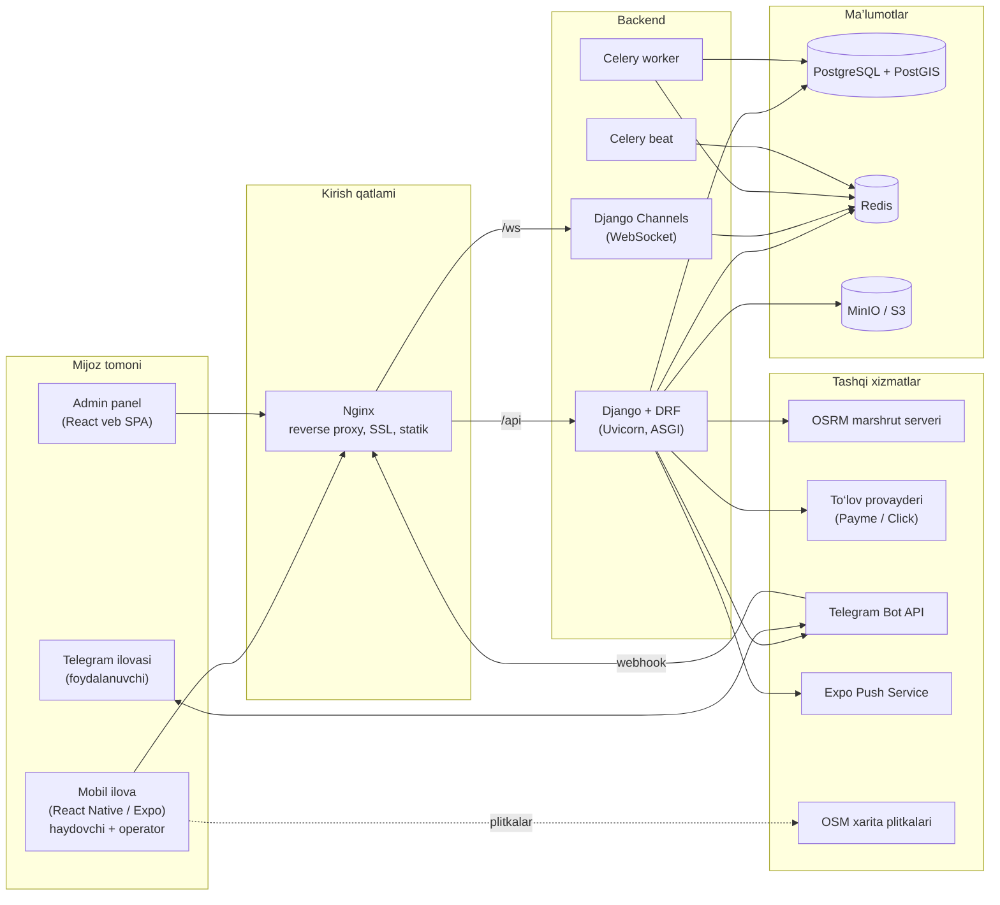
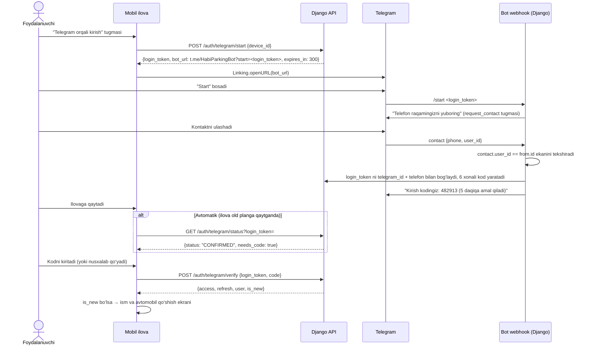
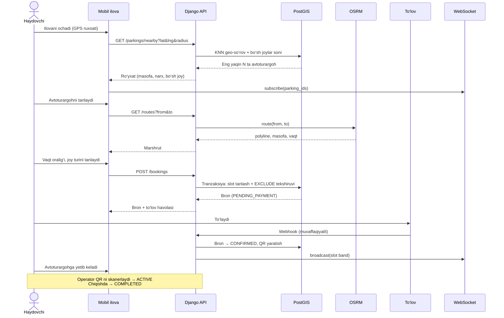
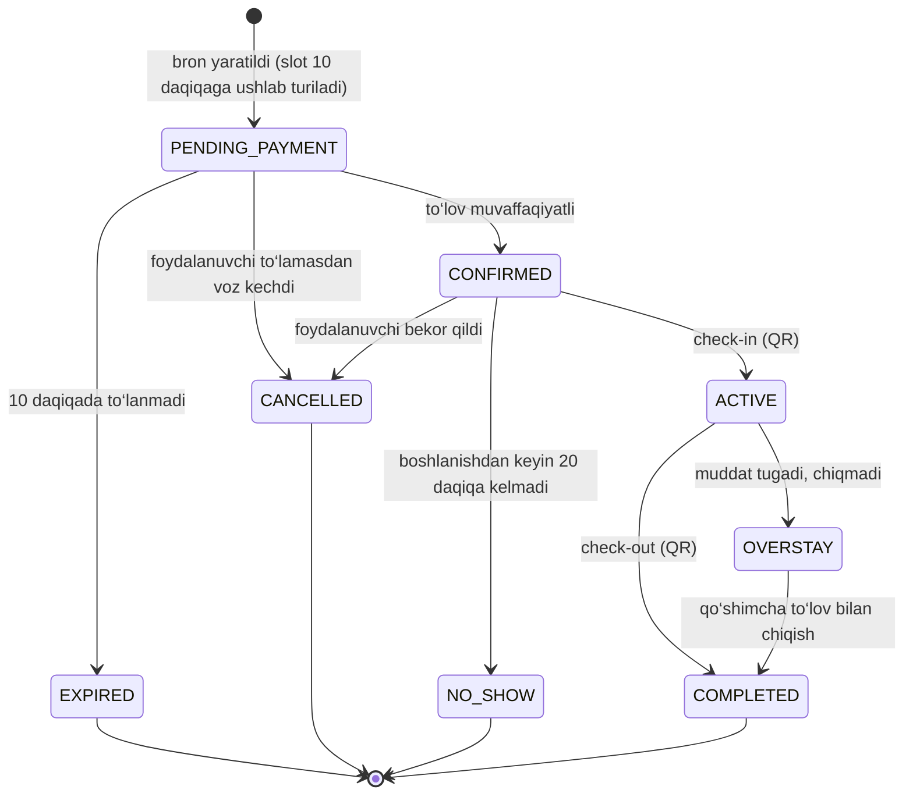
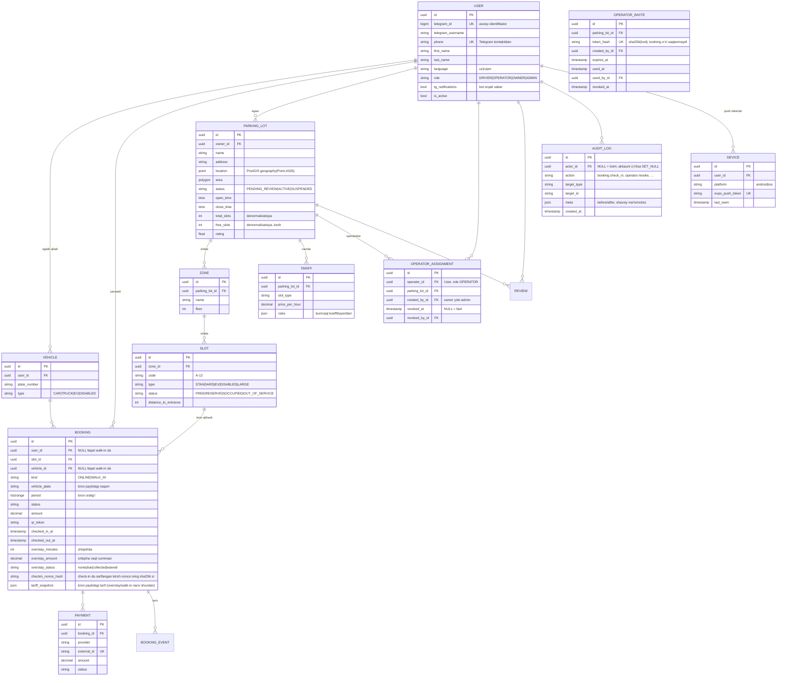
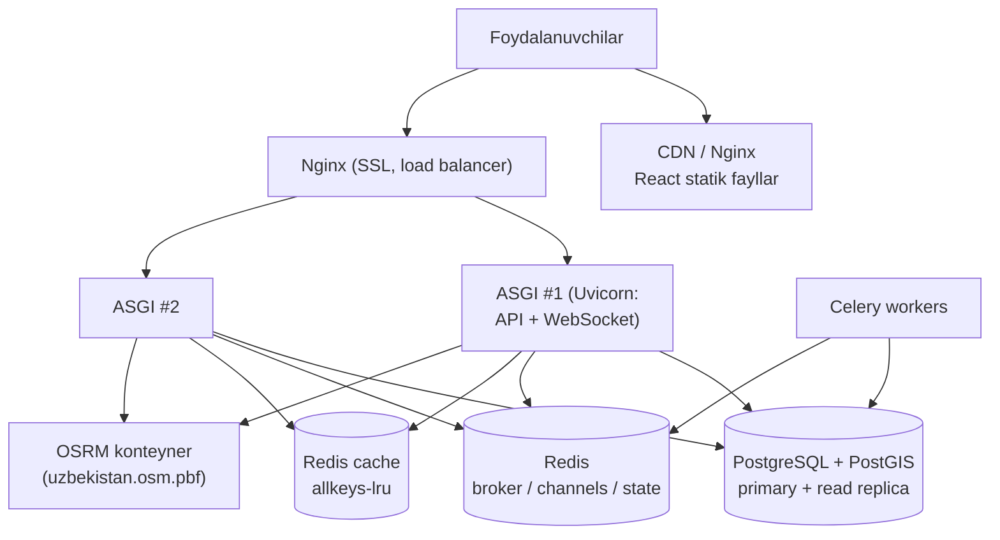

# Avtoturargohlarda bo‘sh joylarni ro‘yxatga olish va bron qilish axborot tizimi

**Arxitektura hujjati (v2.0)**
Backend: Django + Django REST Framework · Foydalanuvchilar uchun: **mobil ilova (React Native, Expo)** · Admin panel: **React veb** (Django admin o‘chirilgan) · Kirish: **Telegram bot orqali** (SMS yo‘q)

> **v2.0 o‘zgarishlari:** haydovchi va operatorlar uchun veb o‘rniga mobil ilova; SMS OTP o‘rniga Telegram bot orqali ro‘yxatdan o‘tish/kirish; bildirishnomalar Telegram bot va push orqali; 21-bo‘lim — Claude Code bilan qurish uchun bosqichma-bosqich yo‘riqnoma.

---

## Mundarija

1. [Loyiha haqida](#1-loyiha-haqida)
2. [Foydalanuvchi rollari](#2-foydalanuvchi-rollari)
3. [Funksional va nofunksional talablar](#3-funksional-va-nofunksional-talablar)
4. [Texnologiyalar steki](#4-texnologiyalar-steki)
5. [Umumiy tizim arxitekturasi](#5-umumiy-tizim-arxitekturasi)
6. [Platforma qanday ishlaydi (asosiy oqimlar)](#6-platforma-qanday-ishlaydi-asosiy-oqimlar)
7. [Ma’lumotlar bazasi modeli](#7-malumotlar-bazasi-modeli)
8. [Backend tuzilishi (Django)](#8-backend-tuzilishi-django)
9. [REST API](#9-rest-api)
10. [Algoritmlar](#10-algoritmlar)
11. [Karta va marshrut moduli](#11-karta-va-marshrut-moduli)
12. [Real vaqt rejimi (WebSocket)](#12-real-vaqt-rejimi-websocket)
13. [Mobil ilova (React Native)](#13-mobil-ilova-react-native)
14. [React admin panel (veb)](#14-react-admin-panel-veb)
15. [Xavfsizlik](#15-xavfsizlik)
16. [Fon vazifalari (Celery)](#16-fon-vazifalari-celery)
17. [Joylashtirish (Deploy)](#17-joylashtirish-deploy)
18. [Testlash](#18-testlash)
19. [Ishlab chiqish bosqichlari](#19-ishlab-chiqish-bosqichlari)
20. [Papkalar tuzilishi](#20-papkalar-tuzilishi)
21. [Claude Code bilan qurish yo‘riqnomasi](#21-claude-code-bilan-qurish-yoriqnomasi)

---

## 1. Loyiha haqida

**Muammo.** Shahar markazlarida haydovchilar bo‘sh joy qidirib ko‘p vaqt yo‘qotadi, tirbandlik oshadi, avtoturargoh egalari esa joylardan to‘liq foydalana olmaydi.

**Yechim.** Ikki qismli platforma: haydovchi va operatorlar uchun **mobil ilova** (Android/iOS), avtoturargoh egalari va ma’murlar uchun **veb admin panel**. Unda:

- avtoturargohlar va ulardagi har bir joy (slot) ro‘yxatga olinadi;
- haydovchi xaritada o‘ziga **eng yaqin** bo‘sh joyli avtoturargohlarni ko‘radi;
- tanlangan avtoturargohgacha **marshrut** quriladi;
- joyni oldindan **bron qiladi**, to‘laydi va QR kod oladi;
- kirish/chiqishda QR kod tekshiriladi, joy holati real vaqtda yangilanadi;
- foydalanuvchi **Telegram bot** orqali bir necha soniyada ro‘yxatdan o‘tadi (SMS kerak emas);
- avtoturargoh egalari va administratorlar hammasini **React veb admin panel** orqali boshqaradi.

---

## 2. Foydalanuvchi rollari

| Rol | Kim | Qayerda ishlaydi | Asosiy imkoniyatlar |
|---|---|---|---|
| **Haydovchi (Driver)** | Oddiy foydalanuvchi | Mobil ilova | Telegram orqali ro‘yxatdan o‘tish, avtomobil qo‘shish, xaritada qidirish, marshrut, bron, to‘lov, tarix, sharh |
| **Operator** | Avtoturargoh xodimi | Mobil ilova (operator rejimi) | O‘z avtoturargohidagi joylar holati, QR skanerlash (kirish/chiqish), joyni qo‘lda band/bo‘sh qilish |
| **Avtoturargoh egasi (Owner)** | Biznes egasi | Veb admin panel | O‘z avtoturargohlarini qo‘shish, narx belgilash, operatorlar biriktirish, daromad hisobotlari |
| **Super admin** | Platforma ma’muri | Veb admin panel | Barcha foydalanuvchilar, avtoturargohlar, bronlar, to‘lovlar, tariflar, tizim sozlamalari, audit jurnali |

Operator alohida ilova o‘rnatmaydi: oddiy haydovchi ilovasiga kiradi, roli `OPERATOR` bo‘lsa pastki menyuda “Operator” bo‘limi paydo bo‘ladi.

**Rolni biriktirish (Step 9a, taklif-kod oqimi).** `OPERATOR` roli odam **o‘zi roziligi bilan** olinadi: telefon yoki `@username` bo‘yicha odamni qidirish olib tashlandi (u shaxsiy ma’lumot yig‘ish va odamni rozilik-siz biriktirish edi). Egasi (yoki ADMIN) `POST /admin/parkings/{id}/operator-invites` bilan bir martalik **taklif-kod** yaratadi (128 bit, 26 ta base32 belgi; kod faqat yaratilganda BIR MARTA qaytadi, bazada faqat `sha256`; muddati 72 soat), xodimga uzatadi; xodim o‘z akkauntidan `POST /me/operator-invites/accept {code}` yuboradi (9.2, 9.3). `DRIVER` → `OPERATOR` ga ko‘tariladi; `OWNER`/`ADMIN` rollari hech qachon o‘zgarmaydi va biriktirilmaydi (kod sarflanmaydi, javob umumiy `invite_invalid`). Barcha rad etish sabablari (noto‘g‘ri, muddati o‘tgan, ishlatilgan, bekor qilingan kod; lot `ACTIVE` emas; akkaunt OWNER/ADMIN) **bir xil `400 invite_invalid`** — kodlarni ajratib bo‘lmaydi; ko‘p noto‘g‘ri urinish akkauntni vaqtincha bloklaydi (429 `invite_locked`). Biriktirishni bekor qilish (`DELETE`) oxirgi biriktirish bo‘lsa rolni `DRIVER` ga qaytaradi; rol har so‘rovda bazadan o‘qiladi, shuning uchun kirish darhol to‘xtaydi. Bitta operator bir nechta lotga biriktirilishi mumkin. Operator API (9.2) ruxsati: `IsOperatorOfLot` (faol biriktirish + `is_active`) **yoki** `IsOwnerOfLot` (egasi o‘z lotida) **yoki** `IsSuperAdmin` (hamma lotda, qo‘llab-quvvatlash uchun). Check-in, walk-in va qo‘lda slot holati uchun lot `ACTIVE` bo‘lishi shart; chiqish, ortiqcha pulni yopish va lotlar/xaritani **o‘qish** lot to‘xtatilgan (`SUSPENDED`) yoki qayta ko‘rib chiqishda (`PENDING_REVIEW`) bo‘lsa ham ishlaydi — ichkarida turgan mashina qamalib qolmasin. Lot xodimi (operator) o‘sha lotda bron qila olmaydi (422 `own_lot_booking`, egasi bilan bir xil qoida) va o‘z bronini o‘zi kiritib/chiqarib bera olmaydi (403 `self_service_forbidden`).

Rollar `RBAC` (rolga asoslangan ruxsatlar) orqali boshqariladi (15-bo‘lim).

---

## 3. Funksional va nofunksional talablar

### 3.1 Funksional talablar

1. **Telegram bot orqali** ro‘yxatdan o‘tish va kirish (bot telefon raqamni kontakt sifatida oladi, 6 xonali kod beradi). Admin panelga Telegram Login Widget orqali kirish.
2. Avtomobil qo‘shish (davlat raqami, turi: yengil, yuk, elektromobil, nogironlar uchun).
3. Avtoturargohni ro‘yxatga olish: manzil, koordinata, ish vaqti, qavatlar/zonalar, joylar soni, narx.
4. Har bir joy (slot): raqami, turi (oddiy, EV zaryad, nogiron, katta), holati.
5. Xaritada joriy joylashuv bo‘yicha eng yaqin avtoturargohlarni topish (radius, filtrlar).
6. Marshrut qurish (masofa, vaqt, yo‘nalish ko‘rsatmalari).
7. Vaqt oralig‘i bo‘yicha bron qilish (masalan 14:00–16:00), bir joyni ikki kishi bron qila olmasligi kafolatlanadi.
8. To‘lov (Payme, Click, Uzum kabi provayderlar yoki karta).
9. QR kod orqali kirish/chiqish (check-in / check-out).
10. Bronni bekor qilish, muddatini uzaytirish, kelmaslik (no-show) holatini avtomatik yopish.
11. Bildirishnomalar **Telegram bot** va mobil push (Expo) orqali: bron tasdiqlandi, 15 daqiqa qoldi, muddat tugadi.
12. Reyting va sharhlar.
13. Admin panel: CRUD, statistika, hisobotlar (Excel/PDF eksport), audit jurnali.

### 3.2 Nofunksional talablar

| Talab | Maqsad |
|---|---|
| Yaqin avtoturargoh qidiruvi javob vaqti | < 200 ms (p95) |
| Bron yaratish javob vaqti | < 500 ms (p95) |
| Bir vaqtdagi foydalanuvchilar | 10 000+ (gorizontal kengayish) |
| Ikki marta bron (double booking) | **0** — ma’lumotlar bazasi darajasida kafolat |
| Mavjudlik (availability) | 99.5% |
| Til | O‘zbek (lotin), rus, ingliz (i18n) |
| Platformalar | Android 8+, iOS 15+ (mobil); so‘nggi Chrome/Edge/Safari (admin veb) |

---

## 4. Texnologiyalar steki

### Backend
| Qatlam | Texnologiya | Nima uchun |
|---|---|---|
| Til / framework | Python 3.12, **Django 5.x** | Tez ishlab chiqish, ORM, xavfsizlik |
| API | **Django REST Framework** | Serializer, permission, pagination |
| Geo | **GeoDjango + PostGIS** | Fazoviy indeks, masofa bo‘yicha qidiruv |
| Ma’lumotlar bazasi | **PostgreSQL 16 + PostGIS 3** | Tranzaksiyalar, `EXCLUDE` cheklovlari, geo |
| Kesh / navbat | **Redis 7** | Kesh, taqsimlangan qulf, Celery broker, Channels |
| Real vaqt | **Django Channels** (ASGI, WebSocket) | Joy holatini jonli yangilash |
| Fon vazifalari | **Celery + Celery Beat** | No-show, eslatmalar, hisobotlar |
| Autentifikatsiya | **djangorestframework-simplejwt** | JWT access/refresh |
| Telegram bot | Bot API **webhook** → Django view, `httpx` bilan javob | Ro‘yxatdan o‘tish kodi, bildirishnomalar; alohida jarayon kerak emas |
| API hujjati | **drf-spectacular** (OpenAPI 3) | Swagger UI |
| Marshrut | **OSRM** (o‘z serverida) yoki **GraphHopper** | OpenStreetMap asosida tezkor marshrut |
| Fayllar | MinIO / S3 | Rasmlar, hisobotlar |

### Mobil ilova (haydovchi + operator)
| Qatlam | Texnologiya | Izoh |
|---|---|---|
| Framework | **React Native + Expo (SDK 57), TypeScript** | Bitta kod — Android va iOS; React bilimi to‘g‘ridan-to‘g‘ri ishlatiladi |
| Navigatsiya | **Expo Router** (fayl asosidagi) | Tablar, stack, deep link (`habi://`) |
| Server holati | **TanStack Query** | Kesh, qayta so‘rov, optimistik yangilash |
| Global holat | Zustand | Sessiya, til, tanlangan filtrlar |
| Karta | **react-native-maps** (Android: Google, iOS: Apple Maps) | Marker, `Polyline`; klasterlash o‘zimizniki: `supercluster` (bo‘sh joylar yig‘indisi va rang kerak, `react-native-map-clustering` buni bera olmaydi) |
| Joylashuv | `expo-location` | Foreground kuzatish, ruxsatlar |
| QR | `expo-camera` (skaner), `react-native-qrcode-svg` (QR ko‘rsatish) | |
| Pastki panel | `@gorhom/bottom-sheet` | Xarita ustidagi ro‘yxat |
| Saqlash | `expo-secure-store` | Refresh token shifrlangan holda |
| Push | `expo-notifications` | Expo Push Service orqali |
| To‘lov | `react-native-webview` | Payme/Click to‘lov sahifasi |
| UI / stil | NativeWind (Tailwind) + o‘z komponentlari | |
| Formalar | React Hook Form + Zod | |
| i18n | i18next + react-i18next, `expo-localization` | uz / ru / en |
| Build | **EAS Build / EAS Update** | APK/AAB, IPA, OTA yangilanish |

### Admin panel (veb)
| Qatlam | Texnologiya |
|---|---|
| Framework | **React 19 + TypeScript + Vite** (Ant Design 5 + `@ant-design/v5-patch-for-react-19`; mobil bilan bitta React versiyasi — hoisted node_modules) |
| Routing | React Router v6 |
| Server holati | TanStack Query |
| UI | **Ant Design 5** (+ ProComponents jadvallar) |
| Karta | Leaflet + react-leaflet, `leaflet-draw` (poligon chizish) |
| Grafiklar | Recharts |
| Formalar | React Hook Form + Zod |
| i18n | react-i18next |

Ikkala klient ham umumiy **TypeScript API klienti** (OpenAPI’dan `orval` bilan generatsiya) va umumiy tiplardan foydalanadi (monorepo, 20-bo‘lim).

### Infratuzilma
Docker, Docker Compose (dev), Nginx (reverse proxy + statik), Uvicorn (ASGI), GitHub Actions (CI/CD), Sentry (xatolar), Prometheus + Grafana (monitoring).

---

## 5. Umumiy tizim arxitekturasi



**Asosiy tamoyillar:**

- **Monolit + modullar** (modular monolith): bitta Django loyihasi, ichida aniq chegaralangan ilovalar (apps). Kelajakda kerak bo‘lsa, `routing` yoki `payments` alohida mikroservisga ajratiladi.
- **Stateless API**: JWT tufayli API serverlarini gorizontal ko‘paytirish mumkin.
- **Django admin o‘chirilgan**: `django.contrib.admin` `INSTALLED_APPS` dan olib tashlanadi, `/admin/` URL yo‘q. Barcha boshqaruv `/api/admin/...` endpointlari orqali React admin panelda.
- **Ma’lumotlar yaxlitligi bazada**: bron ziddiyatlari PostgreSQL `EXCLUDE` cheklovi bilan bloklanadi (10.3-bo‘lim).

---

## 6. Platforma qanday ishlaydi (asosiy oqimlar)

### 6.0 Telegram orqali ro‘yxatdan o‘tish va kirish

SMS o‘rniga **Telegram bot** (masalan `@HabiParkingBot`) ishlatiladi: bepul, tez, telefon raqam Telegram tomonidan tasdiqlangan bo‘ladi, bot keyinchalik bildirishnomalar kanali sifatida ham xizmat qiladi.

**Mobil ilova uchun oqim (deep link + kod):**



**Qoidalar:**

| Qoida | Qiymat / sabab |
|---|---|
| `login_token` | 32 bayt tasodifiy (`secrets.token_urlsafe`), Telegram `start` parametri chegarasi 64 belgi, faqat `A-Za-z0-9_-` |
| Kod | 6 xonali, `login_token` ga bog‘langan — boshqa birovning kodini “taxmin qilish” mumkin emas |
| Muddat | Token va kod 5 daqiqa; bir martalik |
| Urinishlar | Bir token uchun 5 ta noto‘g‘ri kod → token bekor; IP bo‘yicha 10 ta `/start`/daqiqa |
| Kontakt tekshiruvi | `message.contact.user_id == message.from.id` — faqat **o‘zining** raqamini yubora oladi |
| Saqlash | Redis: `tglogin:<token>` → `{status, telegram_id, phone, code_hash, attempts}` (kod hash qilinib saqlanadi) |
| Webhook himoyasi | `setWebhook(secret_token=...)`; har so‘rovda `X-Telegram-Bot-Api-Secret-Token` sarlavhasi tekshiriladi |
| Bot to‘g‘ridan-to‘g‘ri ochilsa | `/start` parametrsiz kelsa, bot “Ilovadagi *Telegram orqali kirish* tugmasini bosing” deb javob beradi va ilovani yuklab olish havolasini beradi |

**Takroriy kirish:** foydalanuvchi telefonni almashtirsa yoki chiqib ketsa, xuddi shu oqim; `telegram_id` bo‘yicha mavjud akkaunt topiladi (`is_new=false`).

**Admin panel (veb) uchun:** **Telegram Login Widget**. BotFather’da `/setdomain admin.habi.uz`. Widget `id, first_name, username, photo_url, auth_date, hash` qaytaradi; backend tekshiradi:

```python
import hashlib, hmac, time

def verify_telegram_widget(data: dict, bot_token: str) -> bool:
    received_hash = data.pop("hash")
    check_string = "\n".join(f"{k}={v}" for k, v in sorted(data.items()))
    secret = hashlib.sha256(bot_token.encode()).digest()
    calc = hmac.new(secret, check_string.encode(), hashlib.sha256).hexdigest()
    fresh = time.time() - int(data["auth_date"]) < 86400
    return hmac.compare_digest(calc, received_hash) and fresh
```

Faqat roli `OWNER` yoki `ADMIN` bo‘lgan `telegram_id` admin panelga kira oladi. Zaxira sifatida super admin uchun email + parol + TOTP (2FA) qoldiriladi (Telegram ishlamay qolsa).

**Bot buyruqlari:** `/start` (kirish), `/bronlarim` (faol bronlar va QR havolasi), `/til` (til tanlash), `/yordam`. Bildirishnomalar: bron tasdiqlandi, 15 daqiqa qoldi, muddat tugadi, qaytarilgan to‘lov.

### 6.1 Haydovchining to‘liq yo‘li



### 6.2 Bron holatlari (State machine)



Holatlar o‘tishi faqat `bookings/services.py` dagi xizmat funksiyalari orqali amalga oshiriladi (to‘g‘ridan-to‘g‘ri `status=` yozish taqiqlanadi). Har o‘tish `BookingEvent` jadvaliga yoziladi.

**Bekor qilish siyosati (standart):** boshlanishiga 1 soatdan ko‘p qolsa — 100% qaytariladi, 1 soatdan kam — 50%, boshlangandan keyin — qaytarilmaydi. Qiymatlar admin panelda sozlanadi. Amalga oshirish: hozircha `settings` (`BOOKING_CANCEL_*`; admin “settings” bo‘limi keyin shu o‘quvchiga ulanadi). Aniq 1 soat qolgan bo‘lsa — 100% (chegara “≥ 1 soat”), boshlanish lahzasi va undan keyin — 0%. Faqat `CONFIRMED` bekor qilinganda pul qaytariladi (foizlar **to‘langan summadan**, `paid_amount`); `PENDING_PAYMENT` ni ham bekor qilish mumkin (to‘lov yo‘q → qaytarish 0). `ACTIVE/OVERSTAY` bekor qilinmaydi (409 `invalid_transition`).

### 6.3 Operator oqimi

1. Owner admin panelda xodim uchun bir martalik taklif-kod yaratadi (2, 9.3); xodim kodni o‘z akkauntida kiritadi (`POST /me/operator-invites/accept`) va operator bo‘ladi. Operator mobil ilovaga odatdagidek kiradi va “Operator” tabida QR skanerni ochadi (kamera).
2. `POST /api/v1/operator/checkin {qr_token}` → server tokenni tekshiradi (imzo, muddat, avtoturargoh mosligi, bir martalik nonce; tartibi — 10.8).
3. Bron `ACTIVE`, slot `OCCUPIED`, `checked_in_at`; haydovchining QR i endi **chiqish kodi** (`purpose: exit`) bo‘ladi. WebSocket orqali hamma kuzatuvchilarga yuboriladi (hook; realtime keyingi qadamda).
4. Chiqishda `POST /operator/checkout` (haydovchining chiqish QR i; walk-in uchun `booking_id` + davlat raqami; telefon o‘lgan ONLINE bron uchun faqat OWNER/ADMIN `override` + izoh bilan) → `COMPLETED`, slot bo‘shaydi, haqiqiy turgan vaqt hisoblanadi; bron tugaganidan keyingi vaqt uchun **ortiqcha summa tarif bo‘yicha** hisoblanadi va **kassada naqd** yig‘iladi (online to‘lov yo‘q): operator `collect=true` bilan tasdiqlaydi.
5. Bronsiz kelgan mashina (walk-in): operator `POST /operator/walk-in {slot_id, plate_number}` — davlat raqami + bo‘sh slot; mashina `ACTIVE` bron sifatida yoziladi, summa chiqishda butun turgan vaqt uchun hisoblanib kassada yig‘iladi. Joyni qo‘lda `OCCUPIED` qilish **yo‘q**: `PATCH /operator/slots/{id}` faqat `FREE` / `OUT_OF_SERVICE`.
6. Kelmagan haydovchi 20 daqiqadan keyin `NO_SHOW` bo‘ladi (10.7); u kelsa ham check-in `booking_no_show` bilan rad etiladi (supurgi hali ishlamagan bo‘lsa ham).

### 6.4 Avtoturargoh egasining oqimi

1. Admin panelga Telegram Login Widget orqali kirish va “Avtoturargoh qo‘shish” arizasi → `PENDING_REVIEW`.
2. Avtoturargoh ma’lumotlari: xaritadan nuqta tanlash, zonalar, slotlar (ommaviy yaratish: “A zona, 1–50”).
3. Super admin tasdiqlaydi → `ACTIVE`, xaritada ko‘rinadi.
4. Narx, ish vaqti, operatorlarni boshqaradi, daromad hisobotlarini ko‘radi.

---

## 7. Ma’lumotlar bazasi modeli



### 7.1 Muhim indekslar va cheklovlar

```sql
-- Fazoviy indeks (yaqinlarni qidirish uchun)
CREATE INDEX parking_lot_location_gist ON parking_lot USING GIST (location);

-- Bir slotda vaqt oraliqlari kesishmasligi (double booking yo‘q)
CREATE EXTENSION IF NOT EXISTS btree_gist;
ALTER TABLE booking ADD CONSTRAINT booking_no_overlap
  EXCLUDE USING GIST (slot_id WITH =, period WITH &&)
  WHERE (status IN ('PENDING_PAYMENT','CONFIRMED','ACTIVE','OVERSTAY'));

-- To‘lov webhookini ikki marta qayta ishlamaslik
CREATE UNIQUE INDEX payment_provider_ext ON payment (provider, external_id);
```

Django’da: `period = DateTimeRangeField()`, cheklov esa `ExclusionConstraint` (`django.contrib.postgres.constraints`) orqali modelda e’lon qilinadi.

**Bron (Step 7) uchun tayyorgarlik eslatmalari** (parking ilovasi shunga moslangan):

- `Booking.slot` FK — `on_delete=PROTECT`. Slot/zona/avtoturargohni o‘chirishda `ProtectedError` chiqadi; `parking/services.py` uni allaqachon `409 Conflict` ga aylantiradi (`delete_slot`, `delete_zone`, `delete_lot`).
- `ExclusionConstraint(slot_id WITH =, period WITH &&)` uchun `btree_gist` kerak: bookings migratsiyasida `BtreeGistExtension()` (`django.contrib.postgres.operations`) **ExclusionConstraint qo‘shishdan oldin** turishi shart.
- `ParkingLot.total_slots/free_slots` faqat `parking/services.py` orqali (lot qatori `select_for_update` bilan qulflanib) qayta hisoblanadi; bron servisi slot holatini o‘zgartirganda shu qulf tartibiga (avval lot, keyin slot) amal qilishi kerak.
- Egasi slotni faqat `FREE <-> OUT_OF_SERVICE` qila oladi; `RESERVED/OCCUPIED` faqat bron/operator tizimi.
- ACTIVE lotning `name/address/location/area` maydonlarini egasi o‘zgartirsa, lot qayta `PENDING_REVIEW` ga qaytadi.
- Audit jurnali: `parking.services.audit()` hozircha `habi.audit` logger’iga yozadi (faqat COMMIT’dan keyin, `transaction.on_commit`; `actor/before/after` JSON ko‘rinishida); `audit` ilovasi yaratilganda shu nuqtaga ulanadi.
- **Yagona qulf tartibi (majburiy, barcha bron yozuvchilari uchun):** lot → (o‘sha lotdagi muddati o‘tgan hold bronlari) → foydalanuvchi qatori → avtomobil → slot → bron qatori. **Har qanday bron yozuvchisi — jumladan Step 8 to‘lov webhooki va Step 9 check-in / check-out / walk-in — AVVAL lotni qulflaydi, keyin qolganlarini shu tartibda.** Lotni qulflamaydigan yozuvchi boshqalar bilan deadlock qilishi mumkin (PostgreSQL `40P01`): servis bunda bir marta qayta urinadi, so‘ng 503 `serialization_retry` beradi (9.5). Batafsil — 10.8.
- **Qulf tartibi (majburiy, slot holati uchun):** bookings servisi slot holatini (`FREE/RESERVED/OCCUPIED`) o‘zgartirganda ham AVVAL lot qatorini (`ParkingLot ... select_for_update`), KEYIN slot qatorini qulflashi va oxirida `free_slots` ni qayta hisoblashi shart (lot → slot tartibi). Aks holda `free_slots` poygasi (yo‘qolgan yangilanish) va ikki tranzaksiya teskari tartibda qulflaganda deadlock yuzaga keladi.
- **Mahsulot qarori:** ACTIVE lotda egasi tarif (`Tariff`) va ish vaqtini (`open_time/close_time`) review’siz o‘zgartira oladi; faqat `name/address/location/area` o‘zgarsa lot qayta `PENDING_REVIEW` ga qaytadi. Bu ataylab qabul qilingan qaror (narx/jadval tez-tez o‘zgaradi); o‘zgartirish kerak bo‘lsa avval shu hujjat yangilanadi.
- **`OperatorAssignment` va `OperatorInvite` (Step 9a, `apps.parking`, migratsiya `parking.0005`).** Operator ↔ lot biriktirmasi o‘chirilmaydi, `revoked_at` bilan tugatiladi (tarix qoladi); lotga `PROTECT` (xodimlari tarixi bor lot jimgina o‘chirilmaydi: `parking.services` 409 beradi). Faol juftlik yagona: `UniqueConstraint(operator, parking_lot) WHERE revoked_at IS NULL`; qayta biriktirish yangi qator; faol qatorlar uchun qisman indeks. `OperatorInvite`: `token_hash` unikal, `CHECK used_at ⇒ used_by` va `CHECK` ishlatilgan taklif bekor qilinmaydi; qabul qilish `UPDATE ... WHERE used_at IS NULL AND revoked_at IS NULL AND expires_at > now` (atomik, ta’sirlangan qator soni 1 bo‘lsa g‘olib). Kirish qoidasi bitta joyda — `parking/access.py` (`get_operable_lot(..., active_only)`, `operable_lots`, `IsOperatorOfLot`); xodimlar xizmatlari — `operators/services.py` (lot qulfi → foydalanuvchi qatori, `retrying` + cheklangan qulf kutish).
- **Walk-in va ortiqcha vaqt maydonlari (Step 9a, `bookings.0005`).** `Booking.kind` (`ONLINE`/`WALK_IN`); `user` va `vehicle` NULL bo‘lishi mumkin, lekin faqat `WALK_IN` da (`CHECK booking_online_has_user_vehicle`; Step 11 hisobotlari/ro‘yxatlari `kind` bo‘yicha filtrlashi va `user IS NULL` ni hisobga olishi shart). `overstay_minutes/amount/status`: `CHECK booking_overstay_valid` (`none` ⇔ summa 0; `due/collected/waived` ⇒ summa > 0). Ular `amount/paid_amount` ga tegmaydi (qaytarish hisobi o‘zgarmaydi). `tariff_snapshot` (bron/walk-in paytidagi `price_per_hour` + koeffitsiyentlar; eski qatorlarda NULL → joriy tarif) va `checkin_nonce_hash`. Migratsiya katta jadvalda qisqa qulf bilan: `user/vehicle` uchun `ALTER COLUMN DROP NOT NULL` (FK qayta yaratilmaydi), CHECK lar `NOT VALID` + `VALIDATE CONSTRAINT`; orqaga qaytarish walk-in bor bo‘lsa aniq xato bilan to‘xtaydi. `booking_user_start` indeksi qisman (`user IS NOT NULL`).
- **Audit jurnali diskda (Step 9a, `apps.audit`).** `AuditLog(actor SET_NULL, action, target_type, target_id, meta JSON, created_at)`; indekslar `(created_at)`, `(action, created_at)`, `(target_type, target_id)`. `parking.services.audit()` qatorni **chaqiruvchi tranzaksiyasi ichida** yozadi (rollback bilan birga qaytadi; `on_commit` EMAS) va `habi.audit` logger qatorini commitdan keyin chiqaradi. `meta` shaxsiy ma’lumotsiz: `apps.audit.scrub` — **ruxsat etilgan kalitlar ro‘yxati (allowlist)**; ro‘yxatda bo‘lmagan kalit (yangi, begunoh ko‘rinadigan maydon ham) tashlanadi va faqat nomi `_dropped` ga yoziladi; davlat raqami saqlanmaydi, uning o‘rniga kalitli HMAC xesh belgisi (`#ab12cd34`: bir xil raqamni tanish mumkin, o‘qib/qidirib bo‘lmaydi). Xuddi shu filtrdan o‘tgan ma’lumot `habi.audit` log qatoriga ham tushadi. **Append-only:** model mavjud qatorni `save()` qilmaydi, `delete()`/queryset `update()`/`delete()` rad etiladi; PostgreSQL da trigger (`audit.0002`) ham: `UPDATE` rad etiladi (faqat akkaunt o‘chirilganda `actor` ni NULL qilish mumkin), `DELETE` faqat saqlash muddati tozalashida (`habi.audit_purge`). **Tozalash:** Celery `audit.purge_audit_log` har kuni, 10 000 qatorli partiyalar (bir yurishda ko‘pi bilan 50 partiya), `AUDIT_RETENTION_DAYS`=365 dan eskilari. Tranzaksiya ichidagi `booking.*` auditlari fail-closed (audit yozilmasa o‘zgarish ham qaytadi); tranzaksiyadan KEYINGI skaner/rad etish auditlari va qulf auditlari fail-open (xato loglanadi, javobni buzmaydi). Soxta/buzuq QR (`qr_invalid`) faqat logga yoziladi (jadvalni to‘ldirish mumkin bo‘lmasin). Admin ko‘rinishi — Step 11.

---

## 8. Backend tuzilishi (Django)

### 8.1 Ilovalar (apps)

| App | Mas’uliyati |
|---|---|
| `accounts` | Foydalanuvchi modeli (`telegram_id` asosida, `password` ishlatilmaydi), JWT, rollar, profil, qurilmalar (push tokenlar) |
| `telegram_bot` | Bot webhooki, `/start <token>` va kontakt qabul qilish, login token/kod xizmati, Widget tekshiruvi, bot orqali xabar yuborish |
| `vehicles` | Avtomobillar |
| `parking` | Avtoturargoh, zona, slot, tarif, qidiruv, **operatorlarni biriktirish modellari** (`OperatorAssignment`, `OperatorInvite`) va kirish qoidasi (`access.py`) |
| `bookings` | Bron, holat mashinasi, QR, bekor qilish; darvoza amallari (Step 9): `checkin.py`, `checkout.py`, `walkin.py`, `overstay.py` (ortiqcha vaqt narxi), `reassign.py` (overstay tufayli keyingi bronni ko‘chirish), `sweeps.py` (Celery supurgilari: hold/no-show/overstay), `operations.py` (umumiy qulf/audit yordamchilari) |
| `operators` | Operator API (`/api/v1/operator/`) va xodimlar xizmatlari: ingichka view/serializer, `services.py` (taklif-kod yaratish/qabul qilish/bekor qilish, biriktirishni tugatish), `selectors.py`, slotlar xaritasi, qo‘lda slot holati, skaner va taklif-kod urinishlari qo‘riqchisi (`attempts.py`); modeli yo‘q (modellar `parking` da) |
| `payments` | Provayder adapterlari, webhooklar, qaytarish (refund) |
| `routing` | OSRM bilan integratsiya, marshrut keshi |
| `realtime` | Channels consumerlari, guruhlar |
| `notifications` | Kanal abstraksiyasi: Telegram bot, Expo push, ilova ichidagi xabarlar |
| `reviews` | Reyting va sharhlar |
| `analytics` | Statistika, hisobotlar, eksport |
| `adminpanel` | Faqat ADMIN/OWNER uchun API (`/api/admin/...`) |
| `audit` | `AuditLog` modeli va `scrub` (Step 9a: diskdagi jurnal, shaxsiy ma’lumotsiz); yozish `parking.services.audit()` orqali; ko‘rinish — Step 11 |
| `core` | Umumiy: bazaviy modellar, pagination, xatolar, permissionlar |

### 8.2 Qatlamlar

```
View (DRF ViewSet)  →  Serializer (validatsiya)  →  Service (biznes mantiq, tranzaksiya)
                                                     →  Selector (o‘qish so‘rovlari)
                                                     →  Model (ORM)
```

- **Viewlar ingichka**: faqat so‘rovni qabul qiladi va xizmatni chaqiradi.
- **Services** (`services.py`): yozish amallari, `transaction.atomic`, holat o‘tishlari.
- **Selectors** (`selectors.py`): murakkab o‘qish so‘rovlari (yaqinlar qidiruvi, statistika).

### 8.3 Django admin’ni o‘chirish

```python
# settings.py
INSTALLED_APPS = [
    # "django.contrib.admin",   # o‘chirilgan — admin panel React’da
    "django.contrib.auth",
    "django.contrib.contenttypes",
    "django.contrib.gis",
    "django.contrib.postgres",
    "rest_framework",
    "rest_framework_simplejwt",
    "channels",
    "drf_spectacular",
    # loyiha ilovalari...
]

# urls.py — "admin/" yo‘li yo‘q
urlpatterns = [
    path("api/v1/", include("config.api_urls")),
    path("api/v1/admin/", include("adminpanel.urls")),
    path("api/schema/", SpectacularAPIView.as_view()),
    path("api/docs/", SpectacularSwaggerView.as_view()),
]
```

Birinchi super admin `python manage.py create_superadmin` (maxsus management buyruq) bilan yaratiladi.

---

### 8.4 Payments (Step 8a): modellar, adapterlar, protokollar

**Modellar** (`apps/payments`): `Payment` (uuid, `booking` FK PROTECT, `provider` = `payme|click`, `external_id` = provayder tranzaksiya id, `provider_ref` = Click `click_paydoc_id`, `amount` Decimal so‘mda, `refunded_amount`, `status` CREATED|PENDING|PAID|CANCELLED|REFUNDED|FAILED, `provider_time` (Payme `time`, ms), `raw_state` qisqa PII‘siz JSON, `performed_at`/`cancelled_at`); `UNIQUE (provider, external_id)` (7.1), `CHECK amount > 0`, `CHECK 0 ≤ refunded_amount ≤ amount`, bir bron+provayder uchun bitta `PENDING` (qisman unique). `Refund` (payment, booking, `amount`, `status` PENDING|SENT|DONE|FAILED|MANUAL, `reason`, unikal `idempotency_key` (`cancel:<bron>`, `auto:<payment>`, `provider:<payment>`), `provider_ref`, `attempts`, `last_error` — faqat KOD, `next_attempt_at`). `WebhookEvent` (provayder, metod, tranzaksiya id, bron id, natija kodi, IP, davomiylik; imzo/Authorization/body SAQLANMAYDI). `Booking.payment_provider` (tanlangan checkout) va `CHECK refund_amount ≤ paid_amount`. `CREATED` holati zaxira (hozir ishlatilmaydi); `SENT` — refund yuborilmoqda (claim), qayta ishlovchi o‘lsa 2 daq. dan keyin eskiradi. Pul faqat `Decimal`; tiyin (×100) faqat Payme adapter chegarasida (`money.py`).

**Adapterlar** (`payments/providers/`): `base.PaymentProvider` — `build_payment_url(booking)`, `handle_webhook(request, now)`, `refund(payment, amount)`; `payme.py`, `click.py`; tashqi chaqiruv faqat `http.py` (almashtiriladigan transport; testlar soxta transport bilan). Biznes mantiq `services.py` (to‘lov hayoti) va `refunds.py` da; adapter faqat protokolni tarjima qiladi.

**Qulf tartibi (10.8 ga qo‘shimcha):** har webhook/refund ishchisi AVVAL lotni qulflaydi (`lock_lot`), so‘ng bron qatorini, so‘ng `Payment`/`Refund` qatorlarini. Deadlock (`40P01`) bir marta qayta uriniladi, keyin 503 `serialization_retry`; `55P03` → 503 `lock_timeout`; provayderga bu `-32400` (Payme) / `-7` (Click) bo‘lib ko‘rinadi va provayder qayta yuboradi. `confirm_booking` mantig‘i `confirm_locked` ga ajratilgan (webhook o‘z tranzaksiyasi ichida chaqiradi). Provayder HTTP chaqiruvi hech qachon DB qulfi ostida emas. Refund: (1) claim — atomik shartli `UPDATE` (PENDING|SENT → SENT, `attempts+1`, 2 daq. lease; lot qulfisiz), (2) chaqiruv, (3) natija — `status=SENT AND attempts=N` bilan to‘siqlangan (fenced) `UPDATE` (lot qulfisiz, shuning uchun band lot natijani yo‘qota olmaydi), (4) yon ta’sirlar (Payment→REFUNDED, tarix) lot+bron qulfi ostida, best-effort; yiqilsa `retry_failed_webhooks` tuzatadi.

**Hold va kech to‘lov (qaror).** Provayder tranzaksiyasi paydo bo‘lganda (Payme `CreateTransaction`, Click `Prepare`) hold `now + PAYMENTS_HOLD_GRACE_MINUTES` (5) gacha cho‘ziladi, lekin hech qachon `created + hold + grace` dan oshmaydi (to‘lov sahifasini qayta-qayta ochib joy ushlab bo‘lmaydi). To‘lov (Perform/Complete) bron hamon `PENDING_PAYMENT` bo‘lsa — hold muddati o‘tgan, lekin supurgi hali ishlamagan bo‘lsa ham — qabul qilinadi (slot hamon shu bronniki, pul olingan). `expire_hold` bilan poyga lot+bron qulfi orqali: bitta g‘olib. Bron `EXPIRED/CANCELLED` bo‘lsa: Payme — `-31008` (Payme o‘zi qaytaradi); Click — protokol Complete ga xato qaytarishni taqiqlaydi (faqat -4/-9), shuning uchun pul qabul qilinadi va AVTOMATIK Refund (`unpaid_booking`; bron boshqa to‘lov bilan to‘langan bo‘lsa `duplicate`) yaratiladi.

**Refund oqimi.** `cancel_booking` `refund_amount > 0` bo‘lsa shu tranzaksiyada `Refund` yaratadi (to‘langan Payment dan `min(refund, qolgan)`), `on_commit` → Celery `payments.send_refund` (eksponensial backoff 30 s·2ⁿ, ≤1 soat, `PAYMENTS_REFUND_MAX_ATTEMPTS`=8, so‘ng FAILED `retries_exhausted`). Click: Merchant API `DELETE /v2/merchant/payment/reversal/{service_id}/{payment_id}` — faqat TO‘LIQ qaytarish; qisman (masalan 50% siyosat) → `MANUAL`. Payme: merchant tomonidan refund boshlash API‘si yo‘q — `MANUAL` (kabinetda qaytariladi; Payme keyin `CancelTransaction` reason 5 chaqiradi, bu Refund ni `DONE`, Payment ni `REFUNDED`, bronni `CANCELLED` qiladi). Refund holatlari `BookingEvent` va audit ga yoziladi (`refund_pending|done|manual|failed`).

**Yetkazib berish kafolati: AT-LEAST-ONCE (exactly-once EMAS).** Aniq bir marta bo‘ladigan narsalar: refund yaratish (unikal `idempotency_key`), claim (DB atomik), natijani yozish (holat va urinish raqami bilan to‘siqlangan: tashlab ketilgan urinishning kech natijasi yangisini ham, provayder yopib qo‘ygan refundni ham ochib yubora olmaydi). Provayderga yetib borish esa kamida bir marta: javob yo‘qolsa yoki worker provayder ish qilgandan keyin o‘lsa, lease (2 daq.) tugagach refund qayta claim qilinadi va provayder qayta chaqiriladi. Click da ikkinchi reversal rad etiladi (pul ikki marta qaytmaydi, chunki pulni provayder ushlab turadi). Qayta urinishdan oldin: (a) `CLICK_REVERSAL_DONE_CODES` (sozlanuvchi, standart bo‘sh; kod hujjatda TASDIQLANMAGAN) dagi xato kodi DONE hisoblanadi; (b) `CLICK_STATUS_CHECK=true` va `CLICK_STATUS_REVERSED_VALUES` berilsa, avval Click to‘lov holati so‘raladi (javob shakli TASDIQLANMAGAN — sukut bo‘yicha o‘chiq). Aks holda ikkinchi xato `FAILED` (ko‘rinadigan, qo‘lda hal qilinadi).

**Qaytarish navbati (biznes qarori, foydalanuvchi javob bermaguncha).** Kech bekor (50%) va har qanday qisman qaytarish ikkala provayderda avtomatik emas (Click faqat to‘liq reversal; Payme faqat kabinet) → `Refund.status=MANUAL`. Bunday va `FAILED` refundlar `retry_failed_webhooks` hisobotida (`manual_refunds`, `failed_refunds`, `PAYMENTS_ALERT_HOURS`=24 dan eskilari, `ERROR` log: faqat id) va bron javobida `refund_status` sifatida ko‘rinadi; operator ro‘yxati `payments.selectors.refunds_needing_attention` (admin ko‘rinishi — Step 11). Siyosat 100%/0% ga o‘zgartirilmagan. `refund_amount` — siyosat va'dasi, to‘lov emas.

**OPERATOR YO'RIQNOMASI (MANUAL / FAILED refundlar).** Ro'yxat: `reconcile` hisoboti (`manual_refunds`, `failed_refunds`) / `payments.selectors.refunds_needing_attention`. Buyruq (faqat serverda):
`manage.py resolve_refund <refund id> --actor <kim> --done|--retry|--failed --note "..."`.
- `--actor` MAJBURIY: operator — user id (UUID), Telegram id (raqam) yoki `@username`; foydalanuvchi mavjud, faol va ADMIN bo'lishi shart. Harakat shu shaxs nomi bilan audit (`refund.resolve`) va bron tarixiga (`refund_resolved`, `meta.actor`) yoziladi. Xizmat funksiyasi `refunds.resolve_manual_refund(..., actor=<User>)` actor=None ni qabul qilmaydi (Step 11 admin UI shuni chaqiradi).
- `--note` (200 belgigacha): telefon yoki karta raqami YOZMANG; 9 va undan ortiq raqam yoki `+` dan keyingi raqam bo'lgan izoh rad etiladi.
- `--done`: MANUAL yoki FAILED -> DONE (pul qo'lda/kabinetda qaytarilgan). To'lov qaytarilgan summa bilan to'liq qoplansa `REFUNDED` bo'ladi.
- `--retry`: faqat FAILED -> PENDING (urinishlar 0 dan, qayta navbatga). `FAILED + click_error_*` bo'lsa AVVAL Click kabinetida to'lov holatini tekshiring: pul qaytgan bo'lsa `--done`, qaytmagan bo'lsa `--retry`. `retries_exhausted`/`http_*` bo'lsa provayder tuzalgach `--retry`.
- `--failed`: faqat MANUAL -> FAILED (`operator_failed`) va YAKUNIY: zaxira summa to'lovga qaytariladi, bunday refundni `--done`/`--retry` qilib bo'lmaydi (aks holda xuddi shu pul ustiga ikkinchi refund bo'lardi). Pulni boshqa yo'l bilan qaytarish kerak bo'lsa yangi refund yaratiladi.
- MANUAL (Payme kabineti, Click qisman qaytarish, `no_paid_payment`/`shortfall` — to'lov yozuvi yo'q pul): kabinetda qaytarib `--done`. `PENDING/SENT/DONE` refundlarga tegib bo'lmaydi (409). Payme kabineti refundni `CancelTransaction` bilan o'zi yopsa, MANUAL avtomatik `DONE` bo'ladi.

**Zaxira invarianti.** Har `Payment` uchun: `sum(Refund.amount)` (operator `FAILED` qilganlaridan tashqari — ya'ni PENDING, SENT, DONE, MANUAL va avtomatik FAILED) == `Payment.refunded_amount`. Avtomatik FAILED zaxirani ushlab turadi (qayta urinish yoki provayder yopishi mumkin); operator FAILED zaxirani qaytaradi. Operator amali shu tenglikni o'z tranzaksiyasida tekshiradi (buzilgan bo'lsa 409 `reservation_mismatch`, hech narsa yozilmaydi); `retry_failed_webhooks` oxirgi 7 kunda refundi o'zgargan to'lovlarni tekshiradi (`reservation_mismatch` hisoblagichi + ERROR log, avtomatik tuzatilmaydi). Bir nechta PAID payment bo'lsa bekor qilish refundi ketma-ket (eng avval to'langandan) taqsimlanadi (`cancel:<id>`, `cancel:<id>:2`, ...), qolgan qismi MANUAL `shortfall`.

**Fail-closed qoidasi.** Bekor qilingan, `refund_amount > 0` bron hech qachon refund yozuvisiz qolmaydi: `payments` handler ro'yxatdan o'tmagan bo'lsa to'langan bronni bekor qilish rad etiladi va qaytariladi (503 `refund_handler_missing`); to'langan Payment topilmasa yoki summa yetmasa, yetmagan qism `Refund(payment=NULL, MANUAL)` (`no_paid_payment` / `shortfall`) bo'lib yoziladi; `retry_failed_webhooks` shu invariantni tekshiradi (`orphan_refund_missing`, ERROR log) va yo'qolgan yozuvni tiklaydi.

**Boshqa qarorlar.** Auth o‘tmagan so‘rovlar (noto‘g‘ri Basic/imzo) DB ga YOZILMAYDI (faqat WARNING log) va Click javobida kiruvchi id lar aks ettirilmaydi; `WebhookEvent` 90 kun saqlanadi (`payments.purge_webhook_events`, kunlik, 10 000 lik partiyalar; jadval katta bo‘lsa `created_at` bo‘yicha oylik partitioning tavsiya). Ikki provayderda bir vaqtda ochiq PENDING ruxsat etiladi (rad etilsa, tashlab ketilgan Click sahifasi hold davomida Payme ni to‘sib qo‘yardi — Click Prepare ga Complete kelmaydi): ikkinchi kelgan to‘lov avtomatik refund (`duplicate`) bo‘ladi. Provayder kabinetda butun tranzaksiyani qaytarsa va siyosat qaytarishi kichikroq bo‘lsa, farq `provider_refund_exceeds_policy` hodisasi va WARNING log bilan belgilanadi (odam hal qiladi). `Payment`/`Refund` holatlari faqat `payments/lifecycle.py` (o‘tish jadvallari; AST lint testi) orqali yoziladi. Narxi 0 bo‘lgan bron yaratilmaydi (422 `price_zero`); provayder sozlanmagan bo‘lsa 422 `payment_provider_unavailable`.

**retry_failed_webhooks** (har 5 daq): (1) bron to‘lay olmaydigan eski `PENDING` Payment → `CANCELLED` (Payme: reason 4); (2) bron o‘lgan, hech narsa yig‘ilmagan `PAID` Payment → avtomatik Refund; (3) yo‘qolgan refund tasklarini qayta navbatga; (4) tirik bronning eski PENDING larini sanash/logga yozish. Payme da merchant uchun holat so‘rovi yo‘q; Click holat javobining shakli hujjatda aniq emas — shuning uchun provayderdan so‘ralmaydi. Har element alohida tranzaksiyada, xato izolyatsiyalangan.

**Extend to‘lovi (kelajak, bu qadamda YO‘Q; `BOOKING_EXTEND_ENABLED=False`).** Dizayn: uzaytirish alohida `PENDING_EXTENSION` to‘lov niyati (yangi `Payment` + `purpose=extend`, `extra_amount`, yangi `end` snapshot) sifatida yaratiladi; `period`/`amount` faqat to‘lov `PAID` bo‘lganda, lot+bron qulfi ostida qayta tekshiruv (EXCLUDE) bilan o‘zgaradi; to‘lov kelganda joy band bo‘lib qolgan bo‘lsa — avtomatik Refund (bron o‘zgarmaydi). Alohida order id (`<bron>:<n>`) kerak, chunki Payme bir martalik hisob; refund siyosati qo‘shilgan summaga alohida qo‘llanadi.

**Provayder protokollari (hujjatdan o‘qildi, 2026-10).**

*Tasdiqlangan — Payme* (developer.help.paycom.uz): JSON-RPC 2.0 POST, `Authorization: Basic base64("Paycom:<KEY>")`, javoblar HTTP 200 (200 emas = `-32400`); Payme IP‘lari 185.234.113.1–15; summa tiyinda (butun, >0); `account[order_id]`; metodlar CheckPerformTransaction, CreateTransaction, PerformTransaction, CancelTransaction, CheckTransaction, GetStatement; holatlar 1, 2, -1, -2; sabablar 1–5, 10; 12 soatlik timeout (43 200 000 ms, reason 4); xatolar -32300/-32504/-32700/-32600/-32601/-32400, -31001, -31003, -31007, -31008, -31050…-31099 (`data` = account sub-maydon nomi, `message` ru/uz/en majburiy); qayta so‘rovlar (Create/Perform/Cancel) bir xil javob qaytarishi shart; bir martalik hisobda ikkinchi ochiq tranzaksiya → `-31008`; GET checkout `https://checkout.paycom.uz/base64(m=...;ac.order_id=...;a=<tiyin>;l=..;c=..)`, sandbox `https://test.paycom.uz`; refund faqat kabinetda va `CancelTransaction` orqali.

*Tasdiqlangan — Click* (docs.click.uz): SHOP API `application/x-www-form-urlencoded`, Prepare `action=0`, Complete `action=1`; `sign_string = md5(click_trans_id + service_id + SECRET_KEY + merchant_trans_id [+ merchant_prepare_id] + amount + action + sign_time)`; xatolar 0, -1…-9; Prepare javobi `merchant_prepare_id`, Complete javobi `merchant_confirm_id`; muvaffaqiyatli Prepare+yechishdan keyin Complete xato bo‘la olmaydi (faqat -4/-9); xizmat ko‘rsatilmasa «muvaffaqiyatli» javob + Merchant API orqali bekor qilish; to‘lov URL `https://my.click.uz/services/pay?service_id&merchant_id&amount(N.NN)&transaction_param&return_url`; Merchant API sarlavhasi `Auth: merchant_user_id:sha1(timestamp+secret):timestamp`, `DELETE https://api.click.uz/v2/merchant/payment/reversal/:service_id/:payment_id` (faqat joriy hisobot oyi, onlayn karta, UZCARD rad etishi mumkin).

*TASDIQLANMAGAN (hujjatda yo‘q yoki aniq emas; Click «allaqachon qaytarilgan» xato kodi (`CLICK_REVERSAL_DONE_CODES`) va to‘lov-holat javobi (`payment_status`, `CLICK_STATUS_REVERSED_VALUES`); Payme kabinetidagi refund butun tranzaksiyani qaytarishi (qisman yo‘q deb faraz qilingan); taxmin sifatida amalga oshirilgan, haqiqiy sandboxda tekshirilsin):* Click IP ro‘yxati; Click `sign_time` vaqt zonasi (Asia/Tashkent faraz qilingan, oyna −24 s…+1 s, Prepare uchun) va soniyalar formati; Click Complete takrorida javob (-4 qaytariladi); `error<0` bilan Complete → `-9`; Click qisman reversal API (hujjatda yo‘q → MANUAL); Click to‘lov holati (status) javob shakli; Payme: `create_time` sifatida o‘z DB vaqtimiz qaytariladi; checkout base64 dagi `/` belgisi `%2F` ga kodlanadi, `l`/`c` parametrlari bilan; `-31051` (buyurtma to‘lanmaydi) kodi diapazon ichida tanlangan; `receivers`/fiskal `detail` yuborilmaydi; Payme sandbox (test.paycom.uz) bilan haqiqiy test o‘tkazilmagan.

---

## 9. REST API

Barcha yo‘llar `/api/v1/` bilan boshlanadi. Javoblar JSON, sahifalash `?page=&page_size=`.

### 9.1 Haydovchi uchun

| Metod | Yo‘l | Tavsif |
|---|---|---|
| POST | `/auth/telegram/start` | `login_token` va bot deep link olish |
| GET | `/auth/telegram/status?login_token=` | Bot tasdiqladimi (`PENDING` / `CONFIRMED` / `EXPIRED`) |
| POST | `/auth/telegram/verify` | `{login_token, code}` → JWT + `is_new` |
| POST | `/auth/telegram/widget` | Admin panel: Widget ma’lumotlari → JWT (faqat OWNER/ADMIN) |
| POST | `/auth/token/refresh` | Access tokenni yangilash |
| POST | `/auth/logout` | Refresh tokenni bekor qilish |
| POST/DELETE | `/me/devices` | Expo push tokenni ro‘yxatga olish / o‘chirish |
| POST | `/telegram/webhook` | Telegram Bot API webhooki (maxfiy sarlavha bilan) |
| GET/PATCH | `/me` | Profil |
| CRUD | `/vehicles` | Avtomobillar |
| GET | `/parkings/nearby?lat=&lng=&radius=&slot_type=&limit=&sort=&only_open=` | Eng yaqin avtoturargohlar (batafsil: 10.1f) |
| GET | `/parkings/{id}` | Batafsil + zonalar |
| GET | `/parkings/{id}/availability?from=&to=&slot_type=` | Oraliqda bo‘sh joylar soni |
| GET | `/parkings/{id}/price?from=&to=&slot_type=` | Narx hisoblash |
| GET | `/routes?from_lat=&from_lng=&to_lat=&to_lng=&mode=driving` | Marshrut (shartnoma: 10.2) |
| POST | `/bookings` | Bron yaratish |
| GET | `/bookings`, `/bookings/{id}` | Bronlar |
| POST | `/bookings/{id}/cancel` | Bekor qilish |
| POST | `/bookings/{id}/extend` | Muddatni uzaytirish |
| GET | `/bookings/{id}/qr` | QR kod |
| POST | `/payments/payme/webhook`, `/payments/click/webhook` | To‘lov webhooklari (faqat provayder chaqiradi; JWT yo‘q, CSRF yo‘q; provayder imzosi/Basic auth + ixtiyoriy IP allowlist + IP throttle `payment_webhook` 600/daq; tana ≤ 16 KB → aks holda 413; barcha protokol natijalari HTTP 200). Click bitta URL da `action` (0 Prepare / 1 Complete) bo‘yicha ajratadi; Payme bo‘lmagan metod uchun -32300. Batafsil 8.4 |
| POST | `/parkings/{id}/reviews` | Sharh qoldirish |

### 9.2 Operator uchun

| Metod | Yo‘l | Tavsif |
|---|---|---|
| GET | `/operator/parkings` | Operator ishlatishi mumkin bo‘lgan lotlar (har qanday holatda; `status` maydoni bor), sahifalangan |
| GET | `/operator/parkings/{id}/slots` | Slotlar xaritasi va holati |
| POST | `/operator/checkin` | QR orqali kirish |
| POST | `/operator/checkout` | Chiqish QR i bilan (yoki walk-in uchun `booking_id` + raqam) |
| POST | `/operator/walk-in` | Bronsiz kelgan mashinani bo‘sh slotga yozish |
| PATCH | `/operator/slots/{id}` | Jismoniy holatni qo‘lda o‘zgartirish (`FREE` / `OUT_OF_SERVICE`) |
| POST | `/me/operator-invites/accept` | Xodim egasi bergan taklif-kodni qabul qiladi (har qanday kirgan akkaunt) |

**Operator API shartnomasi (Step 9a, backend tayyor; mobil 9b shunga tayanadi).** Hammasi `/api/v1/...`, JWT bilan, **barcha** javoblar (xatolar ham) `Cache-Control: no-store`. Ruxsat: OPERATOR (biriktirilgan lotlar) / OWNER (o‘z lotlari) / ADMIN (hamma) (2). Holat bo‘yicha lot talabi: **check-in, walk-in, qo‘lda slot holati — lot `ACTIVE` bo‘lishi shart**; **chiqish, ortiqcha pulni yopish, lotlar ro‘yxati va slotlar xaritasi — lot `SUSPENDED`/`PENDING_REVIEW` bo‘lsa ham ishlaydi** (ichkarida turgan mashina chiqa olishi kerak). Umumiy statuslar: `401` (token yo‘q/yaroqsiz), `403` (rol mos emas: haydovchi va h.k.; walk-in va `PATCH` da ham), `404` (begona/yo‘q lot yoki slot — farqlanmaydi), `429` (throttle, `Retry-After` sarlavhasi bilan), `503 lock_timeout`/`serialization_retry` (lot band — o‘sha so‘rovni qayta yuboring; hech narsa o‘zgarmagan). **Xato tanasi doim `{"detail": "...", "code": "<mashina kodi>"}`; so‘rov tanasi/maydon xatosi (`400`) ham shu shaklda: `{"detail": "...", "code": "validation_error"}`** (DRF maydon xatolari `detail` matnida). Vaqtlar `+05:00`, pul — satr (`"3000.00"`). **Shaxsiy ma’lumot minimal:** hech bir javobda haydovchining ismi, telefoni, Telegram nomi yoki user id si yo‘q — faqat davlat raqami (`plate_number`) va vaqtlar.

*Umumiy bron ko‘rinishi* (`booking`):

```json
{"id": "uuid", "status": "ACTIVE", "kind": "ONLINE|WALK_IN", "plate_number": "01A123BC",
 "slot": {"id": "uuid", "code": "A-12", "zone": "A", "floor": 1, "type": "STANDARD"},
 "parking_lot": {"id": "uuid", "name": "..."},
 "start": "...", "end": "...", "amount": "12000.00", "paid_amount": "12000.00",
 "checked_in_at": "..." , "checked_out_at": null,
 "overstay_minutes": 0, "overstay_amount": "0.00", "overstay_status": "none|due|collected|waived",
 "overstay_needs_review": false}
```

| So‘rov | Muvaffaqiyat | Xato kodlari |
|---|---|---|
| `GET /operator/parkings?page=&page_size=` | `{count,next,previous,results:[{id,name,address,status,open_time,close_time,total_slots,free_slots}]}` | 401, 403, 429 |
| `GET /operator/parkings/{id}/slots` | `{"parking_lot": {…yuqoridagidek…}, "slots": [{"id","code","zone","floor","type","status":"FREE\|RESERVED\|OCCUPIED\|OUT_OF_SERVICE","current_booking": {"id","status","kind","plate_number","start","end"} \| null, "next_booking": {…xuddi shunday, lekin `plate_number` boshlanishi 2 soatdan uzoq bo‘lsa `null`…} \| null}], "truncated": false}` — tartib: qavat, zona, kod; `current_booking` = joyda turgan mashina (`ACTIVE`/`OVERSTAY`/walk-in), `next_booking` = eng yaqin kelmagan `CONFIRMED` bron (keyingi `OPERATOR_MAP_HORIZON_HOURS`=24 soat); davlat raqami ko‘rinishi `OPERATOR_MAP_PLATE_HOURS`=2 soat ichida boshlanadigan bronlar uchun (bron `id` doim bor); ko‘pi bilan `OPERATOR_MAP_MAX_SLOTS`=500 slot (`truncated: true` bo‘lsa ko‘proq bor); so‘rovlar soni slotlar soniga bog‘liq emas | 401, 403, 404, 429 |
| `POST /operator/checkin` `{"qr_token": "...", "parking_lot_id": "uuid"?, "plate_number": "01A123BC"?}` (`plate_number` MAJBURIY, agar lotda `require_plate_on_checkin=true`) | `200 {"allowed": true\|false, "result": "checked_in"\|"already_checked_in", "booking": {…}, "next": {"checkout_by": "...", "overstay": {"free_minutes": 0, "block_minutes": 15, "price_per_block": "1500.00" \| null, "collected_at_exit": true}}}` | 400 `validation_error`, `parking_lot_required`, `qr_invalid`, `qr_expired`, `qr_not_yet_valid`, `qr_wrong_purpose`; 403 `self_service_forbidden`; 409 `wrong_lot`, `qr_outdated`, `already_used`, `plate_mismatch`, `booking_not_paid`, `booking_expired`, `booking_cancelled`, `booking_no_show`, `booking_completed`, `booking_over`, `too_early`, `slot_occupied`, `slot_out_of_service`; 422 `plate_required`; 429 `scan_locked`; 503 |
| `POST /operator/checkout` `{"qr_token"` (+ ixtiyoriy `"plate_number"`) **yoki** `"booking_id" + "plate_number"`, `"collect": false, "parking_lot_id"?, "override": false, "note"?}` | `200 {"allowed": true\|false, "result": "completed"\|"already_completed", "booking": {…}, "actual_minutes": 95, "overstay": {"minutes": 20, "amount": "3000.00", "status": "due"}, "to_collect": "3000.00"}` | 400 `validation_error` (ikkalasi yoki hech biri; `booking_id` raqamsiz; `override` izohsiz yoki `qr_token` bilan), `parking_lot_required`, `qr_*`; 403 `exit_qr_required`, `self_service_forbidden`; 404 `booking_not_found`; 409 `wrong_lot`, `qr_outdated`, `already_used`, `plate_mismatch`, `not_checked_in`, `booking_not_active`, `needs_review`; 429 (throttle; skaner qulfi chiqishga TATBIQ ETILMAYDI); 503 |
| `POST /operator/walk-in` `{"slot_id", "plate_number", "vehicle_type"}` (**`vehicle_type` majburiy**) | `201 {"result": "registered", "booking": {…kind WALK_IN, ACTIVE…}, "valid_until": "..."}` | 400 `validation_error`; 403; 404 (slot begona/yo‘q); 409 `slot_occupied`, `slot_out_of_service`, `slot_reserved_soon`, `plate_busy`; 422 `plate_invalid`, `vehicle_slot_mismatch`, `no_tariff`; 429 `walk_in_rate_limited` (operator uchun soatiga 20 ta muvaffaqiyatli walk-in; **shuningdek daqiqada 10 ta rad etilgan urinishdan keyin** — `plate_busy` orqali raqamlarni terib ko‘rishga qarshi; `Retry-After` bilan) va throttle; 503 |
| `PATCH /operator/slots/{id}` `{"status": "FREE"\|"OUT_OF_SERVICE", "force": false}` | `200 {"id","code","status","affected_bookings": 0}` | 400 `validation_error` (`OCCUPIED`/`RESERVED` qo‘lda qo‘yilmaydi); 403 `force_not_allowed`; 404; 409 `slot_in_use`, `slot_has_bookings`; 429; 503 |
| `POST /me/operator-invites/accept` `{"code": "ABCDE-FGHIJ-…"}` | `200 {"parking_lot": {"id": "uuid", "name": "..."}}` — boshqa hech narsa; akkaunt endi shu lot operatori (DRIVER → OPERATOR) | 400 `validation_error` (maydon yo‘q); **400 `invite_invalid` — barcha rad sabablari uchun bir xil** (noto‘g‘ri/muddati o‘tgan/ishlatilgan/bekor qilingan kod, lot `ACTIVE` emas, akkaunt OWNER/ADMIN); 401; 429 `invite_locked` (5 noto‘g‘ri kod/soat, `Retry-After`) yoki throttle (10/soat); 503 |

*Check-in ekrani — uch rang.* **Yashil** = `200 allowed: true, result: checked_in` (mashina kiritildi). **Amber** = `200 allowed: false, result: already_checked_in`: mashina ichkarida va bu aynan uni kiritgan kod (skrinshot, ikki marta bosish); bu skan **hech kimni kiritmaydi**, hech narsa o‘zgarmaydi va yangi nonce sarflanmaydi — ekranda \"mashina allaqachon ichkarida\" va operator holatni o‘zi hal qiladi (kerak bo‘lsa qo‘lda). Boshqa/eski kirish kodi ichkaridagi bron uchun `409 qr_outdated` (qizil; ichkarida ekani aytilmaydi). **Qizil** = xato tanasi, sabab `code`: `qr_invalid` (soxta/buzuq), `qr_expired`, `qr_not_yet_valid`, `too_early` (boshlanishdan `BOOKING_CHECKIN_EARLY_MINUTES`=30 daq. dan erta), `booking_over`, `booking_no_show` (boshlanishdan 20 daq. o‘tgan), `booking_not_paid`/`expired`/`cancelled`/`completed`, `wrong_lot` (boshqa avtoturargoh QR i **yoki** bu lotga huquqi yo‘q — bir xil javob, begona odam bron borligini bilolmaydi), `qr_outdated` (haydovchi yangi kod ochgan), `already_used`, `plate_mismatch` (operator kiritgan `plate_number` bronnikiga mos emas), `slot_occupied` (joy hali band, masalan overstay), `slot_out_of_service`, `self_service_forbidden`. `parking_lot_id` (ilova hozir ishlayotgan lot) yuborilsa, boshqa lotning to‘g‘ri kodi ham `wrong_lot` bo‘ladi; **bir nechta lotga ruxsati bor foydalanuvchi (operator/owner/admin) uchun `parking_lot_id` majburiy** (aks holda `400 parking_lot_required`); bitta lotli foydalanuvchida server o‘sha lotni o‘zi oladi. `plate_number` ixtiyoriy: mobil UI da raqamni tasdiqlash shart emas, lekin yuborilsa bron raqami bilan (normallashtirilib) solishtiriladi.

*Chiqish ekrani:* **ONLINE bron faqat haydovchining chiqish QR i bilan chiqadi** (`qr_token`): davlat raqami ochiq ma’lumot, shuning uchun u ikkinchi omil emas; ONLINE bron uchun `booking_id` + raqam → `403 exit_qr_required`. Qo‘lda chiqarish: (1) **walk-in** uchun `booking_id` + `plate_number` (hisobi yo‘q, QR yo‘q); (2) telefon o‘lgan ONLINE bron uchun faqat **OWNER/ADMIN**: `booking_id` + `plate_number` + `\"override\": true` + `\"note\": \"sabab\"` (majburiy, ≤ 200 belgi) — izoh bron tarixiga (`override_note`) va auditga yoziladi; operatorda bu `403 exit_qr_required`. **Uch rang, check-in kabi:** `allowed: true` (`completed`) = mashina shu so‘rov bilan chiqarildi; `allowed: false` + `already_completed` = mashina allaqachon chiqib bo‘lgan, bu skan hech narsani o‘zgartirmaydi (amber; ikkinchi bosqich `collect:true` takrori ham shunday javob beradi — pulni yopish uchun `allowed` ga qaramang, `to_collect: "0.00"` va `overstay.status` ga qarang). Chiqish QR i bilan birga ixtiyoriy `plate_number` yuborilsa bron raqami bilan solishtiriladi (`409 plate_mismatch`, holat ko‘rsatilishidan OLDIN, takroriy skanda ham). **Ikki bosqich:** 1) chiqish QR i skanerlanadi → `200 completed`, javobda `to_collect` (kassada olinadigan naqd: ortiqcha vaqt yoki walk-in summasi) — operator summani haydovchiga ko‘rsatadi. 2) Pul olingach shu so‘rov `collect: true` bilan takrorlanadi → `200 already_completed`, `to_collect: \"0.00\"`, `overstay.status = collected` (takrorlash zararsiz; bir marta bajariladi; takror so‘rov ham xuddi birinchisidek imzo, lot va nonce tekshiruvidan o‘tadi; `actual_minutes` takrorda ham haqiqiy `checked_out_at` bo‘yicha). Pul olinmasa `due` qoladi (admin ko‘rinishi — Step 11). `overstay.minutes` — tugashdan keyingi boshlangan daqiqalar; narx har boshlangan 15 daq. blok uchun (bepul oyna **yo‘q**), **bron paytida qotirilgan tarif** (`tariff_snapshot`) koeffitsiyentlari va chiqayotgan mashinasiz hisoblangan lot bandligi bo‘yicha dinamik koeffitsiyent bilan. Chegara: `BOOKING_OVERSTAY_MAX_DAYS`=30 kundan ortiq yoki summa ustun sig‘imidan oshsa summa cheklanadi, `overstay_status` doim `due` (operator `collect:true` desa ham), bronda `overstay_needs_review: true` belgisi turadi va tarixga `overstay_needs_review` yoziladi. **Belgilangan (needs_review) hisobni operator `collect:true` bilan yopa olmaydi: `409 needs_review`; uni faqat OWNER/ADMIN `booking_id` + `plate_number` + `override:true` + `note` bilan yopadi** (belgi yechiladi, izoh tarixga va auditga yoziladi). Tarif ma’lumoti buzuq bo‘lsa (o‘qib bo‘lmaydigan `tariff_snapshot`) joriy tarif ishlatiladi va hisob belgilanadi (`overstay_bad_terms`); koeffitsiyent qoidalari buzuq bo‘lsa summa 0 va belgilanadi — 500 yo‘q, mashina qamalmaydi; tarif bo‘lmasa summa 0 va `overstay_no_tariff` yoziladi (mashina qamalmaydi). Walk-in uchun `overstay` doim `none`, summa `booking.amount` da (butun turgan vaqt, birinchi 10 daq. bepul), `to_collect` = to‘lanmagan qismi. Skaner qulfi chiqishga tatbiq etilmaydi va lot to‘xtatilgan bo‘lsa ham chiqish ishlaydi.

*Chiqish QR i (haydovchi tomoni):* `GET /bookings/{id}/qr` endi `{"qr_token", "expires_at", "purpose": "entry"\|"exit"}` qaytaradi: `CONFIRMED` → `entry`; `ACTIVE`/`OVERSTAY` → `exit` (check-in paytida yangilangan nonce bilan; muddati so‘ralgandan `BOOKING_QR_EXIT_MINUTES`=720 daq., chunki overstay bron tugagandan keyin ham chiqishi kerak; qayta so‘ralsa o‘sha nonce — ikkala token ham ishlaydi, lekin bittasi sarflangach ikkinchisi `already_completed`). Kirish kodi chiqishda `400 qr_wrong_purpose`, aksincha ham. `COMPLETED` va boshqalar → 409 `qr_not_available`.

*Brute-force va throttle:* `checkin`+`checkout` birgalikda 60/daq (foydalanuvchi bo‘yicha), `GET` lar 120/daq, `walk-in`/`PATCH` 30/daq, taklif qabul qilish 10/soat. **Skaner qulfi faqat CHECK-IN ga tatbiq etiladi** (mashinalar doim chiqa olsin): faqat *soxtalashtirish* belgilari sanaladi — **bizning tokenimiz shaklidagi (`payload:vaqt:imzo`, 3 qism, URL-xavfsiz belgilar) lekin imzosi noto‘g‘ri** token (javobi baribir `qr_invalid`) va mavjud bo‘lmagan `booking_id` (`booking_not_found`, chiqishdan); shunchaki matn, boshqa QR (havola, vCard va h.k.) yoki shaklga mos kelmaydigan narsa **sanalmaydi** (yoningdagi odam operatorni qulflay olmaydi); halol rad etishlar (`qr_outdated`, `wrong_lot`, `already_used`, `plate_mismatch`, muddati o‘tgan, erta, to‘lanmagan va h.k.) **sanalmaydi**. Hisoblagich **faqat operator** bo‘yicha (lot id mijozdan keladi va tekshirilmagan, shuning uchun lot kalitga kirmaydi: har urinishda yangi UUID bilan aylanib o‘tib bo‘lmaydi); **check-in va check-out hisoblagichlari alohida**: `OPERATOR_SCAN_FAIL_LIMIT`=10 ta/`OPERATOR_SCAN_FAIL_WINDOW_SECONDS`=300 s dan keyin operatorning check-in i `429 scan_locked` (`Retry-After` — qolgan soniyalar) bo‘ladi va bir marta auditga yoziladi (`operator.scan_locked`); chiqishdagi taxminlar o‘z hisoblagichida sanaladi va faqat `operator.scan_suspicious` auditiga olib keladi, hech narsani bloklamaydi. Audit xatosi API javobini bosmaydi. Hamkasbga ta’sir qilmaydi. Hisoblagich kaliti doim TTL bilan yaratiladi va tugash belgisi yo‘q bo‘lsa qulf ochiq hisoblanadi (abadiy qulf yo‘q); kesh ishlamasa qo‘riqchi ochiq qoladi.

### 9.3 Admin panel uchun (`/api/v1/admin/`)

`users`, `parkings`, `zones`, `slots` (ommaviy yaratish: `POST slots/bulk`), `tariffs`, `bookings`, `payments`, `refunds`, `reviews` (moderatsiya), `settings`, `audit-logs`, `stats/overview`, `stats/revenue`, `stats/occupancy`, `reports/export?format=xlsx`.

`parkings/{id}/operator-invites` va `parkings/{id}/operators` (Step 9a, taklif-kod oqimi; telefon/username bo‘yicha qidirish **olib tashlangan**). `POST operator-invites` (tana ixtiyoriy `{"expires_in_hours": 1..168}`, standart 72) → `201 {"invite_id", "code", "expires_at"}` — `code` (masalan `ABCDE-FGHIJ-KLMNO-PQRST-UVWXY-Z`) **faqat shu javobda**, qayta o‘qib bo‘lmaydi; `Cache-Control: no-store`; xatolar: `400`, `404` (begona lot), `409 invite_limit_reached` (lotda `OPERATOR_INVITE_MAX_OPEN`=20 ta ochiq taklif), `429`, `503`. `GET operator-invites` — ochiq (ishlatilmagan, bekor qilinmagan, muddati o‘tmagan) takliflar `{count,next,previous,results:[{id, created_at, expires_at}]}` (kodsiz). `DELETE operator-invites/{invite_id}` → `204` (takror ham 204; ishlatilgan taklifga ta’sir qilmaydi). `GET operators` — biriktirilgan operatorlar `{count,next,previous,results:[{id (foydalanuvchi id), assignment_id, display_name, created_at}]}`: `display_name` = ism + familiya bosh harfi ("Aziza K.") **faqat OWNER so‘rovida**, ADMIN uchun `null`; telefon va username **yo‘q**. `DELETE operators/{assignment_id}` → `204` (takror ham 204; oxirgi biriktirish bo‘lsa rol `DRIVER` ga qaytadi), `404` (begona/yo‘q/noto‘g‘ri id). Ruxsat: lot egasi yoki ADMIN (`IsSuperAdmin | IsOwnerOfLot`); yaratish/bekor qilish 20/daq; barcha javoblar `Cache-Control: no-store`. Lot maydoni `require_plate_on_checkin` (bool, standart `false`): `PATCH /admin/parkings/{id}` bilan egasi/admin o‘zgartiradi (qayta ko‘rib chiqishga olib kelmaydi); `true` bo‘lsa check-in da `plate_number` majburiy (`422 plate_required`). Audit (diskda): `operator.invite_create`, `operator.invite_revoke`, `operator.invite_accept`, `operator.invite_locked`, `operator.revoke`.

`refunds` (Step 11): ro‘yxat `payments.selectors.refunds_needing_attention` ga tayanadi. `Booking.refund_amount` — siyosat va'dasi, to‘lov EMAS: haqiqiy holat `Refund.status` (`PENDING/SENT/DONE/FAILED/MANUAL`); `MANUAL` — operator provayder kabinetida qo‘lda qaytaradi va holatni `DONE` ga o‘tkazadi (yoki provayder `CancelTransaction` bilan o‘zi yopadi).

### 9.4 Namuna: bron yaratish

```http
POST /api/v1/bookings
Authorization: Bearer <access>
Idempotency-Key: 7c1e...   # takroriy bosishdan himoya

{
  "parking_lot_id": "b2f...",
  "slot_type": "STANDARD",
  "vehicle_id": "a91...",
  "start": "2026-10-15T14:00:00+05:00",
  "end":   "2026-10-15T16:00:00+05:00",
  "preferred_slot_id": null
}
```

```json
201 Created
{
  "id": "e4d...",
  "status": "PENDING_PAYMENT",
  "slot": {"id": "...", "code": "A-12", "zone": "A", "floor": 1},
  "amount": "12000.00",
  "hold_expires_at": "2026-10-15T13:20:00+05:00",
  "payment_url": null
}
```

(Namuna soddalashtirilgan — to‘liq va amaldagi shartnoma 9.5 da. So‘rovga ixtiyoriy `"payment_provider": "payme" | "click"` qo‘shiladi; `payment_url` provayderning https checkout havolasi.)

`409 Conflict` — tanlangan oraliqda bo‘sh joy qolmagan.

### 9.5 Bron API shartnomasi (Step 7a, backend tayyor)

Barcha vaqtlar ISO 8601 **UTC siljishi bilan** (`+05:00` yoki `Z`; siljishsiz qiymat → 400). Javoblarda vaqt `Asia/Tashkent` (+05:00). Pul — satr (`"12000.00"`). Xato tanasi: `{"detail": "...", "code": "<mashina kodi>"}`.

**Bron obyekti** (`POST /bookings`, `GET /bookings`, `GET /bookings/{id}`, `cancel`, `extend` javoblari):

```json
{
  "id": "uuid", "status": "PENDING_PAYMENT|CONFIRMED|ACTIVE|OVERSTAY|COMPLETED|CANCELLED|EXPIRED|NO_SHOW",
  "slot": {"id": "uuid", "code": "A-12", "zone": "A", "floor": 1},
  "parking_lot": {"id": "uuid", "name": "...", "address": "..."},
  "vehicle": {"id": "uuid", "plate_number": "01A123BC", "type": "CAR"},
  "start": "2026-10-15T14:00:00+05:00", "end": "2026-10-15T16:00:00+05:00",
  "amount": "12000.00", "paid_amount": "0.00", "refund_amount": "0.00",
  "hold_expires_at": "2026-10-15T13:20:00+05:00",
  "payment_url": null,
  "checked_in_at": null, "checked_out_at": null, "cancelled_at": null, "created_at": "..."
}
```

`payment_provider` (javobda: `"payme"|"click"`, 8.4 dan oldingi bronlarda `""`) — yaratishda tanlangan checkout; so‘rovda `payment_provider` ixtiyoriy (`null`/yo‘q = server standarti `PAYMENTS_DEFAULT_PROVIDER`, noma’lum qiymat → 400; `Idempotency-Key` barmoq izi unga ham bog‘liq: boshqa provayder bilan qayta yuborish → 422 `idempotency_conflict`). `payment_url` — `string | null`: faqat `PENDING_PAYMENT` va hold amal qilayotganda (`POST /bookings`, `GET /bookings`, `GET /bookings/{id}` da bir xil), aks holda `null` (provayder sozlanmagan bo‘lsa ham `null`). Faqat ochiq ma’lumot: Payme `https://checkout.paycom.uz/<base64(m=<merchant>;ac.order_id=<bron id>;a=<tiyin>;l=<til>[;c=<qaytish url>])>` (sandbox: `https://test.paycom.uz/...`), Click `https://my.click.uz/services/pay?service_id&merchant_id&amount=N.NN&transaction_param=<bron id>[&return_url]`; kalit/imzo hech qachon yo‘q. `refund_status` (yangi, ixtiyoriy, orqaga mos): `none|pending|done|manual|failed` — `refund_amount` ning haqiqiy taqdiri. `refund_amount` — siyosat va'dasi, to‘lov emas: pulni «qaytarildi» deb faqat `done` da ko‘rsating; `pending` — yo‘lda; `manual` — qo‘llab-quvvatlash qo‘lda qaytaradi; `failed` — avtomatik urinish tugadi, qo‘llab-quvvatlash bilan bog‘lanish kerak. `POST /bookings/{id}/cancel` yangi 503 `refund_handler_missing` (faqat sozlash xatosi: to'langan bron bekor bo'lmaydi, qayta urinish xavfsiz). Yangi xatolar `POST /bookings`: 422 `payment_provider_unavailable` (tanlangan/standart provayder sozlanmagan), 422 `price_zero` (narx 0). Mobil WebView origin allowlisti: `checkout.paycom.uz`, `my.click.uz` (dev/sandbox: `test.paycom.uz`). To‘lov kelgach bron `CONFIRMED` bo‘ladi — mijoz `GET /bookings/{id}` ni so‘rab (polling) holatni biladi; hold to‘lov tranzaksiyasi boshlanganda ≤ 5 daq. cho‘ziladi (`hold_expires_at` o‘zgaradi). `paid_amount` — provayder haqiqatda yig‘gan summa (yangi bron: `"0.00"`; to‘lov tasdiqlanganda `bookings.services.confirm_booking` yozadi); qaytarish **shundan** hisoblanadi, `amount` dan emas. `vehicle.plate_number` — bron qilingan paytdagi raqam (keyin avtomobil tahrirlansa ham o‘zgarmaydi). Barcha bron javoblari `Cache-Control: no-store`.

**Query-parametrlarda vaqt:** `GET .../availability?from=&to=` da UTC siljishidagi `+` belgisi URL-kodlanishi shart (`%2B05:00`); kodlanmagan `+` server tomonidan bo‘sh joy deb o‘qiladi va 400 qaytadi. `Z` yozuvi (`2026-10-15T09:00:00Z`) kodlashni talab qilmaydi. JSON tanada bunday muammo yo‘q.

**Yangi / aniqlashtirilgan xato kodlari** (Step 7a ikkinchi tuzatish):
- 422 `booking_limit_reached` (bir vaqtda ko‘pi bilan 2 ta to‘lanmagan `PENDING_PAYMENT`, jami faol/kelgusi 5 ta), 422 `own_lot_booking` (lot egasi o‘z lotiga bron qila olmaydi);
- 429 `booking_cooldown` (10 daqiqada 5 ta tashlab ketilgan hold: yaratib-bekor qilish sikli);
- 409 `vehicle_busy` (bir avtomobil bir vaqtda ikki slotda bo‘la olmaydi), 409 `extend_unavailable` (uzaytirish to‘lovi kelajak qadamda, 8.4 dizayni bo‘yicha yoqiladi; `POST /bookings/{id}/extend` hozircha doim shu javobni beradi);
- 503 `lock_timeout` (lot band — qayta urinib ko‘ring), 503 `serialization_retry` (so‘rov boshqasi bilan to‘qnashdi — deadlock; server bir marta o‘zi qayta urindi; mijoz **o‘sha `Idempotency-Key` bilan** qayta yuborsin: xavfsiz, dublikat bron yaratilmaydi) — `POST /bookings`, `cancel` va `extend` javoblarida bo‘lishi mumkin; tana `{detail, code}`, `POST /bookings/{id}/cancel` allaqachon bekor qilingan bronda 200 va joriy holatni qaytaradi (qayta urinish xavfsiz);
- `/vehicles`: `DELETE` tarixi bor avtomobilni arxivlaydi (204, ro‘yxatdan yo‘qoladi, raqam va limit bo‘shaydi), jonli bron bo‘lsa 409 `vehicle_in_use`; `PUT` da `type` majburiy;
- QR (operator tomoni, Step 9a — 9.2): 400 `qr_invalid` / `qr_expired` / `qr_not_yet_valid` / `qr_wrong_purpose`; 409 `wrong_lot` (eski 400 `qr_wrong_lot` o‘rniga) / `qr_outdated` / `already_used`. `GET /bookings/{id}/qr` javobiga `purpose` (`entry`/`exit`) qo‘shildi, `ACTIVE`/`OVERSTAY` da ham beriladi (chiqish kodi).

| Metod / yo‘l | So‘rov | Muvaffaqiyat | Xatolar |
|---|---|---|---|
| `POST /bookings` | sarlavha **`Idempotency-Key`** (majburiy, 8–128 belgi `[A-Za-z0-9_.:-]`); tana: `parking_lot_id, slot_type, vehicle_id, start, end, preferred_slot_id?` | `201` bron; xuddi shu kalit+tana qayta → `200` + `Idempotent-Replayed: true` | 400 `idempotency_key_required/_invalid`, tana xatosi; 404 lot yo‘q yoki ACTIVE emas; 409 `no_slot_available`, `idempotency_in_progress`; 422 `idempotency_conflict`, `period_invalid`, `period_too_short`, `period_too_long`, `start_in_past`, `too_far_ahead`, `lot_closed`, `vehicle_not_found`, `vehicle_slot_mismatch`, `no_tariff`; 429 (10/daq) |
| `GET /bookings?status=A,B&scope=active/upcoming/history&page=&page_size=` | — | `{count,next,previous,results:[bron]}`; `active`=ACTIVE+OVERSTAY (tugash bo‘yicha), `upcoming`=PENDING_PAYMENT+CONFIRMED (boshlanish bo‘yicha o‘suvchi), `history`=qolganlari (yangisi birinchi) | 400 noto‘g‘ri status/scope |
| `GET /bookings/{id}` | — | bron | 404 (begona bron ham 404) |
| `POST /bookings/{id}/cancel` | — | `200` bron (`status=CANCELLED`, `refund_amount`) | 404, 409 `invalid_transition` |
| `GET /bookings/{id}/cancel-preview` | — | `{"can_cancel": true, "refund_percent": 50, "refund_amount": "6000.00"}` | 404 |
| `POST /bookings/{id}/extend` | `{"end": "..."}` | `200` bron + `extra_amount` | 400, 404, 409 `invalid_transition`/`booking_conflict`, 422 `period_invalid`/`period_too_long`/`lot_closed` |
| `GET /bookings/{id}/qr` | — | `{"qr_token": "...", "expires_at": "...", "purpose": "entry"\|"exit"}` (`Cache-Control: no-store`; `CONFIRMED` → kirish kodi, `ACTIVE`/`OVERSTAY` → chiqish kodi) | 404, 409 `qr_not_available` (boshqa holatlar) |
| `GET /parkings/{id}/availability?from=&to=&slot_type?` | — | `{slot_type, start, end, total, available, is_open}` | 400, 404, 422 |
| `GET /parkings/{id}/price?from=&to=&slot_type=` | — | quyida | 400, 404, 422 `no_tariff`/`lot_closed`/... |
| `GET/POST /vehicles`, `GET/PATCH/PUT/DELETE /vehicles/{id}` | `{plate_number, type: CAR/TRUCK/EV/DISABLED}` | ro‘yxat sahifalanmaydi (≤10) | 409 `vehicle_exists`, `vehicle_in_use`; 422 `vehicle_limit_reached` |

**Narx javobi** (`/parkings/{id}/price`) — “2 soat × 5 000 / tig‘iz ×1.2 / Jami” ekrani uchun:

```json
{"slot_type": "STANDARD", "start": "...", "end": "...", "price_per_hour": "6000.00",
 "total_minutes": 120, "free_minutes": 10, "billed_minutes": 120,
 "segments": [{"start": "...", "end": "...", "minutes": 60, "coefficient": "1.5", "amount": "9000.00"},
              {"start": "...", "end": "...", "minutes": 60, "coefficient": "1", "amount": "6000.00"}],
 "subtotal": "15000.00", "occupancy": "0.9", "dynamic_factor": "1.05", "total": "15750.00",
 "available_slots": 3}
```

`total` — bron shu paytda yaratilsa `Booking.amount` bo‘ladigan summa; narx ko‘rsatma, bron summasi yaratilish paytida **qotiriladi**.

---

## 10. Algoritmlar

Bu bo‘lim tizimning “yuragi”: yaqin joylarni topish, marshrut, bron paytida raqobat (concurrency), joy tanlash va narx.

### 10.1 Eng yaqin avtoturargohlarni qidirish

**Vazifa:** foydalanuvchi koordinatasi `(lat, lng)` berilgan; radius `R` ichidagi, bo‘sh joyi bor, eng yaqin `K` ta avtoturargohni topish.

#### a) Haversine formulasi (to‘g‘ri chiziqli masofa)

Yer sharidagi ikki nuqta orasidagi masofa:

```
a = sin²(Δφ/2) + cos φ1 · cos φ2 · sin²(Δλ/2)
c = 2 · atan2(√a, √(1−a))
d = R_yer · c          (R_yer = 6 371 km)
```

φ — kenglik, λ — uzunlik (radianlarda). Bu formula faqat **taxminiy** masofa beradi (yo‘llarni hisobga olmaydi), shuning uchun u birinchi saralash bosqichida ishlatiladi.

#### b) Fazoviy indeks: R-tree (PostGIS GiST) va KNN

Hamma avtoturargohlar bo‘yicha Haversine hisoblash O(n). Ko‘p yozuvda sekin. Shuning uchun **GiST indeksi** (R-tree tuzilmasi) ishlatiladi:

- R-tree nuqtalarni ichma-ich to‘rtburchaklarga (bounding box) guruhlaydi.
- `ST_DWithin` radius filtri indeks orqali O(log n + k) da bajariladi.
- `<->` operatori **KNN** (k-nearest neighbours) qidiruvi: indeksni masofa bo‘yicha tartibda aylanib chiqadi (best-first search), shuning uchun `ORDER BY ... LIMIT K` juda tez.

```sql
SELECT id, name, free_slots,
       ST_Distance(location, :user_point) AS dist_m
FROM parking_lot
WHERE status = 'ACTIVE'
  AND free_slots > 0
  AND ST_DWithin(location, :user_point, :radius_m)
ORDER BY location <-> :user_point
LIMIT :k;
```

GeoDjango’da:

```python
from django.contrib.gis.db.models.functions import Distance
from django.contrib.gis.measure import D

def nearby_parkings(point, radius_m=3000, k=20, slot_type=None):
    qs = (ParkingLot.objects
          .filter(status="ACTIVE", free_slots__gt=0,
                  location__dwithin=(point, D(m=radius_m)))
          .annotate(distance=Distance("location", point))
          .order_by("distance")[:k])
    return qs
```

**Radiusni kengaytirish:** natija kam bo‘lsa (masalan < 3 ta), radius 1 km → 3 km → 5 km → 10 km bosqichma-bosqich oshiriladi.

#### c) Ikki bosqichli qidiruv (aniqroq natija)

To‘g‘ri chiziqli masofa yo‘l bo‘yicha masofaga teng emas (daryo, bir tomonlama yo‘llar). Shuning uchun:

1. **1-bosqich (tez):** KNN orqali eng yaqin `M = 3K` ta nomzod (masalan 30 ta).
2. **2-bosqich (aniq):** OSRM **Table API** bilan foydalanuvchidan bu nomzodlargacha **haqiqiy yo‘l vaqti** bitta so‘rovda olinadi (1 × M matritsa).
3. Natija quyidagi **ball (score)** bo‘yicha tartiblanadi va `K` tasi qaytariladi.

#### d) Avtoturargohni tavsiya qilish balli

```
score = w1 · norm(yo‘l_vaqti)
      + w2 · norm(narx)
      + w3 · (1 − bo‘sh_joy_ulushi)
      − w4 · norm(reyting)
```

Boshlang‘ich vaznlar: `w1=0.5, w2=0.2, w3=0.2, w4=0.1`. `norm()` — nomzodlar ichida min-max normallashtirish (0..1). Ball qancha kichik bo‘lsa, shuncha yaxshi. Foydalanuvchi “eng arzon” / “eng yaqin” tartibini tanlasa, ball formulasi o‘zgarmaydi — faqat natija tartibi o‘zgaradi (`sort=nearest` masofa, `sort=cheapest` narx bo‘yicha; ball baribir qaytariladi).

#### e) Kesh

- Natija Redis’da `geohash(lat,lng, precision=6)` (~1.2 km katak) + filtrlar kaliti bilan 30 soniya saqlanadi.
- `free_slots` maydoni har bron/check-in/check-out da yangilanadi va WebSocket orqali xaritaga uzatiladi, shuning uchun qisqa kesh muammo emas.

#### f) Amalga oshirish (backend, Step 5a)

`GET /api/v1/parkings/nearby` (IsAuthenticated, 120/min): `lat`, `lng` (majburiy), `radius` (m, 100..10000, default 3000), `slot_type` (STANDARD|EV|DISABLED|LARGE), `limit` (1..50, default 20), `sort` (`recommended`|`nearest`|`cheapest`), `only_open` (default false). Javob: `{results:[{id,name,address,location{lat,lng},distance_m,duration_s|null,free_slots,total_slots,price_per_hour|null,rating|null,is_open,score}], radius_used_m, count}`; xatolar `{detail, code}` (400 `validation_error`).

- `slot_type` berilmasa: ACTIVE va `free_slots>0` (denormalizatsiya); berilsa: shu turdagi FREE slot bor lotlar (jonli EXISTS), `free_slots/total_slots` va `price_per_hour` shu tur bo‘yicha. Berilmasa narx — eng arzon tarif. `rating=0` (sharh yo‘q) javobda `null`.
- Radius: so‘ralgan radiusdan boshlab 1→3→5→10 km; `min(3, limit)` dan kam lot (only_open bo‘lsa — ochiqlari) topilsa keyingi qadam; `radius_used_m` qaytariladi. Kengayish bazaga qo‘shimcha so‘rov bermaydi (pastdagi bitta nomzod so‘rovi ichida Python da).
- PostGIS: har katak uchun BITTA so‘rov: `ST_DWithin(radius = 10 km + katak qoplash radiusi·1.01 + 50 m)` + bevosita `ORDER BY location <-> point LIMIT 150` (GiST KNN). Sferoid (PostGIS) va sfera (Haversine) farqi uchun 1 % + 50 m zaxira. Indekslar: to‘liq `parking_lot_location_gist` (7.1) saqlanadi, yangisi `parking_lot_loc_active_gist` (`WHERE status='ACTIVE'`; `free_slots` predikatda YO‘Q — issiq hisoblagich HOT yangilanishni to‘sar edi). Katta jadvalda yangi indeks `AddIndexConcurrently` (+ `atomic=False`) bilan quriladi. Ommaviy yuklashdan keyin `ANALYZE parking_lot` (seed buyrug‘i qiladi). GDAL siz mashinada (faqat dev/test) sof Python Haversine zaxirasi.
- Nomzodlar M=3·limit, OSRM Table (jami 3 s, javob ≤ 1 MB) bitta so‘rovda. OSRM yo‘q/xato bo‘lsa `duration_s=null`, ball masofa bilan hisoblanadi (har qanday holatda 200); faqat `OsrmError` yumshoq ushlanadi, dasturlash xatolari ko‘rinadi. Ulanish/timeout/5xx dan keyin Redis da 30 s “OSRM down” bayrog‘i (`osrm:down`) o‘rnatiladi — shu vaqtda OSRM chaqirilmaydi. Biror lot uchun vaqt `null` bo‘lsa — hamma lot uchun masofa ishlatiladi (birliklar aralashmasin). `distance_m` — Haversine (so‘rov nuqtasidan), ball barcha sortlarda qaytariladi.
- **Cheklov:** `sort=cheapest` global emas — faqat radius ichidagi eng yaqin 3·limit nomzod orasidan eng arzonlari. Global “eng arzon” kerak bo‘lsa alohida narx-indeksli so‘rov kerak (hozir yo‘q).
- Kesh: kalit `nearby:<geohash6>:<slot_type|any>` (radius/sort/only_open/limit kalitda YO‘Q — ular Python da qo‘llanadi), TTL 30 s, foydalanuvchiga bog‘liq emas. Katak MARKAZI atrofidagi eng yaqin ≤150 nomzod (statik ma’lumot) keshlanadi; `distance_m`, `duration_s`, `score`, `is_open` har so‘rovda so‘rov nuqtasi bo‘yicha qayta hisoblanadi. Ro‘yxat 150 ga yetsa (cap) — KESHLANMAYDI va log yoziladi: bunda to‘liqlik kafolati faqat markazdan eng uzoq nomzodgacha masofa − katak qoplash radiusi bilan cheklangan. `free_slots` keshda 30 s gacha eskirishi mumkin. Redis ishlamasa yoki noto‘g‘ri sozlangan bo‘lsa — kesh o‘tkazib yuboriladi.
- `is_open`: `open_time/close_time` (Asia/Tashkent), tun oshuvchi oraliq qo‘llab-quvvatlanadi; vaqtlar belgilanmagan (NULL/NULL) bo‘lsa — doim ochiq. `open_time == close_time` nol uzunlikdagi oraliq: API va CHECK cheklov (`parking_lot_hours_not_zero_length`) rad etadi.
- Test ma’lumot: `python manage.py seed_parkings` (faqat `DEBUG=True` VA `settings.ALLOW_SEED=True` — ikkinchisi faqat dev sozlamasida; idempotent, 30 lot, owner `telegram_id` manfiy — haqiqiy Telegram ID bilan to‘qnashmaydi).
- Prod: `DATABASE_URL` faqat `postgis://` bo‘lishi shart (aks holda start yiqiladi); `OSRM_URL` http/https bo‘lishi shart.

### 10.2 Marshrut qurish algoritmlari

Marshrut yo‘l grafida eng qisqa yo‘lni topish masalasi: chorrahalar — **tugunlar**, yo‘l bo‘laklari — **qirralar**, qirra og‘irligi — o‘tish vaqti (uzunlik / tezlik chegarasi, tirbandlik koeffitsiyenti).

| Algoritm | Murakkablik | Qo‘llanilishi |
|---|---|---|
| **Dijkstra** | O((V+E) log V) | Asosiy, kafolatlangan eng qisqa yo‘l; katta shaharda sekin |
| **A\*** | Dijkstra’dan tezroq amalda | Evristika `h(n) = haversine(n, maqsad) / v_max` — maqsad tomonga yo‘naltiradi |
| **Ikki tomonlama Dijkstra** | ~2 barobar tez | Boshidan va oxiridan bir vaqtda qidiradi |
| **Contraction Hierarchies (CH)** | so‘rov: millisekundlar | **OSRM ishlatadi**. Oldindan grafni qayta ishlaydi (“yorliq” qirralar), so‘rov paytida faqat “yuqoriga” qidiradi |

**Tanlangan yechim:** O‘zbekiston OSM xaritasi (`uzbekistan-latest.osm.pbf`) bilan **o‘z serverimizdagi OSRM** (CH yoki MLD rejimi). Afzalliklari: bepul, tez (< 50 ms), tashqi API limitlari yo‘q.

**A\* psevdokodi** (o‘quv maqsadida va OSRM ishlamay qolganda zaxira sifatida, kichik hudud grafi uchun):

```python
import heapq

def a_star(graph, start, goal, h):
    open_heap = [(h(start), 0, start)]
    g = {start: 0}
    parent = {start: None}
    while open_heap:
        f, cost, node = heapq.heappop(open_heap)
        if node == goal:
            return reconstruct(parent, goal), cost
        if cost > g[node]:
            continue
        for nxt, w in graph[node]:
            new_cost = cost + w
            if new_cost < g.get(nxt, float("inf")):
                g[nxt] = new_cost
                parent[nxt] = node
                heapq.heappush(open_heap, (new_cost + h(nxt), new_cost, nxt))
    return None, float("inf")
```

`h` — **qabul qilinadigan (admissible)** evristika bo‘lishi kerak (haqiqiy qiymatdan oshmasligi), shunda A\* eng qisqa yo‘lni kafolatlaydi. Haversine masofasini maksimal tezlikka bo‘lish shu shartni bajaradi.

**Backend integratsiyasi (`apps/routing/`) — amalga oshirilgan:**

`GET /api/v1/routes?from_lat&from_lng&to_lat&to_lng&mode=driving` (JWT, 60 so‘rov/daq har foydalanuvchiga; `mode` faqat `driving`, boshqasi 400).

```json
{"distance_m": 2346, "duration_s": 321,
 "geometry": {"type": "LineString", "coordinates": [[69.2743, 41.3113], "..."]},
 "steps": [{"instruction_key": "turn_left", "name": "Amir Temur", "distance_m": 120, "duration_s": 30,
            "location": {"lat": 41.31, "lng": 69.27},
            "maneuver": {"type": "turn", "modifier": "left", "exit": null}}],
 "source": "osrm", "approximate": false}
```

- `instruction_key`: `depart, arrive, turn_left, turn_right, slight_left, slight_right, sharp_left, sharp_right, straight, uturn, roundabout, merge, fork, ramp, continue, other` va tomonli variantlar `merge_left, merge_right, fork_left, fork_right, ramp_left, ramp_right`. Tomon aniq bo‘lmasa (modifier yo‘q yoki `straight`) eski `merge`/`fork`/`ramp` qaytadi — mobil har ikkisini tarjima qilishi kerak. `continue`/`new name` + `left`/`right` → `slight_left`/`slight_right`. `maneuver.exit` — aylanma chiqish raqami (1..50) yoki `null`. Ko‘cha nomi tozalangan (boshqaruv belgilari olib tashlanadi, 100 belgigacha), HTML-escape **qilinmaydi** (HTML/WebView da ko‘rsatilsa escape shart).
- Qadamlar 500 tagacha: oshsa eng kam ahamiyatli ichki qadamlar (`continue`, `other`, `straight`, so‘ng `slight_*`/`merge*`) o‘chirilib, ularning masofa/vaqti oldingi qadamga qo‘shiladi — qadamlar yig‘indisi marshrut yig‘indisiga teng qoladi (har qadam alohida yaxlitlangani uchun ±1 m/s farq bo‘lishi mumkin). Birinchi `depart` va oxirgi `arrive` saqlanadi.
- Xatolar (`{detail, code}`): 400 `validation_error`; 400 `route_too_far` (nuqta `ROUTING_BBOX` (default lat 36.5–46.0, lng 55.5–74.5) dan tashqarida yoki to‘g‘ri chiziq masofasi `ROUTING_MAX_STRAIGHT_KM` (default 2000) dan katta; zaxira ham shu chegaradan o‘tadi); 404 `route_not_found` (OSRM `NoRoute`/`NoSegment`, shu jumladan nuqta yo‘ldan 500 m dan uzoq bo‘lsa: zaxira ishlatilmaydi); 503 `routing_unavailable` (zaxira qurib bo‘lmasa; to‘g‘ri chiziq doim qurilgani uchun amalda deyarli erishilmas — OSRM ishlamasa 503 emas, `source=fallback` qaytadi).
- Oqim: chegara tekshiruvi → Redis `route:<src lat 4 kasr>:<src lng 4 kasr>:<dst lat 6 kasr>:<dst lng 6 kasr>` (TTL 300 s, foydalanuvchiga bog‘liq emas) → `OsrmClient.route()` (`radiuses=500;500`; to‘g‘ri masofa > 100 km bo‘lsa `overview=simplified`) → xato bo‘lsa to‘g‘ri chiziq zaxirasi. **Yumaloqlash qarori:** manba nuqta 4 kasrga (~11 m) yumaloqlanib ham kalitda, ham OSRM so‘rovida ishlatiladi (bitta kalit = bitta javob, geometriyaning birinchi nuqtasi so‘rovdan ≤ ~8 m farq qilishi mumkin; mobil o‘z joylashuvini chiziq boshiga qo‘shib chizadi); manzil (avtoturargoh) aniq (6 kasr) — bir-biriga yaqin ikki avtoturargoh bitta keshni bo‘lishmaydi. Trade-off: foydalanuvchi siljib turgani uchun manba bo‘yicha hit kam, manzil bo‘yicha yuqori.
- Kesh: yozuvlar `SECRET_KEY` bilan HMAC-imzolangan (o‘qishda arzon tekshiruv; imzosiz/buzilgan yozuv = miss); 256 KB dan katta yozuv keshlanmaydi, 100 KB dan kattasi 60 s; `too_large`/`bad_payload`/`bad_json` uchun 45 s salbiy kesh. Redis xatosi kesh o‘tkazib yuboriladi (fail-open). Single-flight (bir vaqtdagi bir xil miss) hozircha yo‘q. **Redis talabi:** throttle, breaker va (agar bir Redis bo‘lsa) Celery broker bilan bir instance ishlatilsa, kesh ularni siqib chiqarmasligi uchun alohida DB/instance yoki `maxmemory` + `allkeys-lru` (kesh kalitlari TTL li) sozlang; broker uchun `noeviction` kerak, shuning uchun kesh va broker uchun alohida instance tavsiya etiladi.
- `source`: `"osrm"` — haqiqiy yo‘l marshruti (`approximate: false`); `"fallback"` — OSRM ishlamayapti: 2 nuqtali to‘g‘ri chiziq, masofa = haversine, vaqt = masofa / 30 km/s (taxmin), qadamlar `depart` + `arrive`, `approximate: true`. Zaxira keshlanmaydi. **Mobil `source=fallback` yoki `approximate=true` bo‘lsa ogohlantirish ko‘rsatishi shart (11.2).** Bir xil/yaqin boshlanish va manzil xato emas: 0 uzunlikdagi marshrut qaytadi.
- A\* (`astar.py`) hozircha faqat unit-testlangan kutubxona: yo‘l grafi (OSM) yuklash yo‘q, shuning uchun zaxira to‘g‘ri chiziq bilan ishlaydi. Kichik hudud grafi paydo bo‘lganda `a_star()` + `haversine_heuristic()` zaxiraga ulanadi.
- OSRM mijozi (`OsrmClient`) jarayon bo‘yicha bitta `httpx.Client` (`get_osrm_client()`), `table()` (nearby) va `route()` uchun umumiy circuit breaker (`osrm:down`: 5 s ichida kamida 3 ta timeout/transport/5xx dan so‘ng 30 s ochiladi; bitta sekin so‘rov uni yoqmaydi), 3 s umumiy deadline va 1 MB javob chegarasi; `trust_env=False`, `Accept-Encoding: identity`, redirectlar yo‘q. `OSRM_URL` faqat `scheme://host[:port]` (login/parol, path, query, fragment rad etiladi). Javob qat‘iy tekshiriladi (geometriya ≤ 20 000 nuqta, qadamlar shakli, NaN/manfiy qiymatlar rad etiladi); xato xabarlarida URL bo‘lmaydi.

**Qayta marshrut (rerouting):** mobil ilova foydalanuvchi joylashuvini kuzatadi (`expo-location` `watchPositionAsync`); marshrut chizig‘idan 50 m dan uzoqlashsa yoki tanlangan avtoturargohda bo‘sh joy qolmasa (WebSocket xabari), yangi marshrut so‘raladi / keyingi eng yaqin avtoturargoh taklif qilinadi. Server tomonda qayta marshrut mantig‘i yo‘q: mobil `/routes` ni qayta chaqiradi. Chiziqdan masofa: `apps.core.geomath.distance_to_polyline_m(lat, lng, coordinates)` (GeoJSON `[lng, lat]` tartibi; mobil xuddi shu algoritmni o‘zida takrorlaydi: nuqtani lokal tekislikka proyeksiyalab, har bir kesmagacha masofaning minimumi).

### 10.3 Bron qilishda raqobat (concurrency) va double booking’ning oldini olish

**Muammo:** ikki foydalanuvchi bir vaqtda oxirgi bo‘sh joyni bron qiladi. Oddiy “tekshir → yoz” ketma-ketligi **race condition** keltirib chiqaradi.

**Uch qatlamli himoya:**

1. **Ma’lumotlar bazasi cheklovi (asosiy kafolat).** `EXCLUDE USING GIST (slot_id WITH =, period WITH &&)` — bir slotda kesishuvchi faol bronlar fizik jihatdan yozilmaydi. Ilova kodida xato bo‘lsa ham ikki marta bron bo‘lmaydi.
2. **Pessimistik qulf.** Slot tanlash `SELECT ... FOR UPDATE SKIP LOCKED` bilan: bir tranzaksiya qulflagan slotni boshqasi kutmasdan o‘tkazib yuboradi va keyingi bo‘sh slotni oladi. Bu slot darajasidagi kutishni yo‘qotadi (lot darajasidagi ketma-ketlik haqida — pastdagi eslatma).
3. **Idempotentlik.** `Idempotency-Key` sarlavhasi Redis’da 24 soat saqlanadi; tugmani ikki marta bosish ikki bron yaratmaydi.

**Bron xizmati:**

```python
from django.db import transaction, IntegrityError
from psycopg.types.range import Range

@transaction.atomic
def create_booking(user, lot_id, slot_type, vehicle, start, end, preferred_slot_id=None):
    validate_period(lot_id, start, end)           # ish vaqti, min/max davomiylik
    period = Range(start, end, "[)")

    busy = Booking.objects.filter(
        status__in=ACTIVE_STATUSES, period__overlap=period
    ).values("slot_id")

    candidates = (Slot.objects
        .select_for_update(skip_locked=True)
        .filter(zone__parking_lot_id=lot_id, type=slot_type)
        .exclude(status="OUT_OF_SERVICE")
        .exclude(id__in=busy))

    slot = pick_slot(candidates, preferred_slot_id)   # 10.4-bo‘lim
    if slot is None:
        raise NoSlotAvailable()                         # → 409

    try:
        booking = Booking.objects.create(
            user=user, slot=slot, vehicle=vehicle, period=period,
            status="PENDING_PAYMENT", amount=calc_price(lot_id, slot_type, start, end),
            hold_expires_at=now() + timedelta(minutes=10))
    except IntegrityError:                              # EXCLUDE cheklovi ishladi
        raise NoSlotAvailable()

    BookingEvent.log(booking, "CREATED")
    transaction.on_commit(lambda: publish_availability(lot_id))
    transaction.on_commit(lambda: expire_hold.apply_async((booking.id,), countdown=600))
    return booking
```

**Vaqtinchalik ushlab turish (hold):** `PENDING_PAYMENT` bron slotni 10 daqiqa band qiladi. To‘lov kelmasa Celery vazifasi uni `EXPIRED` qiladi va slot bo‘shaydi. Bu “to‘lov sahifasida turgan paytda joy boshqaga ketib qoldi” holatini yo‘q qiladi.

> Yuqoridagi kod parchasi **tushuntirish uchun (illustrative)**: amaldagi kod `apps/bookings/services.py` da va u farq qiladi (lot qulfi, foydalanuvchi/mashina qulfi, eng yaxshi nomzodni qulflash, 23P01 ni ajratish, limitlar). Haqiqiy tartib va qarorlar — 10.8.

**Eslatma (navbat haqida):** `SKIP LOCKED` faqat slot darajasida kutishni yo‘qotadi. Lekin har bron amali avval **lot qatorini** qulflaydi (7.1: lot → slot tartibi), shuning uchun **bir avtoturargohning bronlari ketma-ket bajariladi**; bitta lot bo‘yicha o‘tkazuvchanlik bron tranzaksiyasining uzunligi (bir necha indekslangan so‘rov) bilan chegaralangan, turli lotlar esa parallel ishlaydi. Qulf kutishi `lock_timeout` (5 s) bilan cheklangan: oshib ketsa 503 `lock_timeout`.

**Bo‘sh joylar sonini hisoblash (oraliq uchun):**

```
bo‘sh(lot, tur, [t1,t2)) = |slotlar(lot, tur, ishlaydigan)|
                          − |{slot : ∃ faol bron, bron.period ∩ [t1,t2) ≠ ∅}|
```

`free_slots` (hozirgi lahza uchun) denormalizatsiyalangan maydon; har holat o‘zgarishida `F()` ifodasi bilan atomar yangilanadi va har 5 daqiqada Celery tomonidan haqiqiy hisob bilan solishtirib tuzatiladi (reconciliation).

### 10.4 Slot tanlash algoritmi

Foydalanuvchi aniq joy tanlamasa, tizim avtomatik tanlaydi. Maqsadlar: foydalanuvchiga qulay va avtoturargoh uchun samarali (bo‘laklanish kam).

1. **Best-fit (vaqt bo‘yicha):** slotning oldingi bron tugashi bilan yangi bron boshlanishi orasidagi “bo‘shliq” eng kichik bo‘lgan slot tanlanadi. Bu bo‘sh vaqtlarni katta bloklarda saqlab, uzoq bronlar uchun joy qoldiradi (interval scheduling’dagi best-fit evristikasi).
2. **Kirishga yaqinlik:** teng holatda `distance_to_entrance` eng kichik slot.
3. **Maxsus slotlarni asrash:** EV/nogironlar sloti faqat shu turdagi so‘rovga beriladi; oddiy joy qolmasagina va admin ruxsat bergan bo‘lsa, katta slot oddiy mashinaga beriladi.

> Quyidagi parcha ham **illustrative**; amaldagi algoritm `bookings/allocation.py` (sof funksiyalar) da.

```python
def pick_slot(candidates, preferred_id):
    if preferred_id:
        return candidates.filter(id=preferred_id).first()
    return (candidates
            .annotate(gap=gap_before(start))   # oldingi bron tugashidan start gacha
            .order_by("gap", "distance_to_entrance")
            .first())
```

### 10.5 Narx hisoblash

```
narx = Σ (har bir soat bo‘lagi uchun) base_price(slot_type)
          × k_vaqt(soat, hafta_kuni)        # masalan tig‘iz soatlarda 1.3
          × k_band(bandlik_foizi)           # dinamik narx (ixtiyoriy)
```

- Vaqt oralig‘i tarif chegaralari bo‘yicha bo‘laklarga ajratiladi (masalan 07:00–10:00 tig‘iz, 22:00–07:00 tungi).
- **Dinamik koeffitsiyent:** bandlik 80% dan oshsa `k_band = 1 + 0.5·(band − 0.8)`, yuqori chegarasi admin sozlamasida (masalan ×1.5).
- Birinchi 10 daqiqa bepul, keyin 15 daqiqalik bo‘laklar bilan yaxlitlash (sozlanadi).
- Pul faqat `Decimal` bilan hisoblanadi (float emas).

### 10.6 Bandlikni bashorat qilish (2-bosqich, ixtiyoriy)

Xaritada “14:00 da bu yerda bo‘sh joy bo‘lish ehtimoli 70%” ko‘rsatish uchun:

- Tarixiy ma’lumot: har 15 daqiqada har avtoturargoh bandligi (`OccupancySnapshot`).
- Oddiy model: (hafta kuni, 15 daqiqalik oraliq) bo‘yicha o‘rtacha bandlik + eksponensial silliqlash.
- Murakkabroq: gradient boosting (LightGBM) — xususiyatlar: vaqt, kun, bayram, ob-havo, yaqin tadbirlar.

### 10.7 No-show va overstay aniqlash

Celery Beat har daqiqada:
- `CONFIRMED` va `start + 20 daqiqa < hozir` va check-in yo‘q → `NO_SHOW`, slot bo‘shatiladi.
- `ACTIVE` va `end < hozir` → `OVERSTAY`, foydalanuvchiga ogohlantirish, keyingi bron egasini xabardor qilish yoki unga boshqa slot ajratish (10.4 bilan qayta tanlash).

**Amalga oshirilishi (Step 9a).** `detect_overstays` har yangi overstay uchun commitdan keyin `hooks.overstay_detected(booking_id, lot_id)` ni chaqiradi (bildirishnoma — Step 10; hozir faqat log). Undan keyin shu Celery vazifasi `reassign.resolve_overstay_conflicts` ni ishga tushiradi: overstay mashina turgan slotdagi `CONFIRMED` bron (boshlanishi `BOOKING_OVERSTAY_REASSIGN_MINUTES`=15 daq. ichida yoki allaqachon boshlangan) **o‘sha turdagi, o‘sha davr uchun bo‘sh** boshqa slotga ko‘chiriladi (`build_pool` + `rank_slots`, jismoniy band slotlar chetlanadi; lot qulfi → slot `SKIP LOCKED`; EXCLUDE oxirgi kafolat). Narx va QR o‘zgarmaydi (QR slotni emas, lotni nomlaydi); `BookingEvent` `slot_reassigned` (`meta.from/to`) va `hooks.slot_reassigned` (haydovchiga yangi slot kodini yuborish — Step 10). Bo‘sh slot bo‘lmasa hech narsa ko‘chmaydi, `hooks.overstay_conflict` chaqiriladi va kodi `slot_occupied` bilan rad etiladi (operator ko‘radi). `0` qiymat ko‘chirishni o‘chiradi. Check-in paytida `slot_occupied` bo‘lganda joyida qayta ajratish **qilinmagan** (TODO: operatorga muqobil slot taklif qilish).

### 10.8 Bron backend: amalga oshirish qarorlari (Step 7a)

- **Slot holati modeli — vaqt oralig‘i.** Bron yaratish/tasdiqlash/bekor qilish/expire `Slot.status` ni **o‘zgartirmaydi** va `free_slots` ga tegmaydi. Band-bo‘shlik `Booking.period` bilan aniqlanadi (10.3 formulasi: ishlaydigan slotlar − faol overlap). `Slot.status` (`FREE/OCCUPIED/RESERVED`) faqat jismoniy hozirgi lahzani bildiradi va check-in/check-out/walk-in/qo‘lda holat (Step 9) da o‘zgaradi: `sync_slot_status` (o‘z qulfi bilan) yoki darvoza tranzaksiyalari ichida `operations.set_slot_status_locked` (lot qulfi → slot qulfi → `parking.services.recalculate_counters`, ya’ni reconcile bilan bir xil ta’rif). Hozir boshlanadigan bron (boshlanish ≤ hozir + 15 daq) jismoniy `OCCUPIED/RESERVED` slotga berilmaydi (walk-in tugash vaqti yo‘q). `OUT_OF_SERVICE` hech qachon berilmaydi.
- **`period` va EXCLUDE.** `period` — `tstzrange`, `'[)'`. Modelda `ExclusionConstraint(slot WITH =, period WITH &&) WHERE status IN (PENDING_PAYMENT, CONFIRMED, ACTIVE, OVERSTAY)` e’lon qilingan; migratsiyada `btree_gist` yoqish **birinchi** operatsiya. SQLite (GDAL‘siz dev/test) da range turi va EXCLUDE yo‘q, shuning uchun: (a) constraint klasslari (`PostgresOnly*`) DDL ni faqat PostgreSQL da chiqaradi, (b) `period` SQLite da matn sifatida saqlanadi, (c) overlap mantig‘i `starts_at/ends_at` skalyar ustunlari (saqlashda `period` dan hosil qilinadi; PostgreSQL da `CHECK starts_at = lower(period)`) bilan **ikkala bazada bir xil kod** orqali servisda ham tekshiriladi, (d) haqiqiy kafolat `@pytest.mark.postgis` testlarida (CI).
- **Holat o‘zgarishi.** `bookings/state.py` — o‘tishlar jadvali (6.2) va `BLOCKING_STATUSES`. Model `save()`/`QuerySet.update()` `status` ni faqat `services._apply_transition` ochgan himoya ichida yozishga ruxsat beradi; boshqa yo‘l `StatusWriteForbidden`. Har o‘tish `BookingEvent` (o‘zgarmas) + `audit()`.
- **Qulf tartibi (yagona, barcha bron yozuvchilari uchun).** `lot → (shu lotdagi muddati o‘tgan hold bronlari) → foydalanuvchi qatori → avtomobil → slot → bron qatori`; foydalanuvchi va avtomobil qulflari `FOR NO KEY UPDATE`, slot — `NO KEY UPDATE SKIP LOCKED`. **Har qanday bron yozuvchisi (jumladan Step 8 to‘lov webhooki va Step 9 check-in/check-out/walk-in) AVVAL lotni qulflaydi**, keyin kerakli qolganlarini shu tartibda (hech biri kerak bo‘lmasa o‘tkazib yuboriladi, tartib o‘zgarmaydi). Lotni qulflamaydigan yozuvchi (xom SQL, kelajakdagi walk-in) deadlock keltirishi mumkin: `create/cancel/extend/confirm/sync/system` o‘tishlari `OperationalError 40P01` ni ushlab **bir marta** (10–60 ms tasodifiy pauza bilan) qayta urinadi, keyin 503 `serialization_retry`; `55P03` (qulf kutish vaqti tugadi) → 503 `lock_timeout`, qayta urinishsiz. `set_config('lock_timeout', …, true)` tranzaksiya-lokal: servis `atomic()` ning boshida o‘rnatadi; agar chaqiruvchi o‘z tashqi `atomic()` iga o‘ragan bo‘lsa sozlama tashqi tranzaksiya oxirigacha qoladi. Eski bayon (moslik uchun): har bron amali: lot (`_lock_lot`) → slot (`SKIP LOCKED`, faqat tanlangan slot) → bron qatori. Barcha slotlar emas, tartiblangan nomzodlardan eng yaxshisi qulflanadi va yoziladi; qulflangan bo‘lsa yoki EXCLUDE buzilsa keyingisi sinaladi (`BOOKING_MAX_PICK_ATTEMPTS`), oxirida 409 `no_slot_available`. Payments webhooki (Step 8) ham shu tartibga amal qilishi shart.
- **Narx (10.5).** Birinchi 10 daqiqa bepul, qolgani 15 daqiqalik bo‘laklarga (yuqoriga yaxlitlanadi); bo‘laklar bronning boshidan ketma-ket, koeffitsiyent — bo‘lak **boshlanish** vaqtidagi qoida (Asia/Tashkent, kun+vaqt; tun oshuvchi qoida boshlangan kunga tegishli); bir xil koeffitsiyentli bo‘laklar bitta segment. `subtotal × k_band`; `k_band = 1` (bandlik ≤ 80%), aks holda `1 + 0.5·(band−0.8)`, yuqori chegara 1.5; bandlik = shu oraliqda band slotlar ulushi (bron yaratilishidan oldin). Faqat `Decimal`, ROUND_HALF_UP, 2 xona. `amount` yaratilganda qotiriladi; tarif/ish vaqti keyin o‘zgarsa mavjud bronga ta’sir qilmaydi. Uzaytirishda faqat qo‘shilgan vaqt joriy tarif bilan, ikkinchi bepul oynasiz hisoblanadi (to‘lov — Step 8, TODO).
- **Ish vaqti.** Bron oralig‘i **yaratish paytida** lotning bitta ochiq oynasiga sig‘ishi shart (`open/close` NULL = 24/7; `open > close` = tun oshuvchi; bron yopilish vaqtida tugashi mumkin).
- **Davomiylik va moslik.** min 30 daq, max 24 soat, boshlanish ≥ hozir − 5 daq va ≤ hozir + 30 kun, soniyalar tashlab yuboriladi. Mashina ↔ slot: CAR→STANDARD; TRUCK→LARGE; EV→EV|STANDARD; DISABLED→DISABLED|STANDARD (EV/DISABLED/LARGE slotlari faqat o‘z mashinalariga).
- **Idempotentlik.** Redis `habi:idem:booking:<user>:<key>`: `SET NX` bilan “jarayonda” belgisi (120 s: DB `lock_timeout` + `statement_timeout` dan ancha katta, ish boshlanishidan oldin yangilanadi; faqat jarayon o‘lsa tugaydi), muvaffaqiyatda 24 soatga bron id si (belgini faqat egasi — token mos kelsa — yozadi/o‘chiradi; buzuq yozuv tashlab yuboriladi va so‘rov qaytadan boshlanadi). Takror so‘rov bron **hozirgi** holatini qaytaradi (EXPIRED/CANCELLED bo‘lsa ham — mijoz haqiqatni ko‘radi). Bir xil kalit+mazmun → avvalgi bron (200); parallel dublikat 2 s kutadi, so‘ng 409 `idempotency_in_progress`; boshqa mazmun → 422 `idempotency_conflict`. Xatoli urinish kalitni bo‘shatadi (qayta urinish mumkin). Mazmun barmoq izi vaqt zonasi/soniyalardan mustaqil.
- **QR.** `django.core.signing` tokeni, **alohida `QR_SIGNING_KEY`** (prodda majburiy, ≥ 50 belgi; almashtirish: eski kalit `QR_SIGNING_KEY_FALLBACKS` ga) va alohida salt: `{bron id, lot id, nonce, nb = boshlanish − 2 soat, e = tugash + 30 daq}` — shaxsiy ma’lumotsiz, uzunligi ≤ 1024. Bir martalik: **haqiqat — DB** (`Booking.qr_nonce_used_at`, atomik shartli UPDATE), Redis faqat tezkor “sarflangan” javobi (commitdan keyin yoziladi): Redis yo‘qolsa ham qayta ishlatib bo‘lmaydi. `services.rotate_qr_nonce(booking)` nonce ni almashtiradi va sarflanmagan holatga qaytaradi — eski tokenlar bekor. **Check-in (Step 9) tartibi — BITTA tranzaksiyada, lot va bron qulflari ostida:** `verify_token` → `claims_match_booking` → status (CONFIRMED) → `consume_nonce` → CONFIRMED→ACTIVE o‘tishi; o‘tish muvaffaqiyatsiz bo‘lsa tranzaksiya qaytadi va nonce sarflanmagan bo‘lib qoladi.
- **Celery beat** (`config/celery.py`, har 1 daq): `bookings.mark_no_shows` (CONFIRMED, boshlanish + 20 daq < hozir → NO_SHOW), `bookings.detect_overstays` (ACTIVE, tugash < hozir → OVERSTAY), `bookings.expire_overdue_holds` (yo‘qolgan `expire_hold` lar uchun xavfsizlik to‘ri). `expire_hold(booking_id)` bron yaratilgach `hold + 2 s` dan keyin (`on_commit`). Barchasi idempotent, partiyalab (`BOOKING_TASK_BATCH_LIMIT`), har bron o‘z tranzaksiyasida: lot qulfi → bron qulfi → shart qayta tekshiriladi.
- **Slot yig‘ib qo‘yishga qarshi (hoarding).** Foydalanuvchi qatori qulflanib, lot qulfi ostida sanaladi: bir vaqtda ≤ `BOOKING_MAX_PENDING` (2) to‘lanmagan hold; jami `PENDING+CONFIRMED+ACTIVE` (tugamagan) ≤ `BOOKING_MAX_ACTIVE` (5) → 422 `booking_limit_reached`; oxirgi 10 daqiqada ≥ 5 ta tashlab ketilgan hold (to‘lanmay bekor qilingan yoki muddati o‘tgan; `BookingEvent` dan) → 429 `booking_cooldown`. Lot egasi o‘z lotiga bron qila olmaydi (422 `own_lot_booking`); boshqa rollar (DRIVER, OPERATOR, ADMIN, boshqa OWNER) uchun xatti-harakat o‘zgarmagan. `NO_SHOW` dan keyin alohida cooldown **yo‘q** (qasddan qoldirildi; kerak bo‘lsa shu hujjat avval yangilanadi). Quyidagi throttle’lar: `booking_create` 10/daq, `booking_mutate` (cancel/extend) 20/daq, `booking_qr` 30/daq, `booking_quote` 120/daq.
- **Bir avtomobil — bir vaqtda bitta slot.** Ikkinchi `ExclusionConstraint(vehicle_plate WITH =, period WITH &&)` (`booking_vehicle_no_overlap`, jonli statuslar). Avtomobil **normallashtirilgan davlat raqami (bron snapshot’i) bilan** aniqlanadi, `Vehicle` qatori bilan emas: bir xil raqam ikki akkauntda ro‘yxatdan o‘tgan bo‘lsa ham bu bitta jismoniy mashina (`btree_gist` `varchar` ni `text` operator klassi orqali indekslaydi). Xuddi shu tekshiruv servisda ham (`selectors.vehicle_has_overlap(plate, …)`, boshqa foydalanuvchi va boshqa lot bronlarini ham ko‘radi; SQLite uchun). Muddati o‘tgan to‘lanmagan hold servis tekshiruvida hisobga olinmaydi (boshqa lotdagi bo‘lsa uni shu tranzaksiyada expire qilib bo‘lmaydi — lot qulf tartibi buziladi); kamdan-kam hollarda DB cheklovi baribir 409 `vehicle_busy` beradi va ≤ 1 daqiqada supurgi tozalagach qayta urinish o‘tadi. Migratsiya cheklov qo‘shishdan oldin mavjud ma’lumotda overlap bor-yo‘qligini tekshiradi va bo‘lsa bron id lari bilan aniq xato bilan to‘xtaydi (ma’lumotni qo‘lda tuzatib qayta ishga tushiring). `23P01` xatosi constraint nomi bo‘yicha ajratiladi: `booking_no_overlap` → keyingi slotni sinash / 409 `no_slot_available`, `booking_vehicle_no_overlap` → 409 `vehicle_busy`. Boshqa `IntegrityError` hech qachon yutilmaydi.
- **Pul.** `Booking.paid_amount` (CHECK `0 ≤ paid ≤ amount`): qaytarish = siyosat% × `paid_amount` (hech qachon to‘langandan ko‘p emas). To‘lov webhooki o‘z tranzaksiyasida `bookings.services.confirm_locked(booking, paid_amount=...)` ni chaqiradi (lot+bron qulflari ostida; mustaqil chaqiruv uchun `confirm_booking(booking_id, paid_amount=...)` qoldi, kod `bookings/payment_hooks.py` da) (PENDING_PAYMENT→CONFIRMED; allaqachon EXPIRED bo‘lsa `InvalidTransition` — pul qaytarilishi Step 8 vazifasi). **Uzaytirish** (`BOOKING_EXTEND_ENABLED`, standart `False`) to‘lovi (8.4 dizayni) amalga oshirilguncha o‘chiq: 409 `extend_unavailable`; mantiq saqlangan va flag yoqilganda testlanadi. qo‘shimcha to‘lov tayyor bo‘lganda yoqiladi (kelajak).
- **Muddati o‘tgan hold.** `create_booking` lot qulfi ostida shu lotning muddati o‘tgan `PENDING_PAYMENT` bronlarini avval `EXPIRED` qiladi (supurgi hali ishlamagan bo‘lsa ham yolg‘on `no_slot_available` bo‘lmaydi). `_lock_slot` — `FOR NO KEY UPDATE SKIP LOCKED`.
- **Qulf kutishi.** `create_booking` PostgreSQL da `SET LOCAL lock_timeout` (`BOOKING_LOCK_TIMEOUT_SECONDS`, 5 s) o‘rnatadi; `55P03` → 503 `lock_timeout`. Test DB: `lock_timeout=20s`, `statement_timeout=60s`; CI job `timeout-minutes: 15`.
- **Celery izolyatsiyasi.** Supurgi (`mark_no_shows`, `detect_overstays`, `expire_overdue_holds`) har bronni alohida `try/except` da bajaradi (log: faqat bron id, shaxsiy ma’lumotsiz); “zaharli” bron qolganlarni to‘xtatmaydi, u keyingi daqiqada qayta uriniladi va partiyada ko‘pi bilan bitta o‘rin egallaydi. Tasklarda `soft_time_limit=45`, `time_limit=60`.
- **Avtomobil.** Bronda `vehicle_plate` snapshot saqlanadi (keyingi tahrir tarixni o‘zgartirmaydi). Tarixi bor avtomobil o‘chirilganda arxivlanadi (`is_archived`): ro‘yxatda ko‘rinmaydi, limitga kirmaydi, raqami bo‘shaydi (unique faqat arxivlanmaganlar orasida). `type` (EV, DISABLED) foydalanuvchi tomonidan **o‘zi e‘lon qilinadi** va hech narsa bilan tasdiqlanmaydi: maxsus slot qoidasi qulaylik, huquq tekshiruvi emas (biznes xavfi; hujjat/ruxsatnoma tekshiruvi keyingi qadam bo‘lishi mumkin).
- **Quote / availability.** `GET availability|price` slot va bron qatorlarini Python ga yuklamaydi: ikkita `COUNT` so‘rovi (so‘rovlar soni lot kattaligiga bog‘liq emas; test bilan tekshirilgan) va `booking_quote` throttle. `build_pool` (bron yaratish) bilan bir xil qoida, testlar mos kelishini tekshiradi. Lot ish vaqtida faqat bittasi (open yoki close) NULL bo‘lishi DB CHECK (`parking_lot_hours_both_or_none`) bilan taqiqlangan; `fits_working_hours` bunday holatda yopiq deb hisoblaydi.
- **Hozircha amalga oshirilmagan (10.4 qoida 3):** admin ruxsat bergan holda katta (LARGE) slotni oddiy mashinaga berish yo‘q — `compat.py` qat’iy jadval. `OVERSTAY` `period` ni uzaytirmaydi, shuning uchun DB EXCLUDE asl tugashdan keyin slotni bo‘sh deb ko‘radi. **Qoida (servis darajasida, Step 7a da amalga oshirilgan):** `OVERSTAY` bron COMPLETED bo‘lguncha slotni (va raqamni) **band** qiladi — `selectors.blocks()` ni `build_pool`, `count_availability`, `slot_has_overlap`, `vehicle_has_overlap` ishlatadi: `OVERSTAY` va `starts_at < so‘ralgan_tugash` bo‘lsa band. Lot qulfi shuni parallel yozuvchilardan himoya qiladi. **Step 9 uchun:** check-out `OVERSTAY → COMPLETED` o‘tishi bilan slotni bo‘shatadi (`sync_slot_status`); keyingi bron egasini xabardor qilish/boshqa slot ajratish 10.7 da; `period` ni uzaytirish talab qilinmaydi.
- **Fon vazifalari.** `parking.reconcile_free_slots` (har 5 daq): har lot alohida qisqa tranzaksiyada, lot qulfi ostida `recalculate_counters` bilan qayta hisoblanadi, xato lot izolyatsiya qilinadi. Bron supurgilari qisqa taymautlar bilan ishlaydi (qulf 5 s, so‘rov 20 s) — band qator o‘tkazib yuboriladi, keyingi daqiqada olinadi. Prodda barcha ulanishlarga global `lock_timeout=10s`, `statement_timeout=30s` (`DATABASES['default']['OPTIONS']`).
- **Step 9a: operator, QR, check-in/out, walk-in (qarorlar).**
  - **Check-in tartibi (bitta tranzaksiya, `@retrying`, lot qulfi birinchi):** `qr.verify_token` (imzo, `nb/e` oynasi, uzunlik, `purpose=entry`; tranzaksiyadan tashqari) → **lot tokendan emas, bron orqali** olinadi (`lot_id_of_booking`) va operatorning shu lotga huquqi bitta so‘rovda tekshiriladi (qulfsiz oldindan tekshiruv — begona lotlar qulfida navbatga turmasin) → lot qulfi → bron qatori qulfi → huquq qulf ostida qayta tekshiriladi → token `lot_id` == bronning lotiga (aks holda `wrong_lot`) → o‘z broni emas (`self_service_forbidden`) → operator raqam yuborgan bo‘lsa bron raqamiga mosligi (`plate_mismatch`; holat ko‘rsatilishidan oldin) → bron allaqachon ichkarida bo‘lsa takroriy skan (pastga qarang) → holat/vaqt jadvali → `claims_match_booking` (nonce; mos kelmasa `qr_outdated`) → slot qulfi va jismoniy tekshiruv → `consume_nonce` → slot `OCCUPIED` (`free_slots` qayta hisoblanadi) → **bitta UPDATE**: `CONFIRMED→ACTIVE`, `checked_in_at`, yangi nonce (chiqish kodi uchun), sarflangan kirish nonce ining hash i (`checkin_nonce_hash`) (`BookingEvent` actor = operator; yangi nonce va hash audit satriga tushmaydi — `redact`). `consume_nonce` dan keyin biror narsa yiqilsa tranzaksiya to‘liq qaytadi va nonce sarflanmagan bo‘lib qoladi; Redis “sarflangan” belgisi faqat `on_commit` da yoziladi; Redis yo‘q bo‘lsa ham haqiqat DB da (`qr_nonce_used_at`).
  - **QR — bearer token; xavf va qarshi chora (qaror):** kirish QR i uni ko‘rsatgan odamni tasdiqlaydi, kimligini emas: skrinshotni olgan boshqa mashina haqiqiy haydovchidan oldin kirishi mumkin. Check-in da operator mashinani ko‘rib raqamni tekshirishi tavsiya etiladi (`plate_number` ixtiyoriy maydon — yuborilsa bron raqami bilan solishtiriladi). Lot egasi buni majburiy qila oladi: `ParkingLot.require_plate_on_checkin` (standart `false`; `true` bo‘lsa raqamsiz skan `422 plate_required`, kod sarflanmaydi). Haydovchi yangi kod ochsa eskisi `qr_outdated` bo‘ladi (skrinshot ham).
  - **Takroriy skan (skrinshot, ikki marta bosish):** ichkaridagi (`ACTIVE`/`OVERSTAY`) bron uchun kirish tokeni **yashil o‘tmaydi**. Imzo, lot va `nb/exp` oldin tekshiriladi; keyin token nonce ining `sha256` i check-in da saqlangan `checkin_nonce_hash` ga teng bo‘lsagina — aynan shu kod — `200 allowed:false, already_checked_in` (amber: hech nima o‘zgarmaydi, nonce sarflanmaydi). Boshqa/eski nonce yoki hash yo‘q (Step 9 dan oldingi qatorlar) → `409 qr_outdated` (qizil; ichkarida ekani aytilmaydi). Natijada 50 parallel skan bitta kod bilan: 1 ta `checked_in` (yashil) + 49 amber.
  - **Holat jadvali (check-in):** `PENDING_PAYMENT` → `booking_not_paid`, `EXPIRED` → `booking_expired`, `CANCELLED` → `booking_cancelled`, `NO_SHOW` → `booking_no_show`, `COMPLETED` → `booking_completed` (hammasi 409); `CONFIRMED` bo‘lsa: `hozir ≥ end` → `booking_over`; `hozir > start + 20 daq` → `booking_no_show` (supurgi hali ishlamagan bo‘lsa ham, supurgi sharti bilan bir xil); `hozir < start − BOOKING_CHECKIN_EARLY_MINUTES`(30) → `too_early` (QR o‘zi `start − 120 daq.` dan o‘qiladi, darvoza esa 30 daq. dan). Slot: `OUT_OF_SERVICE` → `slot_out_of_service`, `OCCUPIED` (masalan overstay mashina) → `slot_occupied` — ikkalasida nonce **sarflanmaydi**.
  - **Huquqsiz operator** QR da ham, `booking_id` da ham begonaga hech narsa bildirmaydi: QR yo‘lida `409 wrong_lot` (boshqa lot kodi bilan bir xil), `booking_id` yo‘lida `404 booking_not_found` (mavjud bo‘lmagan id bilan bir xil). Audit satrlariga bron/lot id faqat operator ko‘ra oladigan lot uchun yoziladi (tasodifiy id lar bilan mavjud bronlarni nomlovchi satrlar yozilmaydi).
  - **Chiqish (qaror):** check-in nonce ni almashtiradi, `GET /bookings/{id}/qr` `ACTIVE`/`OVERSTAY` da `purpose: exit` tokenini beradi (claim `p="exit"`; `p` yo‘q = kirish). **ONLINE bron faqat chiqish QR i bilan chiqadi**; qo‘lda (`booking_id` + raqam) — walk-in uchun yoki OWNER/ADMIN `override` + izoh bilan (tarixga va auditga yoziladi); raqam tekshiruvi holat/tur ko‘rsatilishidan oldin. Chiqish: verify → lot/huquq (lot qaysi holatda bo‘lsa ham) → qulflar (lot → bron → slot) → `claims_match` → `consume_nonce` → `→COMPLETED` → slot `FREE` (`OUT_OF_SERVICE` belgisi saqlanadi) → nonce sarflangan. Takroriy chiqish (`COMPLETED`) ham xuddi shu imzo/lot/nonce tekshiruvlaridan o‘tgach `200 already_completed` (`actual_minutes` — haqiqiy `checked_out_at` bo‘yicha).
  - **Lot holati (qaror):** check-in, walk-in, qo‘lda slot holati — faqat `ACTIVE` lot. Chiqish, ortiqcha pulni yopish (`collect`) va lotlar/xaritani o‘qish `SUSPENDED`/`PENDING_REVIEW` lotda ham ishlaydi (`access.get_operable_lot(..., active_only=False)`): ichkarida turgan mashina qamalib qolmasin.
  - **Overstay puli kassada (qaror):** bu qadamda online to‘lov yo‘q. `price_overstay`: `period.end` dan chiqish lahzasigacha boshlangan daqiqalar (1 soniya = 1 daq.), har boshlangan `BOOKING_ROUNDING_MINUTES`(15) daq. blok, **bepul oyna yo‘q**, blok boshlanish vaqtidagi tarif koeffitsiyenti (tun chegarasi, 10.5), `k_band` joriy bandlik bo‘yicha (`count_availability`; **chiqayotgan mashinaning o‘z slotisiz**), `ROUND_HALF_UP` 2 xona. Tarif — bron yaratilganda qotirilgan `tariff_snapshot` (eski qatorlarda yo‘q → joriy tarif; narx keyin o‘zgarsa boshlangan turgan vaqt qayta baholanmaydi). Natija `overstay_minutes/amount` ga yoziladi; `collect=true` → `collected`, aks holda `due`; summa 0 bo‘lsa `none`. Chegara: `BOOKING_OVERSTAY_MAX_DAYS`(30) kundan ortiq vaqt hisoblanmaydi va summa `DecimalField(12,2)` sig‘imi bilan cheklanadi (`pricing` sikli ham `MAX_BLOCKS` bilan cheklangan); cheklangan hisob doim `due` + `overstay_needs_review` hodisasi (operator `collect` desa ham). Tarif yo‘q → summa 0, `overstay_no_tariff` hodisasi (jimgina emas); mashina qamalmaydi. `amount`/`paid_amount`/`refund_*` tegilmaydi. Erta chiqish qaytarim bermaydi va muddatni qisqartirmaydi.
  - **Walk-in modeli (qaror — eng xavfsizi). Davri 4 soat (standart): operator yopmasa, davr tugagach supurgi uni `OVERSTAY` ga o‘tkazadi va chiqishda butun turgan vaqt hisoblanadi.** alohida “walk-in user” yaratilmaydi; `Booking(kind=WALK_IN, user=NULL, vehicle=NULL, vehicle_plate=<normallashgan>, status=ACTIVE, amount=0, tariff_snapshot)` — shu sababli slot va raqam bo‘yicha EXCLUDE, check-out va overstay supurgisi **bitta mexanizm** bilan ishlaydi. `vehicle_type` majburiy (slotga mos bo‘lishi shart). Davr `[hozir, min(hozir + BOOKING_WALKIN_MAX_HOURS(**4**), slotdagi / shu raqamdagi keyingi bron boshlanishi − BOOKING_WALKIN_BUFFER_MINUTES(5)))`. Rad etish: slot `FREE` emas (`slot_occupied`/`slot_out_of_service`), `BOOKING_WALKIN_MIN_GAP_MINUTES`(15) ichida slotda bron boshlansa yoki davom etayotgan bo‘lsa `slot_reserved_soon`, raqam shu oraliqda band bo‘lsa **`plate_busy`** (qaysi lotda ekani aytilmaydi), tarif yo‘q `no_tariff`, `vehicle_slot_mismatch`; bitta operator soatiga ko‘pi bilan `OPERATOR_WALKIN_PER_HOUR`(20) (oshsa `429 walk_in_rate_limited` + audit; sanoq `BookingEvent` dan, lot qulfi ostida). Muddati o‘tgan to‘lanmagan holdlar avval `EXPIRED` qilinadi. **Ish vaqti:** walk-in lotning ish vaqtiga bog‘lanmaydi (operator joyida va mashinani ko‘radi) — online bronda esa bron yaratilganda tekshiriladi; bu ataylab qabul qilingan biznes qarori. Summa chiqishda butun haqiqiy vaqt uchun (**birinchi `BOOKING_FREE_MINUTES`=10 daq. bepul**, keyin 15 daq. bloklar) `amount` ga yoziladi, `collect=true` → `paid_amount = amount`. Davri (keyingi bron oldida) tugagan walk-in boshqa mashina kabi `OVERSTAY` bo‘ladi, lekin ortiqcha emas, **butun turgan vaqt** bir marta hisoblanadi (`overstay_detected` hooki `user_id=None` bilan chaqiriladi). Qo‘lda `OCCUPIED` qo‘yish olib tashlangan (6.3-5).
  - **Qo‘lda slot holati (`PATCH /operator/slots/{id}`):** faqat `FREE`/`OUT_OF_SERVICE`. Joyda mashina (`ACTIVE`/`OVERSTAY`) bo‘lsa har qanday o‘zgartirish `409 slot_in_use`. `OUT_OF_SERVICE` da kutayotgan bronlar (`CONFIRMED`, yoki hold i tugamagan `PENDING_PAYMENT`, hali tugamagan) bo‘lsa `409 slot_has_bookings`; `force=true` faqat OWNER/ADMIN uchun (operatorga `403 force_not_allowed`) va bronlarni **o‘zgartirmaydi** (ular darvozada `slot_out_of_service` ga duch keladi; hal qilish — Step 11); soni auditga yoziladi. Lot qulfi → slot qulfi → `free_slots` qayta hisoblanadi.
  - **Qulf tartibi va qayta urinish.** *Invariant:* har bir darvoza yozuvchisi AVVAL lotni qulflaydi; undan keyin kerakli qatorlar `operations.py` docstringidagi tartibda (lot → [lotning muddati o‘tgan holdlari] → bron → slot; darvoza foydalanuvchi/avtomobil qatorlariga tegmaydi, `extend_booking` kabi bron slotdan oldin). Barcha darvoza amallari (`check_in`, `check_out`, `register_walk_in`, slot holati, `resolve_overstay_conflicts`) va xodimlar xizmatlari (taklif yaratish/qabul qilish/bekor qilish, biriktirishni tugatish) `services.retrying` (bir marta qayta urinish `40P01`, `55P03` → 503 `lock_timeout`) eng tashqi o‘ram va `set_local_timeouts` bilan ishlaydi. Darvoza tranzaksiyalari ichida `sync_slot_status` chaqirilmaydi (u o‘z qayta urinishiga ega — ichma-ich bo‘lmaydi); `operations.set_slot_status_locked` ishlatiladi.
  - **Xodimlarni biriktirish — taklif-kod (qaror):** qidiruv (telefon/username) olib tashlangan. `create_invite` (lot qulfi ostida ochiq takliflar soni ≤ `OPERATOR_INVITE_MAX_OPEN`), `accept_invite`: kod normallashtiriladi, `sha256` bo‘yicha topiladi, **lot qulfi → akkaunt qatori** → lot `ACTIVE` va akkaunt OWNER/ADMIN emas (kod sarflanishidan OLDIN tekshiriladi) → atomik `UPDATE ... WHERE used_at IS NULL AND revoked_at IS NULL AND expires_at > now` (ta’sirlangan qator soni — g‘olib) → biriktirish + rol ko‘tarish. Barcha rad sabablari bir xil `400 invite_invalid`; akkaunt bo‘yicha noto‘g‘ri urinish hisoblagichi (`OPERATOR_INVITE_FAIL_LIMIT`=5 / soat → `429 invite_locked`). Javob minimal: `{parking_lot: {id, name}}`.
  - **Overstay oqibatlari (10.7):** `overstay_conflict` hooki bir booking uchun BIR marta (tarixdagi `overstay_conflict` hodisasi belgi; har daqiqa takrorlanmaydi); `reassign` lot qulfidan keyin muddati o‘tgan holdlarni bo‘shatadi (yolg‘on “joy band” bo‘lmasin).
  - **Audit (diskka):** (allowlist, append-only, tozalash — 7.1) har urinish (qabul ham, rad ham) `operator.checkin` / `operator.checkout` / `operator.walk_in` yozuvi: `actor` = operator id, `after = {outcome: <natija kodi>, booking, lot}`; `AuditLog` qatori **chaqiruvchi tranzaksiyasida** yoziladi (rollback bilan qaytadi); rad etilgan urinish tranzaksiya qaytgandan **keyin** yoziladi (qator saqlanadi). Soxta kod (`qr_invalid`) faqat logga. **QR token, nonce va taklif-kod hech qachon yozilmaydi** (Sentry: `qr_token` kaliti va skaner/qabul so‘rovlari tanasi aniq yo‘llar ro‘yxati bo‘yicha tashlanadi). Diskka yoziladigan boshqa amallar: qo‘lda slot holati, taklif yaratish/qabul/bekor, biriktirishni tugatish, `scan_locked`/`invite_locked`, `override` bilan chiqarish, ortiqcha pul yig‘ildi (`booking.fee_collected`), `overstay_no_tariff`/`overstay_needs_review`, `slot_reassigned`. Muvaffaqiyatli o‘tishlar qo‘shimcha `BookingEvent` (actor = operator).
  - **Hali yo‘q / TODO:** check-in da band slot o‘rniga muqobil slot taklifi; overstay/ko‘chirish bildirishnomalari (Step 10 — hooklar tayyor); `waived` ni admin belgilashi va `due` ro‘yxati (Step 11); WebSocket; `AuditLog` ni `AUDIT_RETENTION_DAYS` dan keyin tozalaydigan vazifa; `packages/api-client` qayta generatsiyasi (klient hozir qo‘lda yozilgan — keyingi qadam).
- **Keyingi qadamlar (kodda TODO):** `payment_url`/to‘lov va qaytarish (Step 8, bajarildi), WebSocket `publish_availability_changed`, overstay xabarnomalari (hooklar Step 9a da), admin bronlar ro‘yxati va qo‘lda bekor qilish (Step 11).

---

## 11. Karta va marshrut moduli

### 11.1 Mobil ilova komponentlari

```
mobile/src/features/map/
  MapScreen.tsx           # react-native-maps MapView + MapControls + MapSheet (BottomSheet)
  UserLocation.ts         # expo-location: ruxsat, watchPositionAsync (faqat tab fokusda), 4 s birinchi-fix kutish
  locationWatcher.ts      # kuzatuvchi mantig‘i (generatsiya tokeni, eski fix filtri) - sof, testlangan
  ParkingMarkers.tsx      # klasterlangan markerlar (cluster.ts, supercluster), rang bandlik bo‘yicha; yopiq lotda "—"
  ParkingSheet.tsx        # pastki panel: yaqin avtoturargohlar ro‘yxati
  ParkingPreview.tsx      # marker bosilganda karta: nom, narx, bo‘sh joy, tugmalar
  FiltersSheet.tsx        # radius, slot turi, narx, faqat bo‘shlar
  useNearbyParkings.ts    # React Query; "Shu hududda qidirish" tugmasi (onRegionChangeComplete + debounce 400 ms faqat tugma ko‘rinishi uchun)
  useLiveAvailability.ts  # WebSocket obunasi (geohash kataklari)

mobile/src/features/route/            # marshrut va navigatsiya (amalga oshirilgan)
  routeSchemas.ts         # zod: /routes javobi qat‘iy tekshiriladi ([lng,lat] → {latitude,longitude}), noma‘lum instruction_key → 'other', approximate
  routesApi.ts            # authed axios; manba (from) 4 kasr (~11 m), manzil (to) 6 kasr; query key shunga mos
  routeError.ts           # xato turlari (route_too_far alohida), shouldRetry: faqat offline/5xx
  useRoute.ts             # TanStack Query (staleTime 60 s, fallback uchun 0), keshi diskka yozilmaydi
  routeProgress.ts        # sof: chiziqgacha masofa (lokal tekislik, ketma-ket unwrap), monoton oynali moslashtirish (tracker), keyingi qadam, qolgan masofa, yetib kelish
  rerouting.ts            # sof: qayta marshrut darvozasi (gate) va pickAlternative (hozircha chaqiruvchisi yo‘q)
  instructionText.ts      # instruction_key + ko‘cha nomi → uz/ru/en matn; nomni tozalash (\p{C} olib tashlanadi, 60 belgi)
  externalNav.ts          # Yandex Navigator / Google Maps / Apple Maps deep link (+ Android geo: oxirgi chora); faqat manzil koordinatasi
  lotParams.ts            # navigate/[parkingId] parametrlari: UUID, qat‘iy koordinata parser, lotni nearby keshdan yoki havoladan topish
  navigationView.ts       # sof: ekran holati (turn/offRoute/approximate/arrived...), qolgan masofa manbai, e‘lon kaliti
  RouteLayer.tsx          # <Polyline>; approximate bo‘lsa punktir + ogohlantirish
  RouteNotices.tsx        # ApproximateNotice, RouteErrorNotice, ParkingPreview ichidagi RoutePreviewSummary
  NavigationScreen.tsx    # app/navigate/[parkingId].tsx; NavigationPanels.tsx (katta shrift kartochka + pastki panel)
  useNavigationSession.ts # GPS (UserLocation.isNavigation) + useRoute + tracker + rerouting darvozasi
  openExternalNavigator.ts # Linking.canOpenURL / openURL ustidagi yupqa qatlam
```

Bog‘liqlik: `expo-keep-awake` (navigatsiya ekrani uyg‘oq turishi; yetib kelgach yoki ekrandan chiqilganda bo‘shatiladi).

### 11.2 Ishlash mantig‘i

1. Birinchi ochilishda joylashuv ruxsati so‘raladi (`requestForegroundPermissionsAsync`); ruxsat so‘ralayotganda panel skelet ko‘rsatadi (bo‘sh natija emas). Ruxsat berilsa birinchi aniq joylashuvni ~4 s gacha kutiladi (eskirgan/noaniq keshlangan fix e’tiborga olinmaydi), keyin birinchi so‘rov ketadi. Rad etilsa/GPS o‘chiq bo‘lsa — shahar markazi atrofida darhol qidiriladi (manzil qidiruvi (geocoding, Nominatim proksi) hali qilinmagan).
2. `/parkings/nearby` foydalanuvchi joyi (yoki oxirgi tanlangan hudud) atrofida, filtr radiusi bilan so‘raladi. Xarita surilganda so‘rov **avtomatik yuborilmaydi**: markaz qidirilgan hududdan sezilarli (≥ max(500 m, ko‘rinadigan radiusning 25%)) uzoqlashsa yoki uzoqlashtirilib kengroq hudud qamralsa “Shu hududda qidirish” tugmasi chiqadi va **bosilganda** shu hudud uchun so‘rov yuboriladi (“joylashuvimga qayt” — foydalanuvchi atrofiga qaytaradi). `onRegionChangeComplete` 400 ms debounce faqat tugma ko‘rinishini barqarorlashtirish uchun (fling/animatsiyada hodisalar ketma-ket keladi); so‘rov o‘zi debounce talab qilmaydi.
3. Marker rangi: **yashil** (> 30% bo‘sh), **sariq** (10–30%), **qizil** (< 10%), **kulrang** (yopiq). Marker ichida bo‘sh joylar soni (yopiq lotda “—”). Klaster: faqat ochiq lotlarning bo‘sh joylari yig‘indisi va shu bo‘yicha rang.
4. Marker bosilganda pastki panel `ParkingPreview` holatiga ko‘tariladi; “Marshrut” → `/routes` → `Polyline` chiziladi, `fitToCoordinates` bilan xarita moslanadi.
5. “Yo‘lga chiqish” → `NavigationScreen`: `watchPositionAsync` (har 5 m / 2 s, faqat shu ekranda; yetib kelgach yoki ekrandan chiqilganda to‘xtaydi), keyingi burilish ko‘rsatmasi, chiziqdan 50 m dan uzoqlashsa qayta marshrut.
   - **Qayta marshrut qoidalari:** chiziqdan > 50 m **va** ketma-ket 2 ta aniq fix (accuracy ≤ 50 m; aniqligi noma‘lum yoki yomon fix hisobga olinmaydi), kamida 15 s oraliq, so‘rov davomida yangisi yo‘q. Xatoda eksponensial backoff: 429 da 60 s dan, boshqa xatoda 30 s dan, 5 min gacha. Eski marshrut xatoda ham ko‘rinib turadi; foydalanuvchi chiziqqa qaytsa “yangilab bo‘lmadi” xabari yo‘qoladi.
   - **Keyingi qadam/yetib kelish:** accuracy ≤ 100 m fixlar ishlatiladi (yomon fix faqat ko‘rsatiladi). Moslashtirish monoton: oldingi moslashuv atrofida oyna (orqaga ~30 m/3 segment, oldinga ~500 m), oynadagi masofa > 50 m bo‘lsa butun chiziq bo‘yicha qayta qidiriladi. Yetib kelish: oxirgi nuqtadan ≤ 30 m **va** chiziq oxiridan ≤ 40 m (halqa/qarama-qarshi yo‘lak erta “yetdingiz” bermaydi).
   - **Taxminiy (fallback) marshrut:** `source != "osrm"` yoki `approximate == true` bo‘lsa doim ogohlantirish; qadam-qadam o‘rniga faqat to‘g‘ri chiziq yo‘nalishi (kompas) va masofa. OSRM tiklanishini kutib server qayta so‘raladi: harakatda ≥ 15 s, turganda ≥ 45 s, ketma-ket fallback javoblarda yumshoq backoff (15 → 30 → 60 s). Xarita kamerasi faqat birinchi marshrutda va haqiqiy (osrm) marshrutda moslanadi.
6. Tanlangan avtoturargohda joy tugasa (WebSocket xabari), banner: “Joy qolmadi. 400 m narida 12 ta bo‘sh joy bor — o‘tamizmi?” (10.1 bo‘yicha keyingi eng yaxshi nomzod). Bron qilingan bo‘lsa, joy kafolatlangan, bu banner chiqmaydi.
7. **Majburiy (testlanadigan) talab:** `/routes` javobida `source == "fallback"` yoki `approximate == true` bo‘lsa, mobil foydalanuvchiga “taxminiy marshrut” ogohlantirishini ko‘rsatishi shart; `400 route_too_far` va `404 route_not_found` uchun alohida xabar chiqadi.
8. “Tashqi navigator” tugmasi: o‘rnatilgan ilovalarga qarab Yandex Navigator, Google Maps yoki Apple Maps deep link.

### 11.3 Google Maps kalitini cheklash va maxfiylik (mobil xarita)

**Kalit.** Android Google Maps SDK kaliti `EXPO_PUBLIC_GOOGLE_MAPS_API_KEY` orqali beriladi va `app.config.ts` → `android.config.googleMaps.apiKey` ga tushadi. `EXPO_PUBLIC_*` qiymatlari ilova bundle’iga (va AndroidManifest’ga) kiradi, shuning uchun kalit **maxfiy emas**: uni Google Cloud’da cheklash — yagona himoya. Production build’da kalit bo‘lmasa yoki `replace-me` bo‘lsa build xato beradi (`mobile/config/mapsKey.js`); dev’da bo‘lmasa Android xaritasi bo‘sh chiqadi.

Google Cloud Console → Credentials → API key sozlamalari:
1. **Application restriction: Android apps.** Paket `uz.habi.app` + SHA-1 barmoq izlari: *debug keystore* (dev build), *release/upload keystore* va **Play App Signing** kaliti (Play Console → App integrity → App signing key certificate SHA-1; foydalanuvchilar qurilmasida aynan shu imzo bo‘ladi). Har biri alohida qo‘shiladi.
2. **API restriction: faqat “Maps SDK for Android”.** Boshqa API’lar (Places, Directions, Geocoding) bu kalitga yoqilmaydi; ular kerak bo‘lsa server tomonida alohida (cheklangan) kalit bilan.
3. **Kvota va byudjet:** Billing’da byudjet ogohlantirishi (masalan 50/90/100%) va Maps SDK uchun kunlik kvota chegarasi qo‘yiladi — kalit chiqib ketsa zarar cheklanadi.
4. iOS Apple Maps ishlatadi, kalit kerak emas. Kalit aylantirilsa (rotate) yangi kalit bilan yangi build kerak (OTA yetmaydi: manifest o‘zgaradi).

**Maxfiylik.** Koordinatalar `GET /parkings/nearby` query’sida ketadi, shuning uchun backend/proksi access loglarida ko‘rinadi: so‘rov ~110 m ga (3 kasr) yumaloqlanadi, loglarda query-string saqlash muddati qisqa bo‘lishi va ruxsatsiz o‘qilmasligi kerak. Ilovada koordinatalar loglanmaydi; axios xatolari `sanitizeAxiosError` orqali `config.params` ni tozalaydi. Kelajakda Sentry (yoki boshqa xato monitoringi) qo‘shilsa — `beforeSend` da `config.params`, URL query va breadcrumb’lardagi koordinatalar tozalansin. Query cache faqat xotirada, diskka yozilmaydi; logout/akkaunt almashganda `queryClient.cancelQueries()` + `clear()` chaqiriladi.

## 12. Real vaqt rejimi (WebSocket)

- Endpoint: `wss://<domen>/ws/availability/?ticket=<ticket>` (HTTP ham, WebSocket ham bitta ASGI jarayonida: Uvicorn).
- **Autentifikatsiya (Step 10a qarori; avvalgi `?token=<jwt>` varianti BEKOR QILINDI).** JWT ni URL query’da yuborish nginx/proksi/Uvicorn access loglariga tushadi (access token 15 daqiqa amal qiladi, log esa oylar saqlanadi). Shuning uchun ilova avval `POST /api/v1/ws/ticket` (JWT bilan, 30/min, `Cache-Control: no-store`) chaqiradi → `{"ticket": "<22+ belgi>", "expires_in": 30}`. Ticket — bir martalik, 30 s: Redis `SET ws:ticket:<sha256(ticket)> <user_id> NX EX 30`, ulanishda `GETDEL` (ikkinchi marta ishlatib bo‘lmaydi), entropiya 128 bit (`secrets.token_urlsafe(16)`), Redis’da faqat xesh saqlanadi. Ticket loglarga tushsa ham ishlatilgan/muddati o‘tgan bo‘ladi. **Har bir ulanish (qayta ulanish ham) uchun YANGI ticket kerak** — eskisini qayta ishlatib bo‘lmaydi. Ticket `?ticket=` da yoki ulanishdan keyingi birinchi xabarda `{"type":"auth","ticket":"..."}` (10 s ichida) yuboriladi. Eski `?token=` QABUL QILINMAYDI. Yaroqsiz/ishlatilgan/muddati o‘tgan ticket yoki nofaol foydalanuvchi → ulanish qabul qilinib, darhol `4401` bilan yopiladi (WebSocket handshake rad etilsa brauzer/RN yopish kodini ko‘rmaydi, shuning uchun avval `accept`, keyin `close`). Sentry/loglarda `ticket` query parametri va xabar maydoni tozalanadi. Ticket ombori (Redis) ishlamasa — `POST /ws/ticket` 503, WebSocket `1013`.
- **Origin:** mobil ilova `Origin` yubormaydi → ruxsat; `Origin` bor bo‘lsa `ALLOWED_HOSTS` yoki `CORS_ALLOWED_ORIGINS` ro‘yxatida bo‘lishi shart (aks holda handshake rad etiladi, 403).
- Guruhlar (kanal nomlari faqat UUID/geohash’dan quriladi): `lot_<uuid>` (bitta ACTIVE avtoturargoh), `geo_<geohash5>` (hudud bo‘yicha, `^[0-9b-hjkmnp-z]{5}$`), `user_<uuid>` (shaxsiy `booking_status`; ulanishda avtomatik, mijoz boshqa user guruhiga qo‘shila olmaydi), `operator_lot_<uuid>` (`slot_status`; faqat `access.operable_lots` ruxsat bergan lot uchun, har obunada va har heartbeat’da qayta tekshiriladi).

### 12.0 Protokol shartnomasi (mobil 10b uchun)

Barcha kadrlar — JSON matn (binary kadr = `4400`).

**Mijoz → server**

| Xabar | Izoh |
|---|---|
| `{"type":"auth","ticket":"..."}` | faqat URL’da `?ticket=` bo‘lmasa; 10 s ichida |
| `{"type":"subscribe","groups":[{"kind":"lot"\|"geo"\|"operator_lot","id":"..."}]}` | `lot`/`operator_lot` — UUID, `geo` — geohash5 (kichik harf). Bir xabarda ko‘pi bilan 50 ta |
| `{"type":"unsubscribe","groups":[...]}` | bir xil shakl |
| `{"type":"ping"}` | javob `{"type":"pong"}` |
| `{"type":"pong"}` | serverning `ping` iga javob (istalgan xabar “tirik”ligini bildiradi) |

**Server → mijoz**

| Xabar | Izoh |
|---|---|
| `{"type":"ready"}` | autentifikatsiya o‘tdi; shundan keyingina `subscribe` yuboring |
| `{"type":"subscribed","groups":[{kind,id}],"rejected":[{kind,id,code}]}` | `groups` — qabul qilinganlar (oldin obuna bo‘lgan bo‘lsa ham), `rejected` — rad etilganlar |
| `{"type":"unsubscribed","groups":[{kind,id}]}` | javob; shuningdek operator ruxsati bekor qilinsa server o‘zi yuboradi |
| `{"type":"availability","lot_id","free_slots","total_slots","ts"}` | `lot` ga obuna bo‘lganda DARHOL joriy holat (snapshot) keladi, keyin o‘zgarganda. `geo` ga obuna bo‘lganda snapshot **kelmaydi** (mijoz o‘zi `GET /parkings/nearby` dan oladi) |
| `{"type":"slot_status","lot_id","slot_id","status"}` | `operator_lot` guruhi |
| `{"type":"booking_status","booking_id","status"}` | shaxsiy guruh, avtomatik |
| `{"type":"ping"}` | har 30 s; istalgan xabar (masalan `pong`) bilan javob bering, aks holda 90 s dan keyin `4408` |
| `{"type":"pong"}` | `ping` ga javob |
| `{"type":"error","code":"unknown_type"\|"invalid_groups"}` | ulanish yopilmaydi |

`rejected[].code`: `invalid_kind` (noma’lum `kind`, masalan `user`), `invalid_group` (UUID/geohash noto‘g‘ri), `not_found` (lot yo‘q, ACTIVE emas yoki operator huquqi yo‘q — uchalasi bir xil javob, id bilan “zondlash” mumkin emas), `too_many_groups` (ulanish boshiga 50 ta). `error.code`: `invalid_groups` (`groups` ro‘yxat emas yoki 50 dan uzun), `unknown_type`.

`ts` — UTC ISO-8601, **millisekund** bilan (`2026-10-15T13:05:00.123Z`), belgilar soni qat’iy, shuning uchun satr sifatida solishtirish to‘g‘ri: snapshot’dan eski `availability` ni tashlab yuboring.

**Chegaralar:** xabar ≤ 4 KB; ulanish boshiga 50 guruh; tezlik 10 token/s (token bucket), **har element uchun alohida hisoblanadi** (50 guruhli `subscribe` ~10 token = butun chelak, `ping` — 1 token); foydalanuvchi boshiga 5 ta bir vaqtdagi ulanish (ortiqchasi eng eskisini `4409` bilan yopadi); noto‘g‘ri lot id’lar ulanish ichida 30 s eslab qolinadi (qayta so‘rash DB’ga bormaydi). `geo` obunalarida lot ID tekshiruvi yo‘q — ularni cheklash faqat tezlik chelagi va 50 guruh chegarasi orqali (alohida geo-churn limiti yo‘q).

**Yopish kodlari va qayta ulanish**

| Kod | Ma’nosi | Mijoz nima qiladi |
|---|---|---|
| `4400` | noto‘g‘ri JSON/shakl, binary kadr | **qayta ulanmang** — ilova xatosi |
| `4401` | autentifikatsiya (ticket yaroqsiz/ishlatilgan, 10 s ichida `auth` yo‘q, akkaunt o‘chirilgan) | yangi ticket oling; u ham `401/403` bersa — sessiyani tugating |
| `1009` | xabar katta | **qayta ulanmang** |
| `4408` | 90 s jim turdi (idle) | yangi ticket bilan ulaning |
| `4409` | yangi ulanish bilan almashtirildi (5 tadan oshdi) | **qayta ulanmang** — aks holda ikki qurilma bir-birini abadiy siqib chiqaradi |
| `4410` | maksimal yosh (12 soat) | darhol yangi ticket bilan ulaning va qayta obuna bo‘ling |
| `4429` | tezlik chegarasi | **qayta ulanmang** (sekinlashtiring; kamida 30 s kuting) |
| `1011` | server ichki xatosi (heartbeat tekshiruvi bajarilmadi; ulanish “fail closed” yopildi) | exponential backoff bilan qayta ulaning |
| `1013` | ticket ombori vaqtincha yo‘q | exponential backoff bilan qayta ulaning |
| `1006` / tarmoq uzilishi | | exponential backoff bilan qayta ulaning |

Backoff tavsiyasi: 1 s dan boshlab ×2 (tavan 60 s) + ±30% tasodifiy og‘ish (jitter); muvaffaqiyatli `ready` dan keyin qayta boshlanadi. Har urinishdan oldin `POST /ws/ticket` (u 30/min bilan cheklangan, `429` bo‘lsa `Retry-After` ni kuting). Ilova fonga o‘tganda ulanishni yoping, oldingi planga qaytganda yangi ticket bilan ulaning, so‘ng barcha guruhlarga qayta obuna bo‘ling (server obunalarni ulanish bilan birga unutadi). Server har bir ulanishni 12 soatdan keyin `4410` bilan yopadi: Redis channel layer guruh a’zoligini 24 soatdan keyin unutadi (`group_expiry`), shuning uchun ulanish bundan uzoq yashamasligi kerak.

- Xabar formati (hech qachon PII: davlat raqami, telefon, ism yuborilmaydi):

```json
{"type": "availability", "lot_id": "b2f...", "free_slots": 7, "total_slots": 50, "ts": "2026-10-15T13:05:00.123Z"}
{"type": "slot_status", "lot_id": "b2f...", "slot_id": "...", "status": "OCCUPIED"}
{"type": "booking_status", "booking_id": "e4d...", "status": "CONFIRMED"}
```

- Channel layer: Redis (`channels_redis`, prefiks `habi`, `expiry=10`, `capacity=1000`); testlarda `InMemoryChannelLayer`. Xabarlar faqat `transaction.on_commit` dan keyin yuboriladi (hooklar allaqachon `on_commit` orqali chaqiriladi; bekor qilingan tranzaksiya haqida noto‘g‘ri xabar ketmaydi). Nashr qilish **fail-open** va vaqt bilan cheklangan (2 s): channel layer/Redis yiqilsa asosiy oqim buzilmaydi (log yoziladi). Channel layer ulanishi: `socket_connect_timeout=2`, `socket_timeout=10` (`channels_redis` qabul qilish tomoni 5 s gacha bloklanadi, shuning uchun o‘qish timeouti undan katta bo‘lishi shart).
- **Heartbeat fail-closed:** har 30 s server akkaunt faolligini va barcha `operator_lot` huquqlarini BITTA so‘rov bilan qayta tekshiradi. Tekshiruv xato bersa (DB, Redis) ulanish `1011` bilan yopiladi: huquqi tekshirilmagan ulanish ochiq qolmaydi. Har qanday xato (handler, heartbeat, bekor qilingan task) da ham ulanishning Redis yozuvi, guruhlari va fon tasklari `finally` da tozalanadi.
- **Debounce:** bir lot uchun `availability` 200 ms ichida birlashtiriladi (Redis `SET NX PX 200`: birinchi chaqiruv darhol, qolganlari bitta kechiktirilgan `realtime.flush_availability` vazifasiga (`expires=30`); qiymat DB’dan yuborish paytida o‘qiladi, shuning uchun oxirgi holat yo‘qolmaydi).
- `availability` qachon yuboriladi: bron/check-in/check-out/walk-in/slot holati, shuningdek slot qo‘shish/o‘chirish/ommaviy yaratish va `reconcile_free_slots` hisob-kitobni TUZATGANDA (xaritadagi eski son ham tuzatiladi).
- DB yuki: `subscribe` ko‘p lot uchun BITTA so‘rov (ruxsat va snapshot birga); operator ruxsati bitta so‘rovda; heartbeat oddiy foydalanuvchi uchun `EXISTS`. Prodda `CONN_MAX_AGE=60` + `CONN_HEALTH_CHECKS` (`DB_CONN_MAX_AGE`).
- Operator panelida slotlar setkasi shu kanal (`operator_lot_<uuid>`) orqali jonli yangilanadi.

### 12.1 Bildirishnomalar (Step 10a)

- `apps.notifications.dispatcher.notify(user_id, event, context, dedupe_key=...)` → `NotificationLog` (UNIQUE `user, event, dedupe_key`: bir hodisa bir marta) + Celery `send_notification(log_id)`. Hodisalar `transaction.on_commit` dan keyin chaqiriladi; Celery enqueue xatosi asosiy oqimni buzmaydi (publish 1 marta qayta uriniladi; log `PENDING` qoladi). `notifications.resend_pending` har 5 daqiqada 2 daqiqadan eski `PENDING` larni qayta navbatga qo‘yadi, lekin `next_attempt_at` (backoff / `Retry-After`) hali kelmagan qatorlarga TEGMAYDI. Qator `lease_until` bilan band qilinadi (ikki worker bir xabarni ikki marta yubormaydi); har yetkazilgan kanal darhol `delivered` ga yoziladi, shuning uchun keyingi xatoda push qayta yuborilmaydi.
- **Kanal qoidasi (qaror):** *kritik* hodisalar (`overstay_detected`, `overstay_conflict`, `refund_manual`, `refund_failed`) — push VA Telegram (ikkalasi yoqilgan bo‘lsa). Qolganlari — **push birinchi**; foydalanuvchida faol `Device` bo‘lmasa, yoki push yetkazilmasa (barcha tokenlar yaroqsiz), Telegram **zaxira** (`tg_notifications=true` va `telegram_id` bo‘lsa). Telegram botni bloklagan foydalanuvchi (403) → `tg_notifications=False`. Qayta urinish: 5 martagacha, 30 s dan exponential (tavan 30 daq.); kanalning `Retry-After` qiymati 1 s .. 30 daq. oralig‘iga qisqartiriladi (nan/inf e’tiborsiz). Kutilmagan xato ("poison message") ham 5 urinishdan keyin `FAILED` bo‘ladi, abadiy `PENDING` qolmaydi. Foydalanuvchida ko‘pi bilan 5 ta `Device` (eng eskisi o‘chiriladi); Expo yuborish umumiy muddati 40 s.
- Til: `user.language` (uz/ru/en). Matnlar `apps/notifications/messages.py`; **PII yo‘q** (davlat raqami, telefon, ism ishlatilmaydi); summa faqat qaytarish xabarlarida, slot kodi faqat ko‘chirishda.
- Deep link: push `data.url = habi://booking/<id>`; Telegram inline tugma `https://<HABI_PUBLIC_URL>/b/<id>` (universal link; Telegram faqat http(s) qabul qiladi). `HABI_PUBLIC_URL` prod’da majburiy va `https://` bo‘lishi shart.
- Hodisalar: `booking_confirmed`, `booking_expired`, `booking_cancelled`, `refund_done`, `refund_manual` (“qo‘lda qaytariladi, 1–3 ish kuni”), `refund_failed`, `reminder_15m_left` (CONFIRMED/ACTIVE bron tugashiga `NOTIFICATION_REMINDER_MINUTES`=15 daq; matn shu sozlamadan oladi), `overstay_detected` (walk-in `user=None` → o‘tkazib yuboriladi), `slot_reassigned`, `overstay_conflict` (faqat bron egasiga), `no_show`.
- Slot kodi (`Slot.code`) haydovchiga ko‘rsatiladi, shuning uchun admin API’da faqat `[A-Za-z0-9][A-Za-z0-9_-]{0,19}` ruxsat etiladi (havola/markup yuborib bo‘lmaydi).
- Expo receipt’lari: `ok` ticket Redis’da saqlanadi, `notifications.check_push_receipts` (har 15 daq) `DeviceNotRegistered` qurilmalarni o‘chiradi.
- Sozlamalar: faqat mavjud `PATCH /me {tg_notifications}` va `DELETE /me/devices` (YAGNI: alohida `push_enabled` va quiet hours yo‘q).

---

## 13. Mobil ilova (React Native)

**Tanlov:** React Native + **Expo** (TypeScript). Sababi: jamoa React biladi, bitta kod Android va iOS uchun, Expo kamera/joylashuv/push/secure-store modullarini tayyor beradi, EAS orqali build va OTA yangilanish oson.

### 13.1 Navigatsiya xaritasi (Expo Router)

```
app/
  _layout.tsx                 # Providerlar: QueryClient, i18n, Theme, Auth guard
  (auth)/
    welcome.tsx               # 3 slayd onboarding
    login.tsx                 # "Telegram orqali kirish"
    code.tsx                  # 6 xonali kod
    complete-profile.tsx      # yangi foydalanuvchi: ism + birinchi avtomobil
    permissions.tsx           # joylashuv va bildirishnoma ruxsatlari
  (tabs)/
    _layout.tsx               # Pastki menyu
    index.tsx                 # Xarita (asosiy)
    bookings.tsx              # Bronlarim: Faol | Kelgusi | Tarix
    profile.tsx               # Profil (+ "Avtomobillarim" havolasi)
    operator.tsx              # Operator bosh sahifasi (lot tanlash + havolalar). Tab faqat OPERATOR, yoki lotli OWNER/ADMIN uchun (Step 9b: features/operator/tabVisibility.ts)
  parking/[id].tsx            # Avtoturargoh tafsiloti
  booking/new.tsx             # Bron qilish (modal)
  booking/pay.tsx             # To‘lov: provayder sahifasi WebView da (Step 8b, 13.5) -> src/features/payment/PaymentScreen
  payment/result.tsx          # habi://payment/result: to‘lov natijasi (serverdan polling) -> src/features/payment/PaymentResultScreen
  booking/[id].tsx            # Bron tafsiloti: QR, taymer, amallar
  navigate/[parkingId].tsx    # Navigatsiya ekrani
  vehicles/index.tsx, vehicles/edit.tsx
  settings/language.tsx, settings/notifications.tsx
  operator/scan.tsx, operator/slots.tsx, operator/walk-in.tsx, operator/join.tsx   # Step 9b; ekranlar src/features/operator/*Screen.tsx
```

**Pastki menyu:** 🗺 Xarita · 🎫 Bronlarim · 👤 Profil · (🛂 Operator — faqat operatorlarga).

### 13.2 Ekranlar va ko‘rinishi

**1. Kirish ekrani**

```
┌──────────────────────────────┐
│           [Habi logo]        │
│   Bo‘sh joyni toping va      │
│   bir bosishda bron qiling   │
│                              │
│  ┌────────────────────────┐  │
│  │ ✈  Telegram orqali kirish│ │  ← asosiy tugma (Telegram ko‘k)
│  └────────────────────────┘  │
│  Kirish orqali shartlarga    │
│  rozilik bildirasiz          │
│                     UZ RU EN │
└──────────────────────────────┘
```

Tugma bosilganda Telegram ochiladi. Qaytgach `code.tsx`: 6 ta katak, kod buferda bo‘lsa avtomatik qo‘yiladi, “Kodni olmadingizmi? Botni qayta ochish”, qolgan vaqt taymeri (5:00).

**2. Xarita (asosiy ekran)**

```
┌──────────────────────────────┐
│ 🔍 Manzil yoki joy nomi   ⚙  │  ← qidiruv + filtrlar
│                              │
│      (12)        (3)         │
│          ● siz               │  ← klasterlangan markerlar
│   (0)          (25)          │
│                         [◎]  │  ← "joylashuvimga qayt"
├──────────────────────────────┤
│ ▔▔▔  Yaqin avtoturargohlar   │  ← tortiladigan pastki panel
│ Chorsu Parking   350 m · 2dq │
│ 12 bo‘sh · 5 000 so‘m/soat ★4.6│
│ Next Mall        800 m · 4dq │
│ 3 bo‘sh · 8 000 so‘m/soat ★4.8 │
└──────────────────────────────┘
```

Saralash: “Tavsiya” (10.1-d ball), “Eng yaqin”, “Eng arzon”. Filtrlar: radius, slot turi (oddiy / EV / nogironlar / katta), faqat ochiq.

**3. Avtoturargoh tafsiloti** — rasmlar karuseli, manzil, ish vaqti, narxlar jadvali, slot turlari bo‘yicha bo‘sh joylar, reyting va sharhlar, ikkita asosiy tugma: **Marshrut** va **Bron qilish**.

**4. Bron qilish**

```
┌──────────────────────────────┐
│ ← Chorsu Parking             │
│ Sana:   [Bugun ▾]            │
│ Vaqt:   [14:00] — [16:00]    │  ← tez tanlash: 1 soat · 2 soat · 3 soat
│ Joy turi: (•) Oddiy ( ) EV   │
│ Avtomobil: [01 A 123 BC ▾]   │
│ Joy: Avtomatik (A-12) [o‘zgartirish]│
│ ──────────────────────────── │
│ 2 soat × 5 000      10 000   │
│ Tig‘iz vaqt ×1.2     2 000   │
│ Jami               12 000 so‘m│
│  [   To‘lash va bron qilish ] │
│ 10 daqiqa ichida to‘lanmasa   │
│ bron bekor bo‘ladi            │
└──────────────────────────────┘
```

Narx `/parkings/{id}/price` dan jonli olinadi. Narx va avtomobildan keyin **To‘lov usuli** chiplari (Payme | Click; hech biri tanlanmasa — server standarti, `payment_provider` yuborilmaydi). Provayder `payment_provider_unavailable` (422) bilan rad etilsa, shu chip yo‘qoladi; hammasi rad etilsa tanlov o‘rniga izoh chiqadi va tugma o‘chadi. Tanlov `Idempotency-Key` barmoq iziga kiradi (provayder o‘zgarsa — yangi kalit). `price_zero` (422) uchun alohida xabar.

To‘lov (Step 8b, amalga oshirilgan): «To‘lash va bron qilish» → `booking/pay` — `react-native-webview` da faqat server bergan `payment_url` (13.5 talablari bilan). Tepada hold taymeri, ostida «To‘lov holatini tekshirish» va «To‘lovni bekor qilish» (Android orqaga tugmasi ham shu tasdiqqa olib boradi: To‘lovni davom ettirish | Chiqish (bron hold gacha saqlanadi) | Bronni bekor qilish). Provayder `habi://payment/result` ga qaytarganda WebView yopiladi va `payment/result` ekrani **natijaga ishonmasdan** `GET /bookings/{id}` ni so‘raydi:

| Server holati | Ekran |
|---|---|
| `CONFIRMED` (yoki keyingi: ACTIVE/OVERSTAY/COMPLETED) | «To‘lov qabul qilindi», ~2 s dan so‘ng bron tafsiloti (QR) |
| `PENDING_PAYMENT` (webhook kechikdi) | «To‘lov tekshirilmoqda…», har 2,5 s; ko‘pi bilan 75 s; keyin «hali tasdiqlanmadi» + «Qayta tekshirish» / Bronlarimga o‘tish |
| `CANCELLED` / `EXPIRED` / `NO_SHOW` | «To‘lov qabul qilinmadi» + pul yechilgan bo‘lsa avtomatik qaytarilishi haqida matn + `refund_status` bloki |
| 404/403 yoki 5 ta ketma-ket xato | «Holatni tekshirib bo‘lmadi» + Bronlarimga o‘tish |

Bron kartasi va tafsilotida PENDING_PAYMENT bronda «To‘lash» tugmasi: `payment_url` yaroqli va hold (server soati bo‘yicha) amal qilsa yoqiq; aks holda o‘chiq va sababi yoziladi (hold tugadi / to‘lov mavjud emas / manzil xavfsizlik tekshiruvidan o‘tmadi). `refund_amount` — va’da: «Qaytarilgan» yorlig‘i faqat `refund_status=done` da; `pending` («yo‘lda»), `manual` («qo‘lda, 1–3 ish kuni»), `failed` («qo‘llab-quvvatlashga murojaat qiling»), `none`+summa («va’da, pul hali qaytarilmagan»), noma’lum qiymat — neytral matn. Bekor qilish dialogi ham «va’da» tilida.

**5. Bron tafsiloti (QR)** — katta QR kod, slot kodi va qavat, qolgan vaqt taymeri (boshlanishgacha / tugashgacha), tugmalar: **Yo‘lga chiqish**, **Uzaytirish**, **Bekor qilish** (qaytariladigan summa ko‘rsatiladi). Ekran yorqinligi QR ko‘rsatilganda avtomatik oshiriladi (`expo-brightness`). QR oflayn ham ko‘rinadi (keshlangan).

**6. Bronlarim** — tablar: Faol / Kelgusi / Tarix; har kartada holat belgisi (rangli chip).

**7. Profil** — ism, Telegram `@username`, telefon, avtomobillarim, til, bildirishnomalar (Telegram / push yoqish-o‘chirish), yordam, chiqish, akkauntni o‘chirish (do‘kon talabi).

**8. Operator rejimi** — backend shartnomasi 9.2 (Step 9a): `checkin` / `checkout` (ikki bosqich) / `walk-in` / `PATCH slots` / `me/operator-invites/accept`; skaner: Kirish | Chiqish segmenti, yashil / amber / qizil karta.
- **Amalga oshirilgan (Step 9b, `mobile/src/features/operator/`).** Mantiq sof TS modullarda (testlangan: "mantiq qoplamasi, UI emas"; ekranlar/hooklar uchun render testi yo‘q): `operatorSchemas` (zod; noma’lum natija/holat → `unknown`, hech qachon yashil/`ACTIVE` emas), `gateErrors` (kod → `operator.reason.<code>` + qayta urinish siyosati: `auto_once` 503 uchun 1 marta avtomatik, `wait` 429 + `Retry-After`, `manual`, `none`), `gateResult` (javob → yashil/amber/qizil karta), `scanPolicy`, `checkoutFlow`, `slotView`, `tabVisibility`, `inviteCode`, `walkInForm`, `pollingPolicy`, `lotPolicy`, `operatorStore`, `operatorApi`. Backend javoblari `Cache-Control: no-store`; QR token, davlat raqami, bron id va taklif-kod URLga/queryga tushmaydi (faqat JSON tana), loglanmaydi, query/mutation keshiga yozilmaydi (taklif-kod hatto mutation keshida ham yo‘q).
- **Navigatsiya va rol.** `(tabs)/operator.tsx` tabi: `OPERATOR` — doim; `OWNER`/`ADMIN` — faqat `GET /operator/parkings` bo‘sh bo‘lmasa; boshqalar (DRIVER, noma’lum rol) — hech qachon (`href: null`). Bu faqat qulaylik: ruxsatni backend har so‘rovda tekshiradi. Rol `GET /me` dan ilova oldingi planga qaytganda va tablar ochilganda (ko‘pi bilan daqiqada 1 marta) qayta o‘qiladi, faqat `role` o‘zgargan bo‘lsa `authStore.setUser` bilan yangilanadi. `operator/*` deep linklari uchun `authGuard` qoidasi umumiy (anonim → welcome; onboarding → o‘z qadami). Tanlangan lot, "raqamni tekshirish" kaliti va rejim Zustand xotirasida (diskka yozilmaydi), sessiya tugaganda (`onSessionEnd`) tozalanadi. Bitta lot bo‘lsa o‘sha avtomatik; bir nechtada operator tanlaydi, skan so‘rovlari doim `parking_lot_id` bilan ketadi. `SUSPENDED`/`PENDING_REVIEW`/noma’lum holat: check-in, walk-in va slot holati o‘chiriladi (sabab yoziladi), chiqish va xarita ishlaydi.
- **Skaner (`operator/scan.tsx`).** `expo-camera` `CameraView`, faqat `qr`; kamera FAQAT ekran fokusda + ilova oldingi planda + ruxsat bor paytda montaj qilinadi (Androidda to‘xtatishning yo‘li — unmount); kadrlar saqlanmaydi. Ruxsat holatlari: kutilmoqda / so‘ralmagan (Ruxsat berish) / bloklangan (`Linking.openSettings`) / kamera ishlamayapti. Skan matni: ASCII `[A-Za-z0-9-_:.=]`, 16..1024 belgi — mazmuni PARSE QILINMAYDI (URL/JSON/boshqa QR serverga ketmaydi: "Bu Habi QR kodi emas"). Himoya: bir xil kod "sirpanuvchi" 3 s oynada e’tiborsiz (kadrda ushlab turilgan QR so‘rovni qayta-qayta yubormaydi), so‘rov davomida va natija kartasi ekranda turganda yangi skan bloklanadi. Karta: yashil `✓` (`allowed:true`+`checked_in` / `completed`), amber `!` (`already_checked_in`, `already_completed`, qarz qoldi), qizil `✕` (9.2 dagi har bir kod uchun alohida uz/ru/en sabab; noma’lum kod → umumiy qizil). Rang + belgi + matn; karta — yagona `live region`; 5 s (yashil) / 8 s (amber, qizil) dan keyin o‘zi yo‘qoladi, lekin pul yoki qayta urinish kutilsa qoladi; tarixga yozilmaydi; ilova fonga o‘tganda/ekran tark etilganda/rejim almashganda ekran qayta qurilib (`key` bilan remount; `scanPolicy.shouldClearOnChange`) natija, token va yozilgan raqam tozalanadi (to‘lanmagan chiqish yo‘qolmaydi: chiqish QR ni qayta skanerlasangiz server `already_completed` + hali qolgan `to_collect` qaytaradi). Ekran chiqib ketilgan paytda so‘rov tugasa javob tashlab yuborilmaydi: skaner qayta ochilganda AMBER "natija ko‘rinmadi — mashinani tekshiring yoki qayta skan qiling". Kadrda ushlab turilgan QR natija kartasi ko‘rinib turganda ham oynani yangilaydi (`gate.touch`): karta yopilgach u qayta yuborilmaydi. 2xx javobi o‘qib bo‘lmasa (kontrakt xatosi) karta qizil emas, AMBER "server amalni bajargan bo‘lishi mumkin — qo‘lda tekshiring" (faqat ko‘rsatish maydonlari yumshoq: raqam, joy kodi, `result`, `allowed`, `to_collect` majburiy). Ekran o‘quvchi yoqilgan bo‘lsa karta o‘zi yopilmaydi (WCAG 2.2.1). `scan_locked` (faqat check-in): `Retry-After` bo‘yicha qolgan soniya hisoblagichi, tugma shu vaqtgacha o‘chiq va entry skani mijozda ham to‘xtatiladi (chiqish ishlayveradi). Raqam talab qilinganda (`plate_required`) yetishmasligi faqat KEYINGI skanni to‘xtatadi, ekrandagi kartani yoki kamerani o‘chirmaydi. Kamera ishlamasa/ko‘rish qiyin bo‘lsa: "QR ni qo‘lda kiritish" (matn maydoni, bufer faqat tugma bilan, bir xil allowlist; yuborilgach tozalanadi); kamera xatosi yopishqoq emas ("Kamerani qayta yoqish"). Skaner/walk-in/kassa ekranlarida `usePreventScreenCapture` (Android recents) va skanerda `expo-keep-awake`. Haptic — ixtiyoriy qo‘shimcha (`expo-haptics`), ovoz yo‘q.
- **Raqamni tasdiqlash (H2) — qaror.** Check-in kartasida davlat raqami KATTA (40 pt) + "Mashina raqamini tasdiqlang" doim ko‘rsatiladi (vizual solishtirish). Qo‘lda raqam kiritish — lot bo‘yicha "Raqamni tekshirish" kaliti: **standart O‘CHIQ** (9.2: UI da shart emas; har mashinada yozish navbatni sekinlatadi). Yoqilsa maydon paydo bo‘ladi, raqam normallashtirilib `plate_number` bilan yuboriladi (mos kelmasa `plate_mismatch`), noto‘g‘ri/bo‘sh raqam skanni bloklaydi, har natijadan keyin maydon tozalanadi. Lotda `require_plate_on_checkin: true` bo‘lsa (`GET /operator/parkings`; maydon yo‘q bo‘lsa `false`) kalit MAJBURIY yoqilgan va qulflangan.
- **Chiqish (ikki bosqich, `checkoutFlow` holat mashinasi).** 1) `collect:false`; `to_collect` 0 bo‘lsa darhol tugaydi (`allowed:false`/`already_completed` — amber, yashil emas; `allowed` yo‘q eski javobda `result` dan olinadi, `already_completed` hech qachon yashil emas). 2) `to_collect > 0`: katta "Kassada yig‘ing: X so‘m" (summa faqat serverdan, mijoz hisoblamaydi), "Pul olindi" shu so‘rovni `collect:true` bilan takrorlaydi (takroriy bosish holat mashinasida rad etiladi), "Keyinroq (qarz)" qarzni `due` qoldiradi. Backend `needs_review` belgisini BRON obyektida (`overstay_needs_review`) beradi; mobil ikkala joydan ham (`booking.overstay_needs_review` yoki `overstay.needs_review`) o‘qiydi. U `true` bo‘lsa yoki `collect:true` ga `409 needs_review` kelsa (holat mashinasi kassa bosqichiga qaytadi) "Pul olindi" O‘CHIRILADI: OPERATOR uchun faqat tushuntirish + "Tushunarli", OWNER/ADMIN uchun "Izoh bilan yopish (override)" (`booking_id` + `plate_number` + `override:true` + majburiy `note`, `collect:true`; PII yozmaslik ogohlantirishi bilan). Kassa paneli: qayta urinish tugmasi faqat qayta urinish foyda beradigan xatoda (`retry != none`), 429 da `Retry-After` hisoblagichi; kassa kutilayotganda Kirish/Chiqish chiplari o‘chiq, orqaga tugmasi (Android ham) va iOS swipe-back tasdiq so‘raydi/o‘chiriladi. **Kassa kutilayotganda ekran qayta qurilmaydi** (fon, iOS "inactive", tab almashtirish — `scanPolicy.shouldWipe`; faqat kamera to‘xtaydi): summa va plate ekranda qoladi. Qaror: kassa bosqichi davomida chiqish QR tokeni xotirada qoladi (`collect:true` xuddi shu so‘rov; ONLINE bron uchun qo‘lda yo‘l `exit_qr_required`), bosqich tugaganda / "Keyinroq" / chiqishni tasdiqlaganda / sessiya tugaganda / ilova o‘chganda o‘chadi. Walk-in so‘rovi ekran tark etilganda tugasa AMBER "natija ko‘rinmadi — joylar xaritasini tekshiring" (+ xarita yangilanadi); mutation o‘zgaruvchilari (raqam) keshda qolmaydi (`gcTime: 0` + `reset`); override muvaffaqiyatsiz bo‘lib "Orqaga" bosilsa izoh o‘chiriladi; "natija noma’lum"/"ko‘rinmadi" kartalari o‘zi yopilmaydi. `collect:true` dan keyin ham `to_collect > 0` bo‘lsa — "server hali ham qarzni ko‘rsatmoqda" (amber). Qo‘lda chiqarish `walk-in.tsx` ichida: xaritadagi walk-in mashinalar (`booking_id` + raqam); ONLINE mashinalar faqat OWNER/ADMIN ga `override:true` + majburiy sabab (≤200 belgi, PII yozmaslik ogohlantirishi bilan) sifatida ko‘rinadi, operatorga bu yo‘l umuman ko‘rsatilmaydi (`exit_qr_required`).
- **Slotlar (`operator/slots.tsx`).** Bitta so‘rov (`GET /operator/parkings/{id}/slots`), qavat → zona → katak; holatlar: bo‘sh `○` / band `●` / bron `◐` / ishlamaydi `✕` / overstay `!` (rang + belgi + matn). Katak → tafsilot (joydagi mashina raqami, keyingi bron — raqam 2 soatdan uzoq bo‘lsa serverda `null`, UI buni aytadi), `truncated` bo‘lsa ogohlantirish, `PATCH` (`FREE`/`OUT_OF_SERVICE`; mashina bor joyda tugma yo‘q; `slot_has_bookings` + OWNER/ADMIN bo‘lsa `force` tasdiq dialogi bilan). Yangilash: pull-to-refresh + polling **15 s** (faqat ekran fokusda, ilova faol, onlayn; xatoda 30 s → 60 s gacha ortadi), 120 GET/daq limitidan ancha past; realtime — Step 10.
- **Walk-in (`operator/walk-in.tsx`).** `vehicle_type` (CAR|TRUCK|EV|DISABLED) majburiy; davlat raqami `vehiclePlate` qoidalari bilan; joy — xaritadagi bo‘sh va turga mos (keyingi bron 15 daq. ichida boshlanmaydigan) kataklar yoki "Keyingi bo‘sh joy"; muvaffaqiyatda javobdagi `valid_until` ko‘rsatiladi (qat’iy muddatga tayanilmaydi — server uni qisqartirishi mumkin). Xatolar: `slot_occupied`, `slot_out_of_service`, `slot_reserved_soon`, `plate_busy`, `no_tariff`, `vehicle_slot_mismatch`, `plate_invalid`, `walk_in_rate_limited` (429: `Retry-After` hisoblagichi, yuborish tugmasi shu vaqtgacha o‘chiq; muvaffaqiyatsiz urinishlar ham sanaladi), `validation_error`; noma’lum 422 — umumiy "so‘rov qabul qilinmadi", noma’lum 4xx — xavfsiz qizil. Xatodan keyin xarita avtomatik qayta o‘qiladi. Muvaffaqiyat kartasi, kassa paneli va qo‘lda chiqarish natijalari ham skaner kartalari kabi 5–8 s dan so‘ng yo‘qoladi va ekran/ilova fonga ketganda tozalanadi.
- **Taklif-kod (`operator/join.tsx`).** Kirish nuqtasi: Profil tabi → "Operator bo‘lish" (har qanday rolda). Kod qo‘lda yoziladi (buferdan avtoqo‘yish yo‘q, autofill o‘chiq), `ABCDE-FGHIJ-…-Z` niqobi, normalizatsiya (katta harf, bo‘shliq/chiziqlar olib tashlanadi), 26 belgi, alifbo **RFC 4648 base32 (A–Z, 2–7)** — `I/L/O/U` to‘g‘ri harflar (backend ham shunday), faqat `0 1 8 9` mumkin emas. `400 invite_invalid` — BIR XIL "Kod noto‘g‘ri yoki muddati o‘tgan"; `429 invite_locked` — `Retry-After` hisoblagichi; muvaffaqiyatda `/me` qayta o‘qiladi, rol yangilanadi va tab paydo bo‘ladi, kod maydoni tozalanadi.
- **Kamera ruxsati.** `expo-camera` plagini (`app.config.ts`): iOS matni uz (standart), ru/en — `locales/*.json` (`NSCameraUsageDescription`); mikrofon yo‘q (`microphonePermission: false`, `recordAudioAndroid: false`).

### 13.3 Dizayn tamoyillari

- Ranglar: asosiy `#1F6FEB` (ko‘k), muvaffaqiyat `#16A34A`, ogohlantirish `#F59E0B`, xato `#DC2626`; yorug‘ va qorong‘i rejim (`useColorScheme`).
- Bir qo‘l bilan ishlatish: asosiy tugmalar pastda, minimal bosish maydoni 48 dp.
- Haydovchi rulda bo‘lishi mumkin: navigatsiya ekranida katta shrift, kam matn.
- Barcha matnlar i18n kalitlari orqali (`t('booking.pay')`), hech qanday qattiq yozilgan matn yo‘q.
- Bo‘sh holatlar va xatolar uchun alohida ko‘rinishlar (internet yo‘q, joy topilmadi, joylashuv o‘chiq).

### 13.4 Texnik qoidalar

- **Auth:** access token xotirada (Zustand), refresh `expo-secure-store` da. Axios interceptor 401 da bir marta refresh qiladi, navbatdagi so‘rovlarni kutadi; refresh ham rad etilsa → kirish ekraniga.
- **Ilova old planga qaytganda** (`AppState`): auth jarayonida `/auth/telegram/status` tekshiriladi; xaritada ma’lumot yangilanadi; WebSocket qayta ulanadi.
- **Push:** kirgandan keyin `getExpoPushTokenAsync` → `POST /me/devices`; bildirishnoma bosilganda `data.url` bo‘yicha kerakli ekranga (masalan `habi://booking/<id>`).
- **Deep linklar:** `habi://booking/<id>`, `habi://parking/<id>`, `habi://payment/result`; https universal linklar `https://habi.uz/b/<id>` (Telegram bot xabaridagi tugmalar uchun — Telegram faqat http(s) havolalarni qabul qiladi).
- **Oflayn (amalda):** React Query **persist qilinmaydi** — auth ortidagi hech bir javob (bronlar, avtomobillar, xarita, joylashuv) diskka yozilmaydi; kesh faqat xotirada va sessiya tugaganda/akkaunt almashganda tozalanadi. Bron tafsiloti (`networkMode: 'offlineFirst'`) ilova ochiq turganda xotiradagi nusxadan ko‘rinadi. **Oflayn QR** alohida: `qrCache` (`expo-secure-store`, `WHEN_UNLOCKED_THIS_DEVICE_ONLY`) — bron id bo‘yicha, ko‘pi bilan 2 ta, token ≤ 1024 belgi, `expires_at` gacha; QR so‘rovi tarmoq xatosida (yoki qurilma oflayn ekanini bilsa darhol) shu nusxani ko‘rsatadi, server hukmi (404/409) esa eski nusxa bilan yashirilmaydi. Nusxa logout, akkaunt almashuvi va ilova ishga tushishida (sessiya yo‘q bo‘lsa) tozalanadi; logoutdan keyin kelgan javob yozilmaydi (epoch). Idempotency-Key ham faqat xotirada (modul darajasi) va sessiya tugaganda yangilanadi.
- **Query hayot sikli:** `AppState` → `focusManager` (ilova oldingi planga qaytganda eskirgan ma’lumot yangilanadi), `expo-network` → `onlineManager` (internet yo‘qda so‘rovlar to‘xtatiladi); sessiya tugasa yoki akkaunt almashsa kesh to‘liq tozalanadi. Qayta urinish faqat tarmoq/5xx xatolarida (429/4xx da yo‘q).
- **Operator rejimi (Step 9b).** Operator API javoblari ham auth ortida: React Query keshi xotirada, sessiya tugaganda tozalanadi; tanlangan lot, rejim va raqam kaliti `operatorStore` (Zustand, xotira) da va `onSessionEnd` bilan tozalanadi. Skaner/qabul so‘rovlari tanasi (QR token, raqam, taklif-kod) hech qayerga yozilmaydi va loglanmaydi; xato obyektlari `sanitizeAxiosError` dan o‘tadi, foydalanuvchiga faqat i18n kalitlari ko‘rsatiladi (backend `detail` matni emas). Polling: slotlar 15 s (fokus + faol ilova + onlayn; xatoda 60 s gacha ortadi), lotlar ro‘yxati 30 s eskirish, rol (`/me`) ko‘pi bilan 60 s da bir marta; `/me` javobidan faqat `id` va ma’lum `role` (DRIVER/OPERATOR/OWNER/ADMIN, zod) olinadi. OWNER/ADMIN uchun Operator tabi lotlar yuklanguncha yashirin (xavfsiz standart); rol staff bo‘lmay qolsa lotlar keshi va tanlangan lot tozalanadi. Per-fayl coverage: vitest glob-chegaralari jamlanadi, shuning uchun `vitest.config.mts` da har bir operator mantiq fayliga alohida chegara berilgan (80%).
- **Konfiguratsiya:** `app.config.ts` da `extra.apiUrl`, `extra.wsUrl`, `extra.telegramBot` — EAS profillari bo‘yicha (development / preview / production).

### 13.5 To‘lov WebView xavfsizlik talablari (Step 8b uchun majburiy)

`booking/pay.tsx` da provayder sahifasi `react-native-webview` da ochiladi. Quyidagilar bajarilmaguncha ulanmaydi:

- **Faqat https.** `payment_url` sxema darajasida (`bookingSchemas`) tekshiriladi: `https:` va provayder origin allowlist (Payme: `checkout.paycom.uz`, Click: `my.click.uz` — Step 8a hisobotidan tasdiqlanadi); boshqasi `null` ga tushadi va ochilmaydi.
- **Navigatsiya cheklovi:** `originWhitelist` + `onShouldStartLoadWithRequest` — faqat allowlistdagi originlar va `habi://payment/result`; boshqa redirect/`window.open`/`intent:`/`file:` rad etiladi. Yo‘naltirishlar soni cheklanadi.
- **Sozlamalar:** `javaScriptEnabled` faqat provayder sahifasi talab qilsa; mixed content, `allowFileAccess`, `allowUniversalAccessFromFileURLs`, content access o‘chiq; `injectedJavaScript*` ishlatilmaydi; `incognito` yoqiq va `cacheEnabled=false` (cookie/keshni saqlamaslik); `setSupportMultipleWindows=false`.
- **Natijaga ishonmaslik:** `habi://payment/result` faqat «qaytib keldi» signali: ilova bronni serverdan qayta oladi (`GET /bookings/{id}`); haqiqat manbai — webhook (`CONFIRMED`). URL query dagi status hisobga olinmaydi.
- **Maxfiylik:** to‘lov URL, redirect URL va bron id loglanmaydi; xato obyektlari sanitize qilinadi.
- **Xato holatlari:** yuklanmadi/sertifikat xatosi/offline/timeout — aniq i18n xabar, «qayta urinish» va «bronni ko‘rish»; hold tugasa — sahifa yopiladi va bron holati serverdan olinadi.
- **Ekran:** to‘lov sahifasida ekran yozish/skrinshot bloki (`expo-screen-capture`, fokusga bog‘liq).

**Amalga oshirilgan (Step 8b)** — kod `mobile/src/features/payment/`, sof mantiq testlangan (UI uchun render testi yo‘q):

- `paymentUrl.isAllowedPaymentUrl` (qo‘lda yozilgan parser, RN `URL` polyfill ishlatilmaydi): faqat `https:`, host **aniq** allowlistda (`checkout.paycom.uz`, `my.click.uz`), userinfo yo‘q, port yo‘q yoki `443`, uzunlik ≤ 2048, faqat ko‘rinadigan ASCII (boshqaruv belgilari, bo‘sh joy, `\`, Unicode/IDN, `%`-kodlangan boshqaruv belgilari rad). Katta-kichik harf farqi hisobga olinmaydi (host baribir bir xil), oxiridagi nuqta rad. `bookingSchemas.payment_url` shu funksiyadan o‘tadi: yaroqsiz URL bronni rad etmaydi va `ContractError` emas — `paymentUrl=null`, `isPaymentUrlInvalid=true` va UI «to‘lov mavjud emas» ko‘rsatadi. `payAvailability` ochish paytida URL ni yana tekshiradi.
- **Sandbox qoidasi (ikki omilli):** `test.paycom.uz` faqat (a) `__DEV__` (dev client) bo‘lsa, yoki (b) `extra.paymentSandbox=true` (env `EXPO_PUBLIC_PAYMENT_SANDBOX=true`; `eas.json` da development va preview) **VA** `extra.apiUrl` dev/staging serveri (`localhost`, `127.0.0.1`, `10.0.2.2` yoki `staging` / `staging-…` yorlig‘li host) bo‘lsa qabul qilinadi (`paymentSandbox.isSandboxAllowed`, sof funksiya, testlangan). `extra.buildChannel` (`APP_ENV` yoki `EAS_BUILD_PROFILE`) `production` bo‘lsa har doim rad. Production **build** da bayroq `true` bo‘lsa build yiqiladi (`config/paymentSandbox.js`). **OTA qoidasi:** `eas update` / `expo export` da `EAS_BUILD_PROFILE` ham, `APP_ENV` ham yo‘q, shuning uchun bayroqning o‘zi yetmaydi — production API ustida sandbox baribir rad; production OTA ni faqat `pnpm --filter mobile update:production` bilan chiqaring (`APP_ENV=production` majburan o‘rnatadi: haqiqiy env qiymatlari talab qilinadi, bayroq `true` bo‘lsa yiqiladi). Standart (bayroq o‘rnatilmagan) — production xatti-harakati.
- `webviewPolicy.isAllowedNavigation(url) → allow | block | result`: har navigatsiya (shu jumladan redirect) shu darvozadan o‘tadi. **Top-frame** (iOS `isTopFrame !== false` va Android da HAMMA narsa — Android frame haqida xabar bermaydi) qat‘iy allowlistda; `habi://payment/result[?..][#..]` aniq mos kelsa — `result` (yuklanmaydi, WebView yopiladi), qolgan hamma narsa `block` (`intent:`, `market:`, `tel:`, `sms:`, `file:`, `data:`, `javascript:`, boshqa ilova sxemalari). **iOS iframe** (`isTopFrame === false`) uchun har qanday ommaviy `https:` sahifa ruxsat (userinfo, nostandart port, boshqaruv belgilari, IP-literal, `\` rad) — 3-D Secure/bank freymlari Android dagi xatti-harakatga mos; `about:blank` faqat freym uchun; **iframe dan kelgan `habi://payment/result` QABUL QILINMAYDI** (faqat top-frame to‘lovni yopa oladi). Redirect byudjeti 30 (`createNavigationGuard`, freymlar hisobga olinmaydi). Android da JS javobi kech qolsa native yuklab yuborishi mumkin (taymaut oynasi qurilmada sinalmagan), shuning uchun `onNavigationStateChange` va `onLoadStart` da ikkinchi tekshiruv bor (`decideNavigationState`): taqiqlangan URL — WebView xato holatiga o‘tadi va olib tashlanadi; kech kelgan `habi://payment/result` — to‘lov yopiladi.
- **3-D Secure cheklovi.** Top-level redirect bank (ACS) domeniga o‘tsa, allowlist uni **bloklaydi**; foydalanuvchiga URL‘siz xabar chiqadi («Bank sahifasi ochilmadi. To‘lov holatini tekshiring yoki qayta urinib ko‘ring») va «Qayta urinish» / «To‘lov holatini tekshirish» tugmalari, bloklangan navigatsiyalar soni `createNavigationGuard.blocked()` da (URL saqlanmaydi). Provayder bo‘yicha aniq host kerak bo‘lsa, Payme/Click sandboxida **o‘lchab** `paymentUrl.THREE_DS_HOSTS` ga (aniq host, kenglik belgisiz) qo‘shiladi; hozir **bo‘sh** va o‘lchanmagan. Konfiguratsiya nuqtasi — `threeDsHosts` parametri (sof funksiyalarda).
- **Foydalanuvchi qaysi sahifada ekanini ko‘radi:** allowlistdan o‘tgan top-frame **host** (URL emas, logga yozilmaydi) to‘lov oynasi tepasida ko‘rsatiladi.
- **`originWhitelist={['*']}` — ongli chetlanish.** `react-native-webview` whitelist ni `origin` bo‘yicha ANCHORsiz prefiks regex sifatida tekshiradi (`https://checkout.paycom.uz` -> `https://checkout.paycom.uz.evil.com` ham o‘tadi) va whitelistga tushmagan HAR QANDAY URL ni `Linking.openURL` bilan tashqi ilovada ochishga urinadi (`intent:`, `tel:`, `market:` ...) hamda URL ni `console.warn` ga yozadi. Bu 13.5 ning «hech narsa tashqariga chiqmasin» va «URL loglanmasin» talablariga zid, shuning uchun kutubxona whitelist i hamma narsani o‘tkazadi, yagona darvoza — `onShouldStartLoadWithRequest` + `webviewPolicy` (aniq host mosligi).
- **Sozlamalar:** `javaScriptEnabled` (provayder sahifasi talab qiladi), `domStorageEnabled` (provayder SPA — haqiqiy sahifada tekshirilmagan), `incognito`, `cacheEnabled=false`, `sharedCookiesEnabled=false`, `saveFormDataDisabled`, `mixedContentMode='never'`, `allowFileAccess`/`allowFileAccessFromFileURLs`/`allowUniversalAccessFromFileURLs=false`, `allowsInlineMediaPlayback=false`, `geolocationEnabled=false`, `setSupportMultipleWindows=false`, `javaScriptCanOpenWindowsAutomatically=false`, `webviewDebuggingEnabled=false`; `injectedJavaScript*` va `onMessage` yo‘q; WebView ga token/sarlavha/sessiya uzatilmaydi. Android SSL xatosi kutubxonada doim rad (`handler.cancel()`) va `onError` ga «SSL error» bilan keladi -> «sertifikat ishonchsiz», qayta urinish tugmasisiz. Sozlamalar `webviewProps.ts` da ma’lumot sifatida turadi va testda mahkamlangan.
- **Sessiyani tozalash (chegaralar).** Unmount paytida native view allaqachon yo‘q (React ref ni cleanup dan oldin uzadi, kutubxona buyruqlarni e’tiborsiz qoldiradi), shuning uchun `clearCache(true)` / `clearHistory` / `clearFormData` ekrandan **chiqishdan OLDIN** chaqiriladi (natija, chiqish, bekor qilish, hold tugashi yo‘llari; `PaymentWebViewHandle.clearSession`). Cookie larni to‘g‘ridan-to‘g‘ri o‘chirish uchun Expo/RN core da API yo‘q (`@react-native-cookies/cookies` qo‘shilmagan, native bog‘liqlik qo‘shmaslik uchun). **iOS:** `incognito` = nonpersistent store, view yopilganda tashlanadi. **Android:** `incognito` cache/cookie ni faqat WebView **yaratilganda** tozalaydi va undan keyin cookie lar diskka flush bo‘lishi mumkin — ya’ni cookie lar keyingi to‘lov WebView ochilguncha qolishi mumkin; hujjatdagi «incognito = hech narsa saqlanmaydi» Android da to‘liq bajarilmaydi. Haqiqiy tozalash uchun cookie moduli kerak (qaror kutilmoqda).
- **Provayder nazoratidagi xatti-harakatlar (Android).** Fayl yuklab olish (`DownloadListener`), `<form method=POST>` yuborish va `window.open` / `target=_blank` (`setSupportMultipleWindows=false` bo‘lsa shu WebView ga yuklanadi, ya’ni darvozadan o‘tadi) provayder sahifasi nazoratida; ular uchun alohida ilova tomoni to‘siq yo‘q, faqat navigatsiya darvozasi va yuqoridagi sozlamalar. iOS da fayl yuklash `onFileDownload` berilmagani uchun amalga oshmaydi. `limitsNavigationsToAppBoundDomains` (iOS) ishlatilmadi: `WKAppBoundDomains` freymlarni ham cheklaydi va 3-D Secure ni sindiradi.
- **Ekran himoyasi.** `preventScreenCaptureAsync` (Android FLAG_SECURE; iOS da skrinshot bloklanmaydi, faqat yozish/ko‘zgu aniqlanadi — platformaga bog‘liq) va `enableAppSwitcherProtectionAsync` (ilovalar almashtirgichida xiralashtirish), fokus bilan; xato bo‘lsa e’tiborsiz (ekran ishlashda davom etadi). Foydalanuvchiga va’da yumshoq: «imkon bo‘lgan joyda».
- **Holatlar** (`webviewState`): yuklanmoqda (har navigatsiyada 20 s watchdog) → tayyor / xato (`load`, `offline`, `ssl`, `timeout`, `http` ≥ 400, `process` — renderer o‘ldi); xato «yopishib qoladi», qayta urinish WebView ni yangidan montaj qiladi.
- **Polling** (`paymentPolling` holat mashinasi + `paymentPoller` sikl, ikkalasi sof va fake-timers bilan testlangan): interval 2,5 s, ko‘pi bilan 75 s, ketma-ket xatolarda 2×-eksponensial (≤ 10 s), 5 ta ketma-ket xato → `failed`, 404/403 darhol `failed`; terminal holatlar yakuniy; noma’lum status hech qachon «to‘langan» deb olinmaydi. Ilova fonga o‘tsa polling to‘xtaydi (so‘rov bekor qilinadi, muddat saqlanadi), qaytganda darhol bir marta tekshiriladi. Bronlar ro‘yxati faqat status o‘zgarganda yoki tekshiruv tugaganda yangilanadi (har 2,5 s da emas). Faqat autentifikatsiyadan keyin ishlaydi. To‘lov ekrani ochiq turganda bron 5 s da qayta olinadi.
- **Hold tugashi qurilma soatiga ishonmaydi.** Ekran ochilganda hold bir marta baholanadi; undan keyin mahalliy taymer `hold_expires_at` ga yetganda bron serverdan qayta olinadi va faqat server ham «tugadi / status o‘zgardi» desa (`payFlow.holdLapseAction`) sahifa yopilib `payment/result` ga o‘tadi (server to‘lov boshlanganda holdni ≤ 5 daq cho‘zadi). Foydalanuvchi o‘zi bekor qilayotganda (`payFlow.payNavigation`) status o‘zgarishi «to‘lov qabul qilinmadi» ekraniga olib bormaydi: yagona navigatsiya — dialogdan keyingi bron tafsiloti. Bekor qilishdan oldin bron serverdan yangilanadi; «hech narsa to‘lanmagan» deyilmaydi — matn neytral («to‘lov qayd etilmagan; provayderda o‘tgan bo‘lsa avtomatik qaytariladi, holatni tekshiring»).
- **Yuklanish watchdog i** har navigatsiyada (`loadStart`) qayta ishga tushadi (20 s). `Idempotency-Key` barmoq izida `null` (server standarti) va aniq tanlangan provayder har doim ikki xil urinish deb olinadi (server standarti o‘sha provayder bo‘lsa ham): yangi kalit xavfsiz, qayta ishlatilgani — emas.
- `payment/result` ekrani (`habi://payment/result`) tashqi brauzer/ilovadan qaytganda ham ishlaydi: link parametrlaridagi status/summa e’tiborga olinmaydi; bron id faqat UUID bo‘lsa olinadi, bo‘lmasa shu ilova ishida oxirgi to‘lov ochilgan bron (xotirada, sessiya tugaganda tozalanadi), u ham yo‘q bo‘lsa — Bronlarim. Auth guard: anonim foydalanuvchi bu ekranga kira olmaydi (welcome ga yo‘naltiriladi).
- **Ma’lum cheklovlar / tekshirilmagan:** (1) faqat `habi://payment/result` qaytish manzili tanilgan; `PAYMENTS_RETURN_URL` https bo‘lsa, u allowlistda emas va bloklanadi (foydalanuvchi «To‘lov holatini tekshirish» ni bosadi); (2) 3-D Secure/bank sahifalari top-level boshqa domenda bo‘lsa allowlist ularni to‘sadi (yuqoridagi 3-D Secure cheklovi) — Payme/Click sandboxida o‘lchanmagan, `THREE_DS_HOSTS` bo‘sh; (3) haqiqiy qurilma/WebView, Android `shouldOverrideUrlLoading` taymaut oynasi (~250 ms; ekran daraxti qayta renderlanmasligi uchun `PaymentWebView` memo, handlerlar barqaror, hold taymeri alohida komponentda) va provayder sahifalari sinalmagan; (4) UI uchun render testi yo‘q — sof mantiq, holat mashinalari, sikl (fake timers) va WebView sozlamalari testlangan, ekranlar emas.

## 14. React admin panel (veb)

Django admin o‘rniga to‘liq React veb ilova (`admin/`), Ant Design uslubida. Faqat `OWNER` va `ADMIN` rollari kira oladi (Telegram Login Widget, 6.0). Mobil ilova bilan bir xil API va umumiy `api-client` paketidan foydalanadi.

### 14.1 Bo‘limlar

| Bo‘lim | Super admin | Owner |
|---|---|---|
| **Dashboard** — bugungi bronlar, daromad, bandlik foizi, grafiklar | ✔ (hamma) | ✔ (o‘zining) |
| **Avtoturargohlar** — ro‘yxat, xaritada ko‘rish, tasdiqlash/bloklash | ✔ | ✔ (o‘zining) |
| **Zona va slotlar** — vizual setka muharriri, ommaviy yaratish | ✔ | ✔ |
| **Tariflar** — soatlik narx, vaqt koeffitsiyentlari | ✔ | ✔ |
| **Bronlar** — filtr, holat, qo‘lda bekor qilish, qaytarish | ✔ | ✔ |
| **To‘lovlar va qaytarishlar** | ✔ | o‘qish |
| **Foydalanuvchilar** — rollar, bloklash | ✔ | operatorlar |
| **Sharhlar moderatsiyasi** | ✔ | o‘qish |
| **Hisobotlar** — Excel/PDF eksport | ✔ | ✔ |
| **Sozlamalar** — hold vaqti, no-show vaqti, bekor qilish siyosati | ✔ | — |
| **Audit jurnali** | ✔ | — |

### 14.2 Texnik yechimlar

- Har jadval: server tomonida sahifalash, saralash, filtr (`django-filter`).
- Ruxsat: frontendda `<Can permission="parking.change">` komponenti menyu/tugmalarni yashiradi; **asosiy tekshiruv backendda** (DRF permission).
- Avtoturargoh qo‘shishda xaritadan nuqta yoki poligon chizish (`leaflet-draw`).
- Barcha o‘zgarishlar `AuditLog` ga yoziladi: kim, qachon, nima, eski/yangi qiymat.

### 14.3 Admin veb xavfsizligi

**Tokenlar.** Access token (15 daq) va refresh token (30 kun) brauzerda **faqat xotirada** saqlanadi (`localStorage`/`sessionStorage` ishlatilmaydi). Sahifa yangilansa (F5) qayta kirish kerak (Telegram vidjeti, bir bosish). Sabab: `sessionStorage` ham XSS uchun `localStorage` bilan bir xil o‘qiladi, faqat tab yopilguncha yashaydi; xotirada saqlash 30 kunlik refresh tokenni XSS orqali tashqariga olib chiqishni qiyinlashtiradi. Kelajakdagi backend o‘zgarishi: refresh tokenni `HttpOnly; Secure; SameSite=Strict` cookie’da berish (CSRF himoyasi bilan) — shunda F5 da qayta kirish kerak bo‘lmaydi. Chiqishda mahalliy holat darhol tozalanadi, server tomonda refresh token fonda bekor qilinadi (blacklist).

**Telegram Login Widget.** `https://telegram.org/js/telegram-widget.js` skripti kirishdan keyin ham sahifa realmida qoladi; bu **qabul qilingan uchinchi tomon ishonchi** (telegram.org kodi admin sahifasida ishlaydi). Skript `data-onauth` atributini `eval()` bilan ishlatadi (skript manbasida tekshirilgan), shuning uchun `script-src` ga `'unsafe-eval'` kerak. Telegram hujjatlaridagi yangi `Telegram.Login.auth` (OIDC, `client_id`, `id_token`) backenddagi HMAC (`id`, `auth_date`, `hash`) tekshiruviga mos emas, shuning uchun hozircha eski vidjet ishlatiladi. Login sahifasini alohida yo‘ldan xizmat qilish `unsafe-eval` ni toraytirmaydi: CSP hujjat umri davomida bog‘langan, SPA ichidagi client-side navigatsiyada `unsafe-eval` qoladi (to‘liq reload esa xotiradagi tokenni o‘chiradi). Haqiqiy toraytirish yo‘llari: (a) alohida origin’dagi kichik login sahifasi/popup, natija `postMessage` bilan (qabul qiluvchi `event.origin` ni tekshiradi) qaytariladi, `unsafe-eval` faqat o‘sha origin’da; (b) `data-auth-url` redirect rejimi (eval yo‘q): `/login/callback` SPA marshruti hash/query’ni o‘qib `login()` ni chaqiradi va URL tarixdan tozalanadi (`history.replaceState`); Telegram bu rejimda parametrlarni GET bilan beradi, backend widget endpointi esa POST JSON qabul qiladi, shuning uchun moslashtirish kerak; (c) backendda OIDC `id_token` tekshiruvi qo‘shib eski vidjetdan voz kechish. Bot domeni BotFather’da `/setdomain` bilan ro‘yxatdan o‘tkazilishi shart.

**Nginx sarlavhalari (admin SPA):**

| Sarlavha | Qiymat |
|---|---|
| `Content-Security-Policy` | `default-src 'self'; script-src 'self' https://telegram.org 'unsafe-eval'; frame-src https://oauth.telegram.org; style-src 'self' 'unsafe-inline'; img-src 'self' data: https://tile.openstreetmap.org; connect-src 'self'; frame-ancestors 'none'; base-uri 'self'; object-src 'none'; form-action 'self'` |
| `X-Frame-Options` | `DENY` |
| `Referrer-Policy` | `strict-origin-when-cross-origin` (yoki `no-referrer`) |
| `X-Content-Type-Options` | `nosniff` |
| `Strict-Transport-Security` | `max-age=31536000; includeSubDomains` |
| `Cache-Control` | `no-store` — `/api/v1/auth/*` va `/api/v1/me` javoblari uchun |

Izohlar: `'unsafe-eval'` faqat `data-onauth` varianti uchun va sababi yuqorida; `style-src 'unsafe-inline'` Ant Design (CSS-in-JS) uchun; `img-src` dagi xarita plitkalari hosti `VITE_TILE_URL` bilan bog‘langan (MapPicker standarti `https://tile.openstreetmap.org/{z}/{x}/{y}.png`, subdomensiz); boshqa tile provayder qo‘yilsa, uning hosti `img-src` ga qo‘shiladi; API boshqa originda bo‘lsa, `connect-src` ga qo‘shiladi. Bu sarlavhalar brauzerda hali sinab ko‘rilmagan — nginx sozlanganda real Telegram vidjeti bilan tekshirish shart.

---

## 15. Xavfsizlik

| Soha | Chora |
|---|---|
| Autentifikatsiya | Telegram bot kodi (token bilan bog‘langan, 5 daqiqa, 5 urinish) yoki Telegram Widget HMAC tekshiruvi; JWT access 15 daq, refresh 30 kun (mobil), rotation + blacklist |
| Mobil token saqlash | Refresh token `expo-secure-store` (Android Keystore / iOS Keychain); access token faqat xotirada |
| Bot | Bot tokeni faqat serverda (env); webhook `secret_token`; kontakt faqat egasidan qabul qilinadi |
| Avtorizatsiya | RBAC: `IsDriver`, `IsOperatorOfLot`, `IsOwnerOfLot`, `IsSuperAdmin` permission klasslari; obyekt darajasida tekshiruv (owner faqat o‘z avtoturargohini ko‘radi) |
| Rate limiting | DRF throttling + Nginx `limit_req` (`/auth/telegram/*`: 10/daq IP bo‘yicha, bron: 10/daq) |
| QR | Imzolangan token (HMAC / `django.core.signing`), bron ID + muddat + avtoturargoh; bir martalik check-in/chiqish (DB nonce, ikki maqsad: kirish/chiqish); faqat `verify_token` + `claims_match`; ichkaridagi bronning kirish kodi qayta skanerlanganda **yashil emas** (amber `allowed:false`, faqat check-in da sarflangan nonce ning hash i mos bo‘lsa; boshqa kod `qr_outdated`); ONLINE bron faqat chiqish QR i bilan chiqadi (davlat raqami ochiq, ikkinchi omil emas); token hech qachon loglanmaydi/auditga/Sentry ga yozilmaydi; skaner brute-force qo‘riqchisi (faqat imzo xatosi va yo‘q booking id sanaladi; faqat check-in qulflanadi, chiqish hech qachon) va 60/daq throttle; huquqsiz operator begonaga hech narsa bildirmaydi (QR: `wrong_lot`, `booking_id`: 404) (9.2, 10.8) |
| To‘lov webhooklari | Payme: Basic auth `compare_digest`; Click: md5 imzo `compare_digest`; kalit bo‘sh bo‘lsa hamma rad etiladi; prod da barcha kalitlar majburiy (uzunlik tekshiruvi), `PAYMENTS_SANDBOX` prod da taqiqlangan; IP allowlist (`PAYMENTS_PROVIDER_IPS`/`_PAYME_IPS`/`_CLICK_IPS`, bo‘sh = o‘chiq, `check --deploy` ogohlantiradi); IP throttle; tana ≤ 16 KB; replay: Click `sign_time` oynasi + `click_trans_id`, Payme CreateTransaction idempotent; `(provider, external_id)` unikal; summa Decimal + butun tiyin; noto‘g‘ri order_id (UUID emas / yo‘q) bir xil «topilmadi» javobi (IDOR yo‘q); javoblarda ichki xato matni yo‘q, body/Authorization/imzo loglanmaydi va `WebhookEvent` ga yozilmaydi |
| Ma’lumotlar | HTTPS majburiy, parollar argon2, shaxsiy ma’lumotlar minimal, loglarda telefon maskalanadi |
| OWASP | CORS faqat o‘z domenlari, CSRF (cookie bilan), SQL injection’dan ORM himoyasi, fayl yuklashda tur/hajm tekshiruvi |
| Audit | Muhim amallar (holat o‘tishlari, operator/taklif amallari, qo‘lda chiqarish, skaner qulfi) **diskdagi** `AuditLog` da (tranzaksiya ichida, rollback bilan qaytadi) va `habi.audit` logida; shaxsiy ma’lumotsiz (davlat raqami maskalangan); o‘chirilmaydi, faqat `AUDIT_RETENTION_DAYS` dan keyin rejalashtirilgan tozalash |

---

## 16. Fon vazifalari (Celery)

| Vazifa | Jadval | Tavsif |
|---|---|---|
| `expire_hold(booking_id)` | bron + 10 daq | To‘lanmagan bronni `EXPIRED` qilish |
| `expire_overdue_holds` | har 1 daq | `expire_hold` yo‘qolsa xavfsizlik to‘ri (10.8) |
| `mark_no_shows` | har 1 daq | 10.7 |
| `detect_overstays` | har 1 daq | 10.7 |
| `send_reminders` | har 1 daq | “15 daqiqa qoldi” — Telegram bot + Expo push (bron + tur bo‘yicha bir marta, 12.1) |
| `notifications.send(log_id)` | hodisa bo‘yicha | Kanal tanlash 12.1 dagi qoida bo‘yicha: **kritik hodisalar — push VA Telegram, qolganlari — push birinchi, Telegram faqat zaxira**; idempotent, 5 martagacha exponential retry |
| `notifications.prune_push_tokens` | har kuni | 90 kundan eski (`last_seen`) qurilmalarni o‘chirish (Expo `DeviceNotRegistered` yuborish paytida darhol o‘chiriladi) |
| `notifications.purge_notification_log` | har kuni | 180 kundan eski `NotificationLog` qatorlarini bo‘laklab o‘chirish |
| `notifications.check_push_receipts` | har 15 daq | Expo receipt’larini o‘qib, `DeviceNotRegistered` qurilmalarni o‘chirish |
| `notifications.resend_pending` | har 5 daq | Enqueue yo‘qolgan `PENDING` bildirishnomalarni qayta navbatga qo‘yish |
| `realtime.flush_availability(lot_id)` | `availability` debounce’idan keyin (~250 ms) | Kechiktirilgan oxirgi `availability` xabari |
| `reconcile_free_slots` | har 5 daq | `free_slots` ni haqiqiy hisob bilan tuzatish (tuzatilgan lot uchun `availability` ham yuboriladi) |
| `snapshot_occupancy` | har 15 daq | Bashorat uchun tarix |
| `daily_reports` | har kuni 00:30 | Owner’larga kunlik hisobot |
| `retry_failed_webhooks` | har 5 daq | Yetim PENDING to‘lovlarni yopish, «o‘lgan bron + PAID» uchun avtomatik refund, yo‘qolgan refund tasklarini qayta navbatga (8.4) |
| `payments.send_refund(refund_id)` | `cancel_booking`/kech to‘lovdan keyin (`on_commit`) | Refundni provayderga bir marta yuborish, backoff bilan qayta urinish |

**Navbatlar va worker’lar (Step 10a).** `realtime.*` → `realtime`, `notifications.*` → `notify`, qolganlari → `celery`. Har navbatga alohida worker, `--prefetch-multiplier 1`: sekin Telegram/Expo hech qachon sweeplarni va jonli yangilanishni kechiktirmaydi. Natijalar saqlanmaydi (`ignore_result`) — barcha yangi vazifalar uchun. Beat yozuvlarida `expires` bor: worker o‘chiq turganda to‘planib qolgan bir xil sweeplar tashlab yuboriladi. `rate_limit="25/s"` — har bir *worker instance* (jarayon emas) uchun; Telegram butun bot uchun ~30 xabar/s ruxsat beradi, shuning uchun `notify` navbatida BITTA worker ishlating.

---

## 17. Joylashtirish (Deploy)



**Docker Compose xizmatlari (dev):** `db` (postgis/postgis:16-3.4), `redis`, `backend`, `asgi`, `celery`, `celery-beat`, `osrm`, `minio`, `admin` (Vite dev server), `nginx`. Mobil ilova Docker’da emas: `npx expo start` bilan ishlab chiqiladi, telefonda Expo Go / development build orqali ochiladi.

**ASGI, WebSocket va Redis (Step 10a, majburiy).**

- **Server:** HTTP ham, WebSocket ham bitta ASGI jarayonida: `uvicorn config.asgi:application --workers $WEB_CONCURRENCY --lifespan off --ws-max-size 16384 --proxy-headers` (Dockerfile CMD). Gunicorn faqat WSGI (management buyruqlari) uchun qoladi; API ham Uvicorn ostida ishlaydi.
- **nginx WebSocket proksisi:**

```nginx
location /ws/ {
    proxy_pass http://asgi;
    proxy_http_version 1.1;
    proxy_set_header Upgrade $http_upgrade;
    proxy_set_header Connection "upgrade";
    proxy_set_header X-Forwarded-For $remote_addr;
    proxy_read_timeout 120s;   # server ping 30 s, idle chegarasi 90 s: undan KATTA bo‘lishi shart
    proxy_send_timeout 120s;
    limit_conn ws_per_ip 20;   # limit_conn_zone $binary_remote_addr zone=ws_per_ip:10m;
    client_max_body_size 8k;
}
```

  `Upgrade`/`Connection` sarlavhalarisiz WebSocket ishlamaydi; `proxy_read_timeout` standart 60 s bo‘lsa jim ulanishlar 60 s da uziladi. Access log’da `?ticket=` bor (ticket bir martalik, 30 s, shuning uchun xavfsiz), lekin baribir `/ws/` uchun query’ni log formatidan olib tashlash tavsiya etiladi (`$uri` ishlating, `$request_uri` emas).
- **Redis rollari** (alohida database raqami, `*_REDIS_URL` bilan alohida serverga ko‘chiriladi): broker + Celery natijalari `REDIS_URL` (db 0), channel layer `CHANNEL_REDIS_URL` (db 1), Django kesh/throttling `CACHE_REDIS_URL` (db 2), ilova holati — ticketlar, ulanishlar reyestri, debounce, Expo ticketlari, idempotency, urinishlar — `STATE_REDIS_URL` (db 3). **Eviction serverga tegishli, database raqamiga emas:** broker, channel layer va holat `maxmemory-policy noeviction` serverida bo‘lishi shart (kalit chiqarib tashlansa — yo‘qolgan vazifa yoki ticket); kesh `allkeys-lru` serverida bo‘lishi mumkin, shuning uchun prodda `CACHE_REDIS_URL` ni alohida instansiyaga yo‘naltiring. **Redis >= 6.2** (ticket uchun `GETDEL`), CI va dev’da `redis:7.4-alpine` qadalgan. `redis-cli FLUSHDB` ni boshqa database’ga ta’sir qilmasligi uchun testlar db 0 dan boshqasini ishlatadi.
- **Celery worker’lar** (har navbatga bittadan): `celery -A config worker -Q celery`, `... -Q realtime`, `... -Q notify` (hammasida `--prefetch-multiplier 1`), bitta `celery -A config beat`.
- **PostgreSQL ulanishlari:** prodda `CONN_MAX_AGE=60` (`DB_CONN_MAX_AGE`) va `CONN_HEALTH_CHECKS=True`.
- **Muhit:** `HABI_PUBLIC_URL` (majburiy, https), `EXPO_ACCESS_TOKEN` (ixtiyoriy), `CHANNEL_REDIS_URL`, `CACHE_REDIS_URL`, `STATE_REDIS_URL` (ixtiyoriy; standart — `REDIS_URL` dagi db 1/2/3), `WS_*`, `DB_CONN_MAX_AGE`.

**Telegram webhook (lokal ishlab chiqishda):** Telegram faqat ochiq HTTPS manzilga yuboradi, shuning uchun `cloudflared tunnel` yoki `ngrok` ishlatiladi, keyin `python manage.py set_telegram_webhook https://<tunnel>/api/v1/telegram/webhook`. Muqobil: dev rejimida `python manage.py run_bot_polling` (getUpdates) buyrug‘i — webhook kerak emas.

**To‘lov webhooklari uchun nginx / ilova serveri (majburiy):** Uvicorn faqat nginx ko‘radigan interfeysda tinglaydi (to‘g‘ridan-to‘g‘ri internetdan emas), shunda `X-Forwarded-For` ni faqat nginx yozadi; nginx uni `proxy_set_header X-Forwarded-For $remote_addr;` bilan QAYTA YOZADI (mijoz yuborganini qo‘shmaydi) — `NUM_PROXIES=1` shu taxminga tayanadi, IP allowlist va throttle ham. `client_max_body_size 64k;` webhook yo‘llarida (ilova o‘zi 16 KB dan oshganini 413 bilan rad etadi). Prod da `PAYMENTS_PAYME_IPS` standarti — Payme e’lon qilgan 185.234.113.1–15; Click manzillari CLICK dan olinib `PAYMENTS_CLICK_IPS` ga yoziladi (bo‘sh qolsa `check --deploy` `payments.W001` beradi). Ilova (Uvicorn) porti faqat nginx ga ochiq (firewall / `127.0.0.1` yoki ichki tarmoq), internetga emas. Redis broker `visibility_timeout=7200` (refund qayta urinishlari 30 daq. gacha).

**Mobil reliz:** EAS Build (`eas build -p android --profile production` → Google Play AAB; iOS → App Store). Kichik JS o‘zgarishlari EAS Update (OTA) bilan do‘konni kutmasdan yetkaziladi.

**OSRM tayyorlash:**

```bash
wget https://download.geofabrik.de/asia/uzbekistan-latest.osm.pbf
docker run -v $PWD:/data osrm/osrm-backend osrm-extract -p /opt/car.lua /data/uzbekistan-latest.osm.pbf
docker run -v $PWD:/data osrm/osrm-backend osrm-partition /data/uzbekistan-latest.osrm
docker run -v $PWD:/data osrm/osrm-backend osrm-customize /data/uzbekistan-latest.osrm
docker run -p 5000:5000 -v $PWD:/data osrm/osrm-backend osrm-routed --algorithm mld /data/uzbekistan-latest.osrm
```

**CI/CD (GitHub Actions):** lint (ruff, eslint) → testlar (pytest, vitest) → Docker image build → staging’ga deploy → qo‘lda tasdiq → production.

**Muhit o‘zgaruvchilari:** `DATABASE_URL`, `REDIS_URL`, `CHANNEL_REDIS_URL`, `CACHE_REDIS_URL`, `STATE_REDIS_URL`, `HABI_PUBLIC_URL`, `SECRET_KEY`, `JWT_SIGNING_KEY`, `OSRM_URL`, `PAYME_*`, `CLICK_*`, `TELEGRAM_BOT_TOKEN`, `TELEGRAM_BOT_USERNAME`, `TELEGRAM_WEBHOOK_SECRET`, `EXPO_ACCESS_TOKEN`, `ALLOWED_HOSTS`, `CORS_ALLOWED_ORIGINS`.

---

## 18. Testlash

| Tur | Vosita | Nimani tekshiradi |
|---|---|---|
| Unit | pytest, pytest-django, factory_boy | Narx hisoblash, holat o‘tishlari, slot tanlash |
| Geo | pytest + PostGIS test bazasi | Yaqinlar qidiruvi to‘g‘ri tartibda |
| **Raqobat (concurrency)** | `ThreadPoolExecutor` bilan 50 ta parallel bron so‘rovi bitta oxirgi slotga | Faqat **bittasi** muvaffaqiyatli, qolganlari 409 |
| Operator darvozasi (Step 9a) | pytest (SQLite mantiq) + `@pytest.mark.postgis` + `@pytest.mark.redis` | Check-in/out holat jadvali, bir martalik nonce, amber takroriy skan, overstay hisobi (snapshot, chegara), walk-in, ruxsat matritsasi, taklif-kod oqimi, brute-force, N+1, audit qatorlari; PostgreSQL: bitta QR bilan 50 parallel skaner (faqat bittasi `checked_in`, qolgani amber), bitta taklif-kod uchun 50 akkaunt (bitta g‘olib), check-in ↔ cancel/no-show, check-out ↔ overstay supurgisi, walk-in ↔ bron (EXCLUDE), lot-birinchi qulf — deadlock yo‘q, migratsiya CHECK lari; haqiqiy Redis: TTL, INCR, "sarflangan" belgi. CI: `pytest -m "not postgis"` va alohida `pytest -m postgis` (timeout 120 s/test, `pytest-timeout`), Redis service |
| API | DRF `APIClient`, schemathesis | Kontrakt va ruxsatlar |
| Telegram auth | pytest, soxta webhook update’lari | Token/kod muddati, urinishlar limiti, begona kontaktni rad etish, Widget HMAC |
| Mobil | Jest + React Native Testing Library, MSW | Ekranlar, hooklar, formalar |
| Admin veb | Vitest, React Testing Library, MSW | Jadvallar, formalar, ruxsatlar |
| Mobil E2E | **Maestro** | Kirish (test rejimida bot qadami soxtalashtiriladi) → qidirish → bron → QR |
| Admin E2E | Playwright | Kirish → avtoturargoh qo‘shish → slotlar → bronlar |
| Yuklama | Locust / k6 | `/parkings/nearby` p95 < 200 ms, 1000 RPS |

---

## 19. Ishlab chiqish bosqichlari

| Bosqich | Mazmuni | Natija |
|---|---|---|
| **0. Tayyorgarlik** | Monorepo, Docker Compose (PostGIS, Redis), CI, OSRM, BotFather’da bot yaratish | Ishlaydigan bo‘sh loyiha |
| **1. Telegram auth** | `accounts`, `telegram_bot` (webhook/polling, token+kod), JWT; mobil: kirish, kod, profilni to‘ldirish ekranlari; admin: Widget orqali kirish | Foydalanuvchi Telegram orqali kira oladi |
| **2. Avtoturargohlar** | `parking` modellari, admin vebda CRUD, zona/slot muharriri, tariflar | Owner avtoturargoh qo‘sha oladi |
| **3. Karta va qidiruv** | `/nearby` (KNN + OSRM qayta tartiblash), mobil xarita, markerlar, pastki panel, filtrlar | Haydovchi yaqin joylarni ko‘radi |
| **4. Marshrut** | OSRM integratsiyasi, `Polyline`, navigatsiya ekrani, qayta marshrut | Yo‘l ko‘rsatiladi |
| **5. Bron** | Bron xizmati, EXCLUDE cheklovi, hold, holat mashinasi, raqobat testlari; mobil bron ekranlari | Double booking’siz bron |
| **6. To‘lov** | Payme/Click adapterlari, webhook, refund, WebView | To‘liq to‘lov oqimi |
| **7. Operator va QR** | Check-in/out API, mobil operator rejimi (skaner, slotlar, walk-in) | Avtoturargohda ishlatish |
| **8. Real vaqt va bildirishnomalar** | Channels, jonli bandlik, Telegram bot xabarlari, Expo push | Xarita jonli, eslatmalar keladi |
| **9. Admin panel to‘liq** | Dashboard, hisobotlar, audit, sozlamalar | Boshqaruv tayyor |
| **10. Sifat va ishga tushirish** | Yuklama testi, xavfsizlik, monitoring, production deploy, Google Play / App Store | MVP ishga tushadi |
| **11. Kengaytirish** | Bandlik bashorati, dinamik narx, IoT sensorlar, kamera orqali raqamni tanish (ANPR), Telegram Mini App | Keyingi versiya |

---

## 20. Papkalar tuzilishi

```
habi/
├── CLAUDE.md                    # Claude Code uchun qoidalar (21.1)
├── backend/
│   ├── config/
│   │   ├── settings/ (base.py, dev.py, prod.py, test.py)
│   │   ├── urls.py
│   │   ├── api_urls.py
│   │   ├── asgi.py              # Channels routing
│   │   ├── wsgi.py
│   │   └── celery.py
│   ├── apps/
│   │   ├── core/                # BaseModel (uuid, created_at), permissions, pagination, exceptions
│   │   ├── accounts/            # User, Device, JWT, rollar, management/commands/create_superadmin.py
│   │   ├── telegram_bot/        # webhook.py, handlers.py, login_service.py, widget.py, client.py,
│   │   │                        # management/commands/ (set_telegram_webhook.py, run_bot_polling.py)
│   │   ├── vehicles/
│   │   ├── parking/             # models, selectors.py (nearby), services.py
│   │   ├── bookings/            # models, services.py (create/cancel/extend), state.py, qr.py, tasks.py
│   │   ├── payments/            # providers/payme.py, providers/click.py, webhooks.py
│   │   ├── routing/             # osrm_client.py, services.py, astar.py (zaxira)
│   │   ├── realtime/            # consumers.py, routing.py, publishers.py
│   │   ├── notifications/       # channels/telegram.py, channels/expo_push.py, dispatcher.py
│   │   ├── reviews/
│   │   ├── analytics/
│   │   ├── adminpanel/          # admin API viewsetlari
│   │   └── audit/
│   ├── tests/
│   ├── manage.py
│   ├── pyproject.toml           # ruff, pytest sozlamalari
│   ├── requirements/ (base.txt, dev.txt, prod.txt)
│   └── Dockerfile
├── mobile/                      # Expo (React Native) ilova
│   ├── app/                     # Expo Router ekranlari (13.1)
│   ├── src/
│   │   ├── features/ (auth, map, parking, booking, operator, profile)
│   │   ├── components/          # Button, Card, Chip, BottomSheet, EmptyState ...
│   │   ├── lib/ (http.ts, ws.ts, storage.ts, push.ts, linking.ts)
│   │   ├── store/               # Zustand
│   │   ├── theme/
│   │   └── i18n/ (uz.json, ru.json, en.json)
│   ├── app.config.ts
│   ├── eas.json
│   └── package.json
├── admin/                       # React + Vite admin panel
│   └── src/ (layouts/, pages/dashboard, pages/parkings, pages/bookings, pages/users, pages/settings, ...)
├── packages/
│   ├── api-client/              # orval bilan OpenAPI’dan generatsiya (mobile va admin uchun)
│   └── shared/                  # umumiy tiplar, konstantalar, i18n kalitlari
├── infra/
│   ├── nginx/
│   ├── osrm/
│   └── docker-compose.yml
├── docs/
│   └── ARCHITECTURE.md
├── pnpm-workspace.yaml          # mobile, admin, packages/*
└── .github/workflows/ (backend.yml, admin.yml, mobile.yml)
```

---

## 21. Claude Code bilan qurish yo‘riqnomasi

Bu hujjatni `docs/ARCHITECTURE.md` sifatida bo‘sh repoga qo‘ying va Claude Code’ga bosqichma-bosqich topshiriq bering. Bir vaqtda bitta bosqich, har bosqich oxirida testlar o‘tishi va siz tekshirishingiz kerak.

### 21.1 `CLAUDE.md` (repo ildizida)

Claude Code har sessiyada shu faylni o‘qiydi. Boshlang‘ich mazmun:

```markdown
# Habi — avtoturargoh bron qilish tizimi
To‘liq arxitektura: docs/ARCHITECTURE.md. Unga zid ish qilma; o‘zgartirish kerak bo‘lsa, avval hujjatni yangila.

## Tuzilma
- backend/ — Django 5 + DRF + GeoDjango + Channels + Celery (Python 3.12)
- mobile/ — Expo (React Native, TypeScript), Expo Router
- admin/ — React 19 + Vite + Ant Design 5 (@ant-design/v5-patch-for-react-19)
- packages/api-client — OpenAPI’dan generatsiya, qo‘lda tahrirlanmaydi

## Qoidalar
- Django admin ishlatilmaydi (django.contrib.admin o‘chirilgan).
- Kirish faqat Telegram orqali (bot kodi yoki Login Widget). SMS qo‘shma; parol faqat super admin zaxira kirishi uchun.
- Biznes mantiq faqat services.py da, o‘qish so‘rovlari selectors.py da; viewlar ingichka.
- Bron holati faqat bookings/services.py orqali o‘zgaradi.
- Pul — Decimal; vaqt — timezone-aware (Asia/Tashkent), bazada UTC.
- Har yangi endpoint: serializer + permission + test + drf-spectacular sxemasi.
- Mobil va admin’dagi barcha matnlar i18n orqali (uz, ru, en).
- Maxfiy kalitlar faqat .env da; .env.example ni yangilab bor.

## Buyruqlar
- Backend: `docker compose up -d db redis` · `cd backend && pytest` · `ruff check .`
- API klient: `pnpm --filter @habi/api-client generate`
- Mobil: `cd mobile && npx expo start` · `pnpm --filter mobile test`
- Admin: `pnpm --filter admin dev` · `pnpm --filter admin test`
```

### 21.2 Bosqichlar uchun tayyor topshiriqlar

Har birini Claude Code’ga alohida xabar sifatida bering:

1. **Skelet.** “docs/ARCHITECTURE.md 20-bo‘limi bo‘yicha monorepo yarat: backend (Django, settings bo‘lingan, `django.contrib.admin` siz), `infra/docker-compose.yml` (postgis, redis), pnpm workspace, `mobile` (Expo Router TypeScript shabloni), `admin` (Vite React TS + Ant Design), GitHub Actions. `pytest` va `/api/docs/` ishlashi kerak.”
   *Qabul mezoni:* `docker compose up` ko‘tariladi, `/api/docs/` ochiladi, `npx expo start` ishlaydi.
2. **Telegram auth (backend).** “6.0-bo‘lim bo‘yicha `accounts` va `telegram_bot` ilovalarini yoz: User (telegram_id), `/auth/telegram/start|status|verify|widget`, bot webhooki va `run_bot_polling` buyrug‘i, Redis’da token/kod, limitlar. 18-bo‘limdagi auth testlarini yoz.”
   *Qabul mezoni:* haqiqiy bot bilan polling rejimida kod keladi, `verify` JWT qaytaradi, testlar yashil.
3. **Telegram auth (mobil + admin).** “13.1–13.2 bo‘yicha `(auth)` ekranlarini, secure-store, axios interceptor va auth guard’ni qil. Admin panelga Telegram Login Widget sahifasini qo‘sh.”
4. **Avtoturargohlar.** “7 va 8-bo‘limlar bo‘yicha `parking` modellari (PostGIS), admin API (`/api/v1/admin/parkings|zones|slots|tariffs`, `slots/bulk`) va admin vebda CRUD sahifalari, xaritadan nuqta tanlash bilan.”
5. **Yaqin qidiruv va xarita.** “10.1 va 11-bo‘limlar: `/parkings/nearby` (KNN, radiusni kengaytirish, OSRM Table bilan qayta tartiblash, ball, Redis kesh) va mobil `MapScreen` (markerlar, pastki panel, filtrlar). Seed buyrug‘i: Toshkentda 30 ta test avtoturargoh.”
6. **Marshrut.** “10.2 va 11.2: `routing` ilovasi (OSRM klient, kesh, A* zaxira + unit test), mobil `RouteLayer` va `NavigationScreen`.”
7. **Bron.** “10.3–10.5 va 6.2: Booking modeli, `ExclusionConstraint`, `create_booking` (`select_for_update(skip_locked=True)`), hold va Celery vazifalari, narx hisoblash, idempotentlik. 50 parallel so‘rovli raqobat testi majburiy. Mobil bron ekranlari.”
8. **To‘lov.** “`payments`: Payme va Click adapterlari (sandbox), webhook imzosi, idempotentlik, refund; mobil WebView oqimi.”
9. **Operator va QR.** “6.3 va 13.2-8: imzolangan QR, check-in/out API, mobil operator tabi (skaner, slotlar setkasi, walk-in).”
10. **Real vaqt va bildirishnomalar.** “12-bo‘lim va 16-bo‘lim: Channels consumerlari, `on_commit` publisherlar, mobil WebSocket hook; `notifications` dispetcheri (Telegram bot + Expo push), eslatmalar.”
11. **Admin panel to‘liq.** “14-bo‘lim: dashboard, bronlar, to‘lovlar, foydalanuvchilar, sharhlar, sozlamalar, audit, Excel eksport; RBAC tekshiruvlari.”
12. **Sifat.** “18-bo‘lim: Maestro E2E, Playwright, k6 yuklama testi; Sentry; prod Docker va Nginx; EAS build profillari.”

### 21.3 Claude Code bilan ishlash bo‘yicha maslahatlar

- Har bosqich oldidan “avval reja tuz, keyin yoz” deb so‘rang (plan mode) va rejani tasdiqlang.
- Har bosqichni alohida git branch va PR qiling; testlar yashil bo‘lmaguncha keyingisiga o‘tmang.
- Bot tokeni, to‘lov kalitlari kabi maxfiy ma’lumotlarni chatga yozmang: `.env` ga o‘zingiz qo‘ying, Claude Code faqat `.env.example` ni to‘ldiradi.
- Mobil ilovani telefoningizda Expo Go orqali sinang; `react-native-maps` ning Google provayderi uchun Android’da API kalit kerak (development build’da).
- Arxitekturadan chetga chiqish kerak bo‘lsa (masalan boshqa kutubxona), Claude Code’dan avval shu hujjatni yangilashni so‘rang, shunda keyingi sessiyalar ham bir xil yo‘ldan boradi.

---

### Xulosa

Tizim **modulli Django monoliti** (DRF + GeoDjango + Channels + Celery), haydovchi va operatorlar uchun **React Native (Expo) mobil ilova** va egalar hamda ma’murlar uchun **React veb admin panel** dan iborat. Ro‘yxatdan o‘tish va kirish **Telegram bot** orqali: deep link bilan bog‘langan bir martalik token va 6 xonali kod (mobil), Telegram Login Widget (admin). Yaqin avtoturargohlar **PostGIS R-tree (GiST) indeksi va KNN** bilan millisekundlarda topiladi, keyin **OSRM (Contraction Hierarchies)** orqali haqiqiy yo‘l vaqti bo‘yicha qayta tartiblanadi. Marshrut OSRM’da, zaxira sifatida **A\*** algoritmi. Double booking **PostgreSQL EXCLUDE cheklovi + `SELECT FOR UPDATE SKIP LOCKED` + idempotentlik kaliti** bilan to‘liq bartaraf etiladi. Django admin o‘chirilgan.
