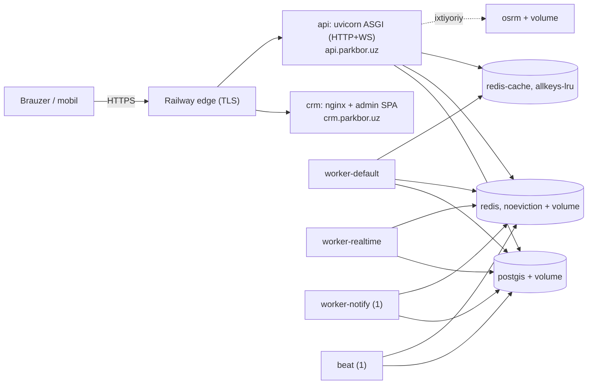

# ParkBor: Railway’ga joylashtirish (runbook)

Arxitektura: `docs/ARCHITECTURE.md` 12, 16, 17. Alohida server (Docker Compose) varianti: `docs/DEPLOY.md`.
Bu hujjat — Railway (railway.com) + GitHub (`ParkBor/parkbor`, `main`) uchun amaliy qadamlar. Hujjat 2026-10-19 holatidagi
Railway hujjatlariga tayanadi (manbalar — oxirida); Railway tez o‘zgaradi, tugma/maydon nomlari farq qilsa, mazmuniga qarang.

## 0. Muhim topilmalar (avval o‘qing)

1. **`railway.json` / `railway.toml` (Config as Code) eskirgan.** Railway uni *deprecated* deb e’lon qilgan; fayllar eski
   xizmatlar uchun 2026-12-01 gacha o‘qiladi, **yangi xizmatlar bu rejimni tanlay olmaydi**, va ba’zi loyihalarda API
   `railway.json` ni rad etgani qayd etilgan. Shu sababli bu repoda **asosiy manba — dashboard sozlamalari** (3-bo‘lim jadvali).
   `deploy/railway/<xizmat>/railway.json` fayllari faqat *ma’lumotnoma nusxa* (bir xil qiymatlar, tekshirilgan JSON); ularni
   Railway’ga ulash shart emas: **“Config file path” maydonini bo‘sh qoldiring**. Yangi mexanizm — Infrastructure as Code
   (`.railway/railway.ts`, `railway config pull/plan/apply`); uning Dockerfile/cron maydonlari ochiq hujjatda to‘liq berilmagan,
   shuning uchun bu yerda ishlatilmadi (keyin: `railway config pull` bilan joriy holatni olib, `railway config migrate` bilan o‘tish).
2. **PostGIS** Railway’ning standart Postgres shablonida yo‘q. Biz `postgis/postgis:16-3.4` ni (compose bilan bir xil)
   `deploy/railway/postgis/Dockerfile` orqali o‘z xizmatimiz sifatida ko‘taramiz (Railway’da PostGIS shablonlari ham bor, ammo
   ularning o‘zgaruvchilari hujjatda to‘liq berilmagan).
3. **Prod start tekshiruvlari staging’ni to‘sadi** (Payme/Click kalitlari, `PAYMENTS_SANDBOX` ni qabul qilmaydi). Ishlab chiqarish
   tekshiruvlarini YUMSHATMAYMIZ; yo‘l — 6-bo‘lim (tasodifiy to‘ldirgich qiymatlar).
4. **Redis**: tarmoqda ikki xil eviction kerak (noeviction va allkeys-lru). Bitta Dockerfile (`deploy/railway/redis`) ikkala xizmatni
   ham beradi; birinchi deployda kesh uchun alohida Redis shart emas (7-bo‘lim).
5. **OSRM’siz ishga tushiring.** Marshrut endpointlari OSRM bo‘lmasa ham ishlaydi (to‘g‘ri chiziq bo‘yicha taxmin, circuit breaker).
6. **Mijoz IP** (to‘lov IP-allowlisti, throttle) uchun `NUM_PROXIES`ni Railway’da tekshirib qo‘yish shart (8-bo‘lim).

## 1. Xizmatlar topologiyasi



| Xizmat | Manba (repo yo‘li) | Tur | Ommaviy domen | Hajm (volume) |
|---|---|---|---|---|
| `postgis` | `deploy/railway/postgis` | PostgreSQL 16 + PostGIS 3.4 | yo‘q (faqat private) | `/var/lib/postgresql/data` |
| `redis` | `deploy/railway/redis` | Redis 7.4, **noeviction** + AOF | yo‘q | `/data` |
| `redis-cache` (keyinroq) | `deploy/railway/redis` | Redis 7.4, **allkeys-lru**, saqlamaydi | yo‘q | yo‘q |
| `api` | `backend` | uvicorn ASGI | `api.parkbor.uz` | yo‘q |
| `worker-default` | `backend` | `celery -Q celery` | yo‘q | yo‘q |
| `worker-realtime` | `backend` | `celery -Q realtime` | yo‘q | yo‘q |
| `worker-notify` | `backend` | `celery -Q notify`, **faqat 1 nusxa** | yo‘q | yo‘q |
| `beat` | `backend` | `celery beat`, **faqat 1 nusxa** | yo‘q | yo‘q |
| `crm` | repo ildizi (`/`) | nginx-unprivileged + admin SPA | `crm.parkbor.uz` | yo‘q |
| `osrm` (ixtiyoriy) | `deploy/railway/osrm` | OSRM mld | yo‘q | `/data` |

Compose’dagi `nginx` bu yerda kerak emas: TLS va domenlarni Railway edge beradi; `crm` faqat statik fayl beradi, API’ga brauzer
to‘g‘ridan-to‘g‘ri murojaat qiladi (`VITE_API_URL=https://api.parkbor.uz/api/v1`, CORS orqali).

Beshta backend xizmati bir xil `backend/Dockerfile` dan alohida quriladi (build bepul, lekin 5 marta); farqi — faqat start buyrug‘i.

## 2. Tayyorgarlik

- [ ] Railway akkaunti. **Hobby** ($5/oy) bilan boshlash mumkin; prod uchun **Pro** tavsiya etiladi (6-bo‘lim narxlari, volume 50 GB, domen limiti 20). Trial rejimi (1 GB RAM/xizmat, 0.5 GB volume) yetmaydi.
- [ ] GitHub: Railway GitHub ilovasiga `ParkBor/parkbor` reposiga ruxsat bering.
- [ ] Telegram: bot tokeni, username (prod va staging uchun alohida bot); BotFather’ga kirish.
- [ ] Ahost DNS paneliga kirish (`parkbor.uz` zonasi).
- [ ] Railway CLI (`npm i -g @railway/cli` yoki `brew install railway`), `railway login`, `railway link` (loyihani tanlang).
- [ ] Maxfiy kalitlar: `python deploy/railway/gen-secrets.py` (staging uchun `--staging`). Chiqishni nusxalab, terminalni tozalang; fayl yozilmaydi.

## 3. Loyiha va xizmatlarni yaratish

1. railway.com → **New Project** → **Deploy from GitHub repo** → `ParkBor/parkbor`. Railway avtomatik xizmat yaratadi — uni o‘chirib, quyidagilarni qo‘lda qo‘shing (**+ New → GitHub Repo → ParkBor/parkbor** har bir xizmat uchun, nom — jadvaldagidek). Environment’ni **production** deb qoldiring (yangi loyiha dual-stack tarmoqda yaratiladi, 2025-10-16 dan keyin).
2. Har bir xizmat uchun **Settings** (nomlar o‘zgarishi mumkin). *Config file path — bo‘sh.* “Builder” — Dockerfile (Dockerfile topilsa, Railway o‘zi tanlaydi).

| Xizmat | Root Directory | Dockerfile | Watch paths | Start command | Pre-deploy | Healthcheck | Restart |
|---|---|---|---|---|---|---|---|
| `postgis` | `/deploy/railway/postgis` | `Dockerfile` (avto) | `/deploy/railway/postgis/**` | — (Dockerfile `CMD`) | — | — | On failure |
| `redis`, `redis-cache` | `/deploy/railway/redis` | `Dockerfile` (avto) | `/deploy/railway/redis/**` | — | — | — | On failure |
| `api` | `/backend` | `Dockerfile` (avto) | `/backend/**` | `exec uvicorn config.asgi:application --host 0.0.0.0 --port ${PORT:-8000} --workers ${WEB_CONCURRENCY:-2} --lifespan off --ws-max-size 16384 --timeout-graceful-shutdown 30 --proxy-headers --no-access-log` | `python manage.py migrate --noinput` | path `/health/live`, timeout 120 s | On failure, 5 |
| `worker-default` | `/backend` | avto | `/backend/**` | `exec celery -A config worker -l info -Q celery -n default@%h --prefetch-multiplier 1 --concurrency 2 --max-tasks-per-child 1000` | — | — | Always |
| `worker-realtime` | `/backend` | avto | `/backend/**` | `exec celery -A config worker -l info -Q realtime -n realtime@%h --prefetch-multiplier 1 --concurrency 2 --max-tasks-per-child 1000` | — | — | Always |
| `worker-notify` | `/backend` | avto | `/backend/**` | `exec celery -A config worker -l info -Q notify -n notify@%h --prefetch-multiplier 1 --concurrency 2 --max-tasks-per-child 1000` | — | — | Always |
| `beat` | `/backend` | avto | `/backend/**` | `exec celery -A config beat -l info --pidfile /tmp/celerybeat.pid -s /tmp/celerybeat-schedule` | — | — | Always |
| `crm` | `/` (repo ildizi) | o‘zgaruvchi `RAILWAY_DOCKERFILE_PATH=deploy/railway/crm/Dockerfile` | `/admin/**`, `/packages/**`, `/pnpm-lock.yaml`, `/package.json`, `/pnpm-workspace.yaml`, `/deploy/railway/crm/**`, `/infra/nginx/snippets/**` | — | — | path `/healthz`, timeout 60 s | On failure, 5 |
| `osrm` (ixtiyoriy) | `/deploy/railway/osrm` | avto | `/deploy/railway/osrm/**` | — | — | — | On failure |

   - **Replicalar:** hamma xizmat 1 nusxa. `worker-notify` (Telegram ~30 xabar/s, har nusxada 25/s limit) va `beat` hech qachon 1 dan oshmasin; hajmi (volume) bor xizmatlar replikani qo‘llamaydi.
   - **`worker-notify` va `beat` deployda:** “Overlap seconds” = **0** (yoki `RAILWAY_DEPLOYMENT_OVERLAP_SECONDS=0`), “Draining seconds” = 10–60 (`RAILWAY_DEPLOYMENT_DRAINING_SECONDS`). Baribir qisqa vaqt ikki nusxa bo‘lib qolishi mumkin: beat vazifalari idempotent va `expires` bilan, notify’da bir necha soniya 2× tezlik xavfsiz.
   - **Pre-deploy** alohida konteynerda, private tarmoqda va xizmat o‘zgaruvchilari bilan ishlaydi; xato bo‘lsa deploy to‘xtaydi. Faqat `api` da: boshqa xizmatlarda migratsiya yo‘q.
   - `collectstatic` kerak emas (API faqat JSON; Django admin o‘chirilgan; `SCHEMA_PUBLIC` prodda o‘chiq).
   - **Hajmlar:** `postgis` — `/var/lib/postgresql/data` (dashboard: xizmat → **Volumes → Add**), `redis` — `/data`. Dockerfile’larda `PGDATA=/var/lib/postgresql/data/pgdata` (volume ildizidagi `lost+found` initdb’ni buzmasligi uchun). Hajmli xizmat qayta deployda qisqa vaqt to‘xtaydi.
   - **Public networking:** faqat `api` va `crm` ga domen bering. `postgis`, `redis*`, `osrm`, workerlarga **domen ham, TCP proxy ham yo‘q**.
   - **Region:** barcha xizmatlar BIR region’da (private tarmoq uchun). O‘zbekistonga eng yaqin: Yevropa (`europe-west4`, Amsterdam) yoki `asia-southeast1` (Singapur) — kechikishni o‘lchab tanlang (o‘lchanmagan).
3. Fayllar ma’lumotnoma: `deploy/railway/*/railway.json`, o‘zgaruvchi shablonlari: `deploy/railway/env/*.env.example`.

## 4. O‘zgaruvchilar (faqat nomlar; sirlarsiz)

Shablonlar: `deploy/railway/env/`. Qiymatlarni Railway **Variables → RAW Editor** ga qo‘ying; sirlarni **Seal** qiling (shundan keyin
ko‘rinmaydi). Umumiy backend o‘zgaruvchilarini **Project Settings → Shared Variables** ga yozib, har bir backend xizmatiga ulash mumkin
(yoki RAW Editor’ga har xizmatga nusxalang). `${{ xizmat.NOM }}` — Railway reference o‘zgaruvchisi (xizmat nomlari yuqoridagidek).

| O‘zgaruvchi | Qaysi xizmatlarda | Qiymat / qanday olinadi |
|---|---|---|
| `SECRET_KEY`, `JWT_SIGNING_KEY` | api, worker-*, beat | `gen-secrets.py` (yoki `python -c "import secrets; print(secrets.token_urlsafe(48))"`, `-`/`_` ni almashtiring) |
| `QR_SIGNING_KEY` | api, worker-*, beat | `gen-secrets.py`; **>= 50 belgi** (kamida shu, aks holda boot yiqiladi) |
| `ALLOWED_HOSTS` | api, worker-*, beat | `api.parkbor.uz,healthcheck.railway.app` (prod boot majburiy; healthcheck uchun ikkinchisi shart). DNS tarqalguncha sinash uchun vaqtincha `.up.railway.app` qo‘shing, keyin olib tashlang |
| `CORS_ALLOWED_ORIGINS` | api (workerlarda ham bo‘lsa zarar yo‘q) | `https://crm.parkbor.uz` (WebSocket Origin tekshiruvi ham shundan foydalanadi) |
| `HABI_PUBLIC_URL` | hammasi (backend) | `https://parkbor.uz` (https majburiy) |
| `NUM_PROXIES` | api | `1` boshlang‘ich, 8-bo‘limdagi tekshiruvdan keyin aniqlang |
| `DATABASE_URL` | hammasi (backend) | `postgis://${{postgis.POSTGRES_USER}}:${{postgis.POSTGRES_PASSWORD}}@${{postgis.RAILWAY_PRIVATE_DOMAIN}}:5432/${{postgis.POSTGRES_DB}}` (**`postgis://`** sxemasi majburiy; parol faqat harf+raqam — `gen-secrets.py` shunday beradi) |
| `REDIS_URL` | hammasi (backend) | `redis://:${{redis.REDIS_PASSWORD}}@${{redis.RAILWAY_PRIVATE_DOMAIN}}:6379/0` (broker) |
| `CHANNEL_REDIS_URL`, `STATE_REDIS_URL` | hammasi (backend) | xuddi shu server, `/1` va `/3` |
| `CACHE_REDIS_URL` | hammasi (backend) | `redis://:${{redis-cache.REDIS_PASSWORD}}@${{redis-cache.RAILWAY_PRIVATE_DOMAIN}}:6379/0`; `redis-cache` yo‘q bo‘lsa **o‘rnatmang** (db 2 ishlatiladi) |
| `OSRM_URL` | hammasi (backend) | **o‘rnatmang** (OSRM’siz); osrm bor bo‘lsa `http://${{osrm.RAILWAY_PRIVATE_DOMAIN}}:5000` |
| `TELEGRAM_BOT_TOKEN`, `TELEGRAM_BOT_USERNAME` | hammasi (backend) | BotFather; staging uchun alohida bot |
| `TELEGRAM_WEBHOOK_SECRET` | hammasi (backend) | `gen-secrets.py` (A-Z a-z 0-9, <= 256) |
| `PAYME_MERCHANT_ID`, `PAYME_KEY` (>= 32), `CLICK_SERVICE_ID`, `CLICK_MERCHANT_ID`, `CLICK_MERCHANT_USER_ID`, `CLICK_SECRET_KEY` (>= 12) | hammasi (backend) | Payme/Click kabinetidan; staging — `gen-secrets.py --staging` to‘ldirgichlari (6-bo‘lim) |
| `PAYMENTS_SANDBOX` | hammasi (backend) | `false` (**`true` bo‘lsa prod boot yiqiladi**) |
| `PAYMENTS_DEFAULT_PROVIDER`, `PAYMENTS_PAYME_IPS`, `PAYMENTS_CLICK_IPS`, `PAYMENTS_RETURN_URL` | hammasi (backend) | `payme`; Payme IP’lari standart (185.234.113.1–15); Click IP’lari CLICK’dan |
| `EXPO_ACCESS_TOKEN` | hammasi (backend) | ixtiyoriy |
| `SENTRY_DSN`, `SENTRY_ENVIRONMENT`, `SENTRY_TRACES_SAMPLE_RATE` | hammasi (backend) | bo‘sh DSN = o‘chiq; `SENTRY_RELEASE=${{RAILWAY_GIT_COMMIT_SHA}}` ixtiyoriy |
| `WEB_CONCURRENCY` | api | `2` (har ishchi ~200–250 MB) |
| `FORWARDED_ALLOW_IPS` | api | `*` (api faqat Railway edge va project private tarmog‘idan ko‘rinadi) |
| `UVICORN_HOST` | api | faqat IPv6-only (2025-10-16 dan oldin yaratilgan) muhitda `::`; yangi loyihada kerak emas |
| `HABI_SUPERADMIN_PASSWORD` | api (vaqtincha) | faqat `create_superadmin` uchun; ishlatgach o‘chiring |
| `POSTGRES_DB`, `POSTGRES_USER`, `POSTGRES_PASSWORD` | postgis | `habi`, `habi`, `gen-secrets.py` |
| `REDIS_PASSWORD`, `REDIS_POLICY`, `REDIS_PERSIST`, `REDIS_MAXMEMORY` | redis, redis-cache | 7-bo‘lim |
| `VITE_API_URL`, `VITE_TELEGRAM_BOT_USERNAME`, `VITE_TILE_URL` | crm (**build vaqti**) | `https://api.parkbor.uz/api/v1`, bot username, `https://tile.openstreetmap.org/{z}/{x}/{y}.png`; o‘zgarsa crm qayta quriladi |
| `API_ORIGIN` | crm (ish vaqti) | `https://api.parkbor.uz` — CSP `connect-src` uchun; `VITE_API_URL` origin’i bilan bir xil bo‘lsin |
| `RAILWAY_DOCKERFILE_PATH` | crm | `deploy/railway/crm/Dockerfile` |

`PORT` ni qo‘lda o‘rnatmang: Railway beradi; uvicorn va nginx shuni tinglaydi (Dockerfile’lar tayyor). Parollarda `$` ishlatmang.

**Prod boot uchun majburiy (bo‘lmasa jarayon ishga tushmaydi):** `SECRET_KEY`, `ALLOWED_HOSTS`, `DATABASE_URL` (`postgis://`), `REDIS_URL`,
`JWT_SIGNING_KEY`, `QR_SIGNING_KEY` (>= 50), `TELEGRAM_BOT_TOKEN`, `TELEGRAM_BOT_USERNAME`, `TELEGRAM_WEBHOOK_SECRET`, `HABI_PUBLIC_URL`
(https), shuningdek Payme/Click 6 ta qiymat (to‘ldirgich emas: `replace-me`, `changeme`, `todo`, `xxx` bilan boshlanmasin; `PAYME_KEY` >= 32,
`CLICK_SECRET_KEY` >= 12), `PAYMENTS_SANDBOX=false`, Payme IP ro‘yxati bo‘sh emas.

## 5. Domenlar va DNS (Ahost)

1. `api` → **Settings → Networking → Custom Domain** → `api.parkbor.uz` (target port: avtomatik, kerak bo‘lsa `PORT` qiymati). `crm` → `crm.parkbor.uz`.
2. Railway har domen uchun **CNAME** (masalan `xxxx.up.railway.app`) va **TXT** (egalikni tasdiqlash) yozuvini ko‘rsatadi — **ikkalasi ham kerak**; TXT bo‘lmasa so‘rovlar 404 beradi. Aniq nom/qiymatlarni dashboard’dan oling.
3. Ahost’da: `api` CNAME → Railway ko‘rsatgan qiymat; `crm` CNAME → shu; TXT’lar Railway aytganidek (nom odatda `_railway-verify.<subdomen>`, aniq nomni dashboard’dan oling).
4. TLS (Let’s Encrypt) odatda DNS yangilanishidan keyin bir soat ichida beriladi; DNS tarqalishi 72 soatgacha. Yashil belgi chiqquncha kuting.
5. **Apex `parkbor.uz`:** Railway CNAME flattening / ALIAS’ni qo‘llaydi, lekin DNS provayder (Ahost) apex’da CNAME/ALIAS qo‘llashi tasdiqlanmagan — Ahost’dan so‘rang. Bu loyiha uchun majburiy emas: `HABI_PUBLIC_URL=https://parkbor.uz` faqat Telegram tugmalaridagi universal link bazasi; saytni/`assetlinks.json` ni xizmat qilish alohida vazifa. Apex ishlamasa, nom serverlarni Cloudflare’ga ko‘chirish Railway tavsiyasi (Cloudflare proxy yoqilsa SSL rejimi **Full**, *Full (strict)* emas).
6. HSTS `includeSubDomains` (backend sozlamasi) `api.parkbor.uz` ga ta’sir qiladi; bu subdomenlar HTTPS’da bo‘lishi shart.

## 6. Birinchi deploy tartibi

Tartib muhim: ma’lumot xizmatlari tayyor bo‘lmasa, `api` ning pre-deploy migratsiyasi yiqiladi.

1. `postgis` → o‘zgaruvchilar → volume → Deploy. Loglarda `database system is ready to accept connections`.
2. `redis` → o‘zgaruvchilar → volume → Deploy. Tekshirish: `railway ssh --service redis -- sh -c 'redis-cli -a "$REDIS_PASSWORD" CONFIG GET maxmemory-policy'` → `noeviction`.
3. Backend umumiy o‘zgaruvchilarini kiriting (4-bo‘lim). **Staging yo‘li (to‘lov kalitlari yo‘q):**
   `python deploy/railway/gen-secrets.py --staging` — Payme/Click uchun tasodifiy to‘ldirgichlar beradi. Ular prod tekshiruvlaridan o‘tadi
   (`PAYMENTS_SANDBOX` baribir `false`; sandbox’ni prod rad etadi), shuning uchun ilova ko‘tariladi, lekin **haqiqiy to‘lovlar ishlamaydi**.
   Bu tekshiruvlarni yumshatmaydi va kodni o‘zgartirmaydi. Prod’ga o‘tishda haqiqiy kalitlar bilan almashtiring va `SENTRY_ENVIRONMENT=production` qo‘ying.
4. `api` ni deploy qiling: build → pre-deploy (`migrate`) → `/health/live` healthcheck → faol. Migratsiya xatosi bo‘lsa deploy to‘xtaydi, eski versiya ishlayveradi.
5. `worker-default`, `worker-realtime`, `worker-notify`, `beat` ni deploy qiling (har biri 1 nusxa). Loglar: `celery@... ready`, beat’da `beat: Starting...`.
6. `crm` ni deploy qiling (build ~ pnpm install + vite build, bir necha daqiqa). `VITE_*` o‘zgaruvchilari build’dan oldin kiritilgan bo‘lishi shart.
7. Domenlarni ulang (5-bo‘lim).
8. **Super admin (bir martalik, qo‘lda):**
   ```bash
   railway ssh --service api -- python manage.py create_superadmin --telegram-id <TELEGRAM_ID> --first-name Admin
   ```
   Parol `HABI_SUPERADMIN_PASSWORD` dan olinadi yoki so‘raladi (>= 12 belgi). Ishlatgach o‘zgaruvchini o‘chiring.
9. **Telegram webhook:**
   ```bash
   railway ssh --service api -- python manage.py set_telegram_webhook --base-url https://api.parkbor.uz
   ```
   Tekshirish: `https://api.telegram.org/bot<TOKEN>/getWebhookInfo` (tokenni terminal tarixiga qoldirmang).
10. **BotFather:** `/setdomain` → botni tanlang → `crm.parkbor.uz` (sxemasiz). Admin kirish vidjeti faqat shu domenda ishlaydi.
11. **To‘lov webhooklari** (haqiqiy kalitlardan keyin): Payme/Click kabinetida `https://api.parkbor.uz/api/v1/payments/payme/webhook` va `.../click/webhook`.

## 7. Redis: eviction savdosi

| Variant | Qanday | Xavf |
|---|---|---|
| **A (birinchi deploy)** | faqat `redis` (noeviction + AOF); `CACHE_REDIS_URL` o‘rnatilmaydi → kesh/throttle db 2 da | kesh kalitlari TTL’li, hajm `REDIS_MAXMEMORY` (400 MB) bilan cheklangan; to‘lsa noeviction **yozuvlarni rad etadi** (kesh ham, broker ham). Past xavf, lekin kuzating |
| **B (tavsiya)** | + `redis-cache` xizmati (xuddi shu Dockerfile, `REDIS_POLICY=allkeys-lru`, `REDIS_PERSIST=no`, `REDIS_MAXMEMORY=128mb`, hajmsiz) va `CACHE_REDIS_URL` | qo‘shimcha ~30–50 MB RAM; kesh to‘lsa faqat kesh kalitlari chiqadi, broker/ticket'lar xavfsiz |

Railway’ning tayyor Redis shabloni rasmiy `redis` rasmi, lekin uning start buyrug‘i/politikasi hujjatda berilmagan, shuning uchun o‘zimizning
Dockerfile ishlatiladi: `maxmemory-policy` aniq qo‘yiladi (compose bilan bir xil). `redis-cli CONFIG GET maxmemory-policy` bilan tasdiqlang.
AOF `everysec`: volume bor, qayta ishga tushsa navbatlar saqlanadi. Redis `used_memory` `REDIS_MAXMEMORY` ga yaqinlashsa oshiring.

## 8. Mijoz IP va `NUM_PROXIES`

To‘lov IP-allowlist va throttle `X-Forwarded-For` ning **o‘ng tomonidan** `NUM_PROXIES` ta hopni oladi (DRF `get_ident`). Railway edge
hujjatda faqat `X-Real-IP`, `X-Forwarded-Proto` (doim `https`), `X-Forwarded-Host` ni ta’riflaydi; `X-Forwarded-For` va hop soni **hujjatlashtirilmagan**,
Railway foydalanuvchilari esa bir-biriga zid natijalar yozgan (mijoz yuborgan qiymat olib tashlanadi; zanjir 1–2 elementli; ba’zan o‘ngdagi hop CDN IP’si; xodimlar javobi ziddiyatli). Shuning uchun:

- Boshlang‘ich `NUM_PROXIES=1` (soxtalashtirib bo‘lmaydi; eng yomon holat — to‘g‘ri Payme so‘rovlari 403 oladi va throttle umumiy IP’ga tushadi, ya’ni *fail-closed*).
- **Soxta-IP sinovi (bir marta, deploydan keyin; o‘z IP’ingizdan):**
  ```bash
  curl -s -o /dev/null -w '%{http_code}\n' -X POST https://api.parkbor.uz/api/v1/payments/payme/webhook \
       -H 'Content-Type: application/json' -H 'X-Forwarded-For: 185.234.113.1' -d '{}'
  ```
  `403` — soxta qiymat qabul qilinmadi (yaxshi). `200` (JSON-RPC xatosi) — Payme IP’si soxtalashtirilishi mumkin: **zudlik bilan** `NUM_PROXIES` ni tuzating va Railway qo‘llab-quvvatlashiga yozing.
- Payme sandbox’dan haqiqiy test chaqiruv kelganda `403` bo‘lsa (to‘g‘ri IP rad etilsa), zanjirda qo‘shimcha hop bor: `NUM_PROXIES=2` qiling va yuqoridagi soxta-IP sinovini `X-Forwarded-For: 185.234.113.1` hamda `X-Forwarded-For: 185.234.113.1, 10.0.0.1` bilan qaytaring (ikkalasi ham `403` bo‘lishi shart).
- IP-allowlist ilovada — himoyaning bir qatlami; asosiysi Payme Basic-auth kaliti va Click imzosi.

## 9. WebSocket

Railway WebSocket’ni (HTTP/1.1) qo‘llaydi, u umumiy 15 daqiqalik so‘rov va 5 daqiqalik jimlik cheklovlaridan ozod. Ilovaning o‘z ping/idle
mantig‘i (30 s ping, 90 s idle, 12 soatlik umr) saqlanadi; nginx’dagi `proxy_read_timeout` kabi sozlama kerak emas. Tekshirish:

```bash
TOKEN=<access token>           # Telegram orqali kirgandan keyin
curl -s -X POST https://api.parkbor.uz/api/v1/ws/ticket -H "Authorization: Bearer $TOKEN"     # {"ticket": "..."}
# so‘ng wss://api.parkbor.uz/ws/... ga ulaning (mobil ilova / wscat), protokol: ARCHITECTURE 12.0
```

Origin tekshiruvi: brauzer `https://crm.parkbor.uz`, `CORS_ALLOWED_ORIGINS` da bo‘lishi shart (mobil mijozda Origin yo‘q — ruxsat).

## 10. Smoke testlar

```bash
curl -i https://api.parkbor.uz/health            # 200 {"status":"ok",...}: PostgreSQL + Redis (readiness)
curl -i https://api.parkbor.uz/health/live       # 200 (liveness)
curl -i http://api.parkbor.uz/health             # 200 (HTTP probalar 301 olmaydi), boshqa yo‘llar 301 -> https
curl -i https://api.parkbor.uz/api/v1/me         # 401 (JWT yo‘q) - API tirik
curl -i https://api.parkbor.uz/api/v1/schema/    # 404: SCHEMA_PUBLIC o‘chiq (prodda shunday bo‘lishi kerak)
curl -I https://crm.parkbor.uz/                  # 200, CSP/HSTS/X-Frame-Options sarlavhalari
curl -I https://crm.parkbor.uz/no/such/route     # 200 (SPA fallback); /assets/nope.js -> 404
# CORS preflight:
curl -i -X OPTIONS https://api.parkbor.uz/api/v1/me -H 'Origin: https://crm.parkbor.uz' \
     -H 'Access-Control-Request-Method: GET' -H 'Access-Control-Request-Headers: authorization'
# kutilgan: 200 + Access-Control-Allow-Origin: https://crm.parkbor.uz
```

Brauzerda `https://crm.parkbor.uz` ni oching: Telegram vidjeti yuklanishi, kirish, konsolda CSP buzilishi bo‘lmasligi kerak (`connect-src` API
origin’ini o‘z ichiga oladi). OSRM yo‘q bo‘lsa marshrut javoblarida `source: fallback` bo‘ladi — bu normal.

## 11. Loglar, yangilash, orqaga qaytarish

- **Loglar:** dashboard → xizmat → **Deployments / Logs**; CLI: `railway logs --service api`. uvicorn access log o‘chirilgan (`--no-access-log`): `?ticket=` logga tushmasin. Railway’ning o‘z HTTP loglari yo‘lni yozishi mumkin; ticket bir martalik va 30 s yashaydi (qabul qilingan xavf, DEPLOY.md 10).
- **Yangilash:** `main` ga push → Railway watch path’ga mos xizmatlarni qayta quradi. Backend o‘zgarsa 5 backend xizmati ham qayta quriladi; `api` avval pre-deploy migratsiyani, so‘ng healthcheck’ni o‘tkazadi, o‘tgandan keyingina trafik yangisiga o‘tadi. Migratsiyalar orqaga mos (additive) bo‘lsin (DEPLOY.md 4).
- **Orqaga qaytarish:** dashboard → xizmat → **Deployments** → oldingi muvaffaqiyatli deploy → **Rollback/Redeploy**. Sxema ham orqaga qaytmaydi: buzuvchi migratsiyadan oldin Postgres zaxirasini oling (12-bo‘lim).
- **Bir martalik buyruqlar:** `railway ssh --service api -- python manage.py <buyruq>` (ishlayotgan konteynerda, private tarmoq bilan). `railway run` lokal kompyuterda ishlaydi va `*.railway.internal` ni ko‘rmaydi — DB/Redis uchun ishlatmang.

## 12. Narx (taxminiy, o‘lchanmagan)

Railway tarifi (2026-10): RAM $10/GB-oy, CPU $20/vCPU-oy, volume $0.15/GB-oy, egress $0.05/GB; Hobby $5/oy ($5 resurs kiritilgan), Pro $20/oy ($20 kiritilgan).
Faraz (haqiqiy RAM o‘lchanmagan; bir haftalik **Usage** ko‘rsatkichi bilan tekshiring): api ~0.45 GB, worker-default ~0.25, realtime ~0.2, notify ~0.2, beat ~0.12, crm ~0.02,
postgis ~0.3–0.5, redis ~0.05 (+ redis-cache ~0.04) → jami ≈ 1.7–2.2 GB.

| Qism | Oylik |
|---|---|
| RAM ~2 GB | ~$17–22 |
| CPU (o‘rtacha 0.2–0.5 vCPU) | ~$4–10 |
| Volume ~3 GB | ~$0.5 |
| Egress (10–50 GB) | ~$0.5–2.5 |
| **Jami resurs** | **~$25–35** |
| Reja to‘lovi (Hobby / Pro) | $5 / $20, kiritilgan resurs hisobiga o‘tadi → **Hobby ≈ $25–35, Pro ≈ $30–45** |

OSRM qo‘shilsa ~+$10–15 (RAM ~1 GB). Trafik/foydalanuvchi o‘ssa, postgis va api RAM/CPU birinchi o‘sadi. Bu taxmin; kafolat emas.

## 13. OSRM (ixtiyoriy, keyinroq)

Ishga tushirishda **kerak emas**: `OSRM_URL` o‘rnatilmasa standart `http://localhost:5000` ga ulanish rad etiladi → `OsrmError` → `/routes` to‘g‘ri chiziqdagi
taxmin (`approximate`, 30 km/s) qaytaradi, `/parkings/nearby` esa masofa bo‘yicha tartiblaydi; circuit breaker (Redis) keyingi so‘rovlarni kechiktirmaydi.

Railway’da OSRM bo‘lishi mumkin, ammo og‘ir: birinchi ishga tushishda O‘zbekiston grafigini tayyorlash (extract/partition/customize) ~2 GB RAM va bir necha daqiqa oladi, keyin ~1 GB RAM
doimiy; volume >= 2 GB. `deploy/railway/osrm/` (Dockerfile + `start.sh`) tayyor, **Railway’da sinalmagan**. Arzonroq muqobil: OSRM’ni tashqi arzon VPS’da ishlatib, `OSRM_URL=https://osrm.example.com` (sxema+host, yo‘lsiz; credential yo‘q) qilish — private tarmoq kerak emas; yoki umuman o‘chirib qo‘yish (hozirgi holat).

## 14. Xavfsizlik ro‘yxati

- [ ] `postgis`, `redis`, `redis-cache`, `osrm`, workerlar, `beat` da **Public domain yo‘q, TCP proxy yo‘q**; hech qayerda ommaviy `DATABASE_URL`/`REDIS_PUBLIC_URL` yo‘q. Faqat `*.railway.internal`.
- [ ] Barcha sirlar (`SECRET_KEY`, `JWT_SIGNING_KEY`, `QR_SIGNING_KEY`, parollar, bot tokeni, Payme/Click) **sealed** o‘zgaruvchi; gitda yo‘q (`gen-secrets.py` hech narsa yozmaydi).
- [ ] `ALLOWED_HOSTS` aniq (wildcard yo‘q; `.up.railway.app` faqat sinov uchun, so‘ng olib tashlang). `PAYMENTS_SANDBOX=false`.
- [ ] 8-bo‘lim soxta-IP sinovi o‘tkazilgan; Payme sandbox sinovi o‘tgan.
- [ ] Super admin paroli (`HABI_SUPERADMIN_PASSWORD`) ishlatilgach o‘chirilgan; parol menejerida saqlangan.
- [ ] BotFather `/setdomain` faqat `crm.parkbor.uz`; staging uchun alohida bot.
- [ ] Railway akkaunti 2FA; loyiha a’zolari minimal; Pro’da kerak bo‘lsa alohida staging/production environment.
- [ ] Compose’dagi nginx himoyalari Railway’da **yo‘q**: IP bo‘yicha `limit_req/limit_conn` (login 10/min, bron 10/min, WS 20/IP), so‘rov hajmi limitlari (64 KB webhook) va `/ws` ulanish limiti. Ilova darajasidagi throttle’lar (DRF) va webhook tana limiti (16 KB) ishlaydi; qo‘shimcha edge himoya kerak bo‘lsa, Cloudflare’ni oldiga qo‘ying (`NUM_PROXIES` ni qayta ko‘ring).
- [ ] CRM CSP `unsafe-eval` (Telegram vidjeti) qabul qilingan xavf, ARCHITECTURE 14.3.

## 15. Zaxira nusxalar — bu hujjat QAMRAMAYDI

- **PostgreSQL:** Railway volume zaxiralari (qo‘lda/avtomatik) — reja bo‘yicha mavjudligini dashboard’da tekshiring; **PITR (aniq vaqtga qaytish) yo‘q**. Qo‘shimcha: kunlik `pg_dump -Fc` ni tashqi joyga (S3/boshqa server) saqlash, masalan Railway cron xizmati yoki lokal `railway ssh --service postgis -- pg_dump ...`. Tiklash sinovini oyiga bir marta o‘tkazing (DEPLOY.md 6).
- **Redis:** AOF volume’da; navbatlar idempotent, alohida zaxira shart emas.
- Monitoring/alertlar (uptime, RAM/CPU, Redis xotirasi), Sentry — alohida sozlanadi (DEPLOY.md 10).
- Staging/production uchun alohida environment, PR environment’lar, mobil reliz (EAS), universal link fayllari — bu hujjatda yo‘q.

## 16. Tekshirilmagan narsalar

- Hech bir Railway sozlamasi bu muhitda ishlatib ko‘rilmadi (Docker ham yo‘q): barcha Dockerfile’lar (`backend`, `crm`, `postgis`, `redis`, `osrm`) *o‘qib* tekshirildi, build qilinmadi. Birinchi build loglarini kuzating.
- Dashboard maydonlari nomi/joylashuvi, Shared Variables’ni xizmatlarga ulash UI’si, `${{redis-cache.…}}` kabi defisli xizmat nomlariga reference ishlashi, start buyruqlarida `${PORT:-8000}` kengayishi (shell orqali ishga tushadi deb faraz qilingan; `exec` bilan SIGTERM to‘g‘ri uzatiladi) tasdiqlanmagan.
- Railway edge’ning `X-Forwarded-For` xatti-harakati (8-bo‘lim).
- Postgres tuning (`shared_buffers=256MB`) va `max_connections=100` yetarliligi; redis `--bind "* -::*"` Railway tarmog‘ida; `osrm` butunlay.
- `/health/live` healthcheck `Host: healthcheck.railway.app` bilan (`ALLOWED_HOSTS` da bo‘lishi shart) — kod bo‘yicha yo‘l `SECURE_REDIRECT_EXEMPT` da, lekin Railway ostida sinalmagan.
- CRM CSP real Telegram vidjeti bilan (ARCHITECTURE 14.3).
- Build vaqti cheklovlari (hujjatda topilmadi) va 5 ta backend build’i parallel.

## Manbalar (Railway hujjatlari, 2026-10-19 da o‘qilgan)

- Config as Code (deprecated): https://docs.railway.com/reference/config-as-code
- Infrastructure as Code: https://docs.railway.com/infrastructure-as-code , https://docs.railway.com/infrastructure-as-code/reference
- Monorepo: https://docs.railway.com/guides/monorepo
- Dockerfile: https://docs.railway.com/builds/dockerfiles
- Healthcheck: https://docs.railway.com/reference/healthchecks
- Pre-deploy: https://docs.railway.com/deployments/pre-deploy-command
- Overlap/draining: https://docs.railway.com/deployments/deployment-teardown
- Private networking: https://docs.railway.com/reference/private-networking , https://docs.railway.com/networking/private-networking/how-it-works
- O‘zgaruvchilar: https://docs.railway.com/variables/reference
- Domenlar: https://docs.railway.com/networking/domains/working-with-domains
- Public networking cheklovlari (WebSocket, sarlavhalar): https://docs.railway.com/networking/public-networking/specs-and-limits
- Volume: https://docs.railway.com/volumes/reference
- Redis: https://docs.railway.com/databases/redis
- Tariflar: https://docs.railway.com/reference/pricing/plans
- CLI: https://docs.railway.com/cli/environment , https://docs.railway.com/cli/ssh
- PostGIS shablonlari: https://railway.com/deploy/postgis
- `X-Forwarded-For` muhokamasi (hujjat emas, foydalanuvchi o‘lchovi): https://station.railway.com/questions/does-the-edge-strip-client-x-forwarded-f-613e5cb6
